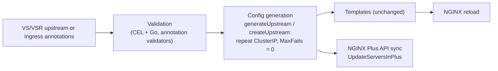

# High-Level Design: Retries for `use-cluster-ip` Upstreams

> Status: Proposal
>
> Related work: [#10038](https://github.com/nginx/kubernetes-ingress/issues/10038),
> [#10988](https://github.com/nginx/kubernetes-ingress/issues/10988),
> [nginx-prometheus-exporter#1372](https://github.com/nginx/nginx-prometheus-exporter/issues/1372)

## Overview

With `use-cluster-ip`, NGINX Ingress Controller (NIC) writes one `server` line
in the upstream block: the Service ClusterIP. NGINX only retries a failed
request on another `server` line, so a request that fails on a terminating or
evicted Pod is never retried. kube-proxy, Istio, or another Service
implementation could send a retry to a healthy Pod behind the same ClusterIP,
but NGINX never makes that retry.

Users can't work around this with a custom template. The template receives the
upstream's server list, but not whether it came from `use-cluster-ip`.

The fix is to repeat the ClusterIP `server` line, with `max_fails=0` on every
copy, so NGINX treats each copy as a separate attempt. This document defines
the user-facing field and annotation, and the generated configuration.

## Goals

- Let users set how many times a failed request is repeated to the Service
  ClusterIP, for VirtualServer, VirtualServerRoute, and Ingress.
- Keep today's output unchanged when the setting is absent or `0`.
- Reject invalid values when the resource is applied, not when NGINX reloads.
- Keep the NGINX config file and the NGINX Plus API updates consistent, so API
  updates never change one copy and leave the others behind.

## Non-Goals

- Retries for upstreams that don't use `use-cluster-ip`. NGINX already retries
  across Pod endpoints.
- Changing which failures are retried. That stays with `next-upstream`,
  `next-upstream-tries`, and `next-upstream-timeout`.
- NGINX Plus Prometheus metrics for repeated servers. See
  [Follow-up Work](#follow-up-work).
- Upstreams whose servers are created only through the NGINX Plus API (the
  Plus-API-only design in [#10988](https://github.com/nginx/kubernetes-ingress/issues/10988)).
  `UpdateHTTPServers` in nginx-plus-go-client collapses identical entries, so the
  repeats would be lost. See [Follow-up Work](#follow-up-work).

## User Contract

| | VirtualServer and VirtualServerRoute | Ingress |
| --- | --- | --- |
| Name | upstream field `use-cluster-ip-retries` | annotation `nginx.org/use-cluster-ip-retries` |
| Type | integer | integer string |
| Range | 0 or more | 0 or more |
| Default | 0 | 0 |
| Requires | `use-cluster-ip: true` when above 0 | `nginx.org/use-cluster-ip: "true"` |
| Mergeable Ingress | — | Minions only, like `nginx.org/use-cluster-ip` |

| Value | Behaviour | Generated `server` lines |
| --- | --- | --- |
| absent or `0` | As today | 1 |
| `N` (1 or more) | Up to N repeats | N+1 identical lines, each with `max_fails=0` |

Example for `use-cluster-ip-retries: 2`:

```nginx
upstream vs_my-ns_my-vs_my-svc {
    zone vs_my-ns_my-vs_my-svc 256k;
    server 10.96.0.10:8080 max_fails=0 fail_timeout=10s max_conns=0;
    server 10.96.0.10:8080 max_fails=0 fail_timeout=10s max_conns=0;
    server 10.96.0.10:8080 max_fails=0 fail_timeout=10s max_conns=0;
}
```

`fail_timeout` is still printed, but has no effect with `max_fails=0`.

### Rules

- **`max_fails` is forced to 0** when the setting is above 0. Otherwise NGINX
  could mark every copy unavailable after failures and return
  `502 no live upstreams` until `fail_timeout` expires. A `max-fails` value from
  the upstream, the annotation, or the ConfigMap is ignored. Today it has no
  effect anyway, because NGINX ignores `max_fails` for an upstream with one
  server.
- **No repeats for ExternalName Services**, which have no ClusterIP.
- **No repeats for NIC's "no endpoints" placeholder server** (the
  `nginx-502-server.sock` server used for empty Services).
- **Which failures are retried** is still controlled by `next-upstream`. With
  the default (`error timeout`) and no `next-upstream-tries` limit, NGINX tries
  all N+1 lines.

## Architecture

All logic is in Go. The templates already render whatever server list and
`MaxFails` value they receive, so they don't change.



### Validation

**VirtualServer and VirtualServerRoute.** Both use the shared `Upstream` type
in `pkg/apis/configuration/v1/types.go`.

- Kubebuilder `Minimum=0` on the field.
- A CEL rule on `Upstream`, so `kubectl apply` rejects the resource before NIC
  sees it:

  ```text
  !has(self.use__dash__cluster__dash__ip__dash__retries)
    || self.use__dash__cluster__dash__ip__dash__retries == 0
    || (has(self.use__dash__cluster__dash__ip) && self.use__dash__cluster__dash__ip)
  ```

  The `__dash__` escapes are required: Kubernetes CEL can't reference field
  names containing `-` any other way, and `Upstream` uses dashed JSON names.
  The rule accepts an empty upstream, `use-cluster-ip` alone, and both fields together.
  It rejects `use-cluster-ip-retries` without `use-cluster-ip`.
- The same check in `validateUpstreams` in
  `pkg/apis/configuration/validation/virtualserver.go`, next to the existing
  `use-cluster-ip` and `subselector` check. This covers clusters running an
  older CRD.

**Ingress.** The annotation follows the same rules as `nginx.org/use-cluster-ip`.
It must be a non-negative integer, and it needs `nginx.org/use-cluster-ip: "true"`.
Mergeable Ingress masters drop it, as they do for `nginx.org/use-cluster-ip`.

### Config Generation

- **VirtualServer:** `generateUpstream` in `internal/configs/virtualserver.go`
  repeats the ClusterIP server N+1 times and sets `ups.MaxFails = 0`.
  VirtualServerRoute upstreams use the same function.
- **Ingress:** `parseAnnotations` stores the value in `ConfigParams` and sets
  `cfgParams.MaxFails = 0`. `createUpstream` in `internal/configs/ingress.go`
  repeats the server.
- Both sides repeat the server N+1 times and skip ExternalName Services and the
  placeholder server.

On NGINX Plus, an endpoint change on another upstream in the same resource can
sync the ClusterIP upstream through the Plus API. The API values come from the
same place as the config file, including `max_fails=0`, so the sync changes
nothing and the repeated lines stay. A Service change, including delete and
recreate, re-renders the config and reloads NGINX.

## Acceptance Criteria

- `use-cluster-ip-retries: N` (1 or more) with `use-cluster-ip: true` produces
  N+1 identical ClusterIP `server` lines with `max_fails=0`, for VS, VSR, and
  Ingress, OSS and Plus.
- Absent or `0` produces exactly today's output.
- `max-fails` set on the upstream, the Ingress annotation, or the ConfigMap is
  overridden with 0 when the setting is above 0.
- ExternalName Services and the placeholder server get one line.
- `kubectl apply` rejects a VS or VSR with retries above 0 and no
  `use-cluster-ip`, with the CEL message; it rejects negative values.
- An Ingress with the annotation and no `nginx.org/use-cluster-ip: "true"`, or
  with a negative value, is rejected by annotation validation.
- On a master Ingress the annotation is removed, like `nginx.org/use-cluster-ip`.
- On NGINX Plus, the server parameters NIC sends through the API for these
  upstreams are the same as the ones in the config file.

## Security Impact

- New external input: one integer per upstream, and one annotation
  parsed as an integer. No string reaches NGINX config, so
  `containsDangerousChars()` is not needed. The annotation injection test gets
  one entry for the new annotation.
- No credential, Secret, or RBAC changes.

## Affected Layers and Files, in Order

1. **Data model:** `UseClusterIPRetries int` on `Upstream` in
   `pkg/apis/configuration/v1/types.go`, with `Minimum=0` and the CEL
   rule. Update the `UseClusterIP` comment, which says NIC configures only one
   upstream server and that `next-upstream` has no effect.
2. **Codegen:** `make update-codegen`, `make update-crds`. Check
   `deploy/crds*.yaml` and `docs/crd/` by hand; CI doesn't diff them.
3. **Validation:** `pkg/apis/configuration/validation/virtualserver.go`;
   `internal/k8s/validation.go` for the annotation.
4. **Config generation:** `internal/configs/config_params.go`,
   `annotations.go` (parse, `MaxFails = 0`, master denylist),
   `ingress.go` (`createUpstream`), `virtualserver.go` (`generateUpstream`).
5. **Templates:** none.
6. **Controller:** none.
7. **Helm:** none.
8. **Tests:** see [Verification](#verification).

## What Must Not Break

- Output for every upstream without the setting, including `use-cluster-ip`
  upstreams with the default `0`.
- Existing VirtualServers and Ingresses: nothing new is validated unless the
  field or annotation is set.
- NGINX Plus API updates for every other upstream.
- Mergeable Ingress master and minion annotation handling.

## Verification

All Go, table-driven, following the file each test lives in:

- **`internal/configs/virtualserver_helpers_test.go`:** a
  `TestGenerateUpstreamWithUseClusterIPRetries` table in the style of
  `TestGenerateUpstreamWithKeepalive`. Each case has a complete expected
  `version2.Upstream`. Cases: not set, `2`,
  upstream `max-fails` overridden, ConfigMap `max-fails` overridden,
  ExternalName, placeholder server, no endpoints.
- **`internal/configs/ingress_test.go`:** extend the existing
  `createExpectedConfigForCafeIngressWithUseClusterIP()` fixture with repeated
  servers and compare the whole config, including a case that overrides
  `nginx.org/max-fails`.
- **`internal/configs/annotations_test.go`:** add both annotations to the
  existing `TestFilterMasterAnnotations` case, and a `parseAnnotations` table
  pinning the `MaxFails` value the mergeable-Ingress API path sends.
- **NGINX Plus path:** cases in the existing `TestCreateUpstreamsForPlus` and
  `TestCreateUpstreamServersConfigForPlus` that check the server parameters sent
  through the API match the config file.
- **`internal/k8s/crdschema_test.go`:** CEL cases against the shipped VS and
  VSR CRDs: empty, `use-cluster-ip` only, both fields, retries only (rejected
  with the rule message), and a hand-built object with the `use-cluster-ip` key
  absent.
- **Validation:** cases for VirtualServer and VirtualServerRoute upstreams, and
  for the Ingress annotation: valid, negative, and missing `use-cluster-ip`.
- **`internal/k8s/annotation_injection_test.go`:** one entry for the
  annotation.
- **No snapshot change:** the templates don't change.
- **Python integration test:** `test_use_cluster_ip_retries` as a new method in
  `TestVSUseClusterIP`, in `tests/suite/test_virtual_server_use_cluster_ip_reloads.py`.
  It uses the access-log pattern of `test_grpc_error_intercept` in
  `tests/suite/test_virtual_server_grpc.py`.
  - **Test data:**
    - `tests/data/virtual-server-use-cluster-ip/standard/virtual-server-retries.yaml`:
      the existing `virtual-server-use-cluster-ip` VirtualServer with
      `use-cluster-ip-retries: 2` on `backend1`.
    - `tests/data/virtual-server-use-cluster-ip/nginx-config.yaml`: a ConfigMap
      whose `log-format` includes `$status` and `$upstream_addr`.
  - **Setup:** apply the ConfigMap. Read the
    ClusterIP of the `backend1-svc` Service. Scale `backend1` to 0 pods, so every
    connection to the ClusterIP fails.
  - **Step 1, `use-cluster-ip` only:** send one request to `/backend1`. Its access
    log line has status `502` and `$upstream_addr` equal to `<ClusterIP>:80`, one
    attempt.
  - **Step 2, retries:** patch the VirtualServer to `virtual-server-retries.yaml`
    and send one request. Its access log line has status `502` and `$upstream_addr`
    equal to `<ClusterIP>:80, <ClusterIP>:80, <ClusterIP>:80`, three attempts.
  - **Assertion:** read the controller pod log, retrying until each line
    appears, then compare `$upstream_addr` exactly.
  - **Teardown:** restore `deployments/common/nginx-config.yaml`, the original
    VirtualServer, and the `backend1` replica count.
  - NGINX lists every server it contacts for a request in `$upstream_addr`,
    separated by commas ([upstream module](https://nginx.org/en/docs/http/ngx_http_upstream_module.html#var_upstream_addr)).
    NIC's default `log-format` doesn't include that variable, so the test sets it.
- **Gates:** `make test`, `make lint`.

## Decisions

| # | Decision | Rationale |
| --- | --- | --- |
| D1 | `max-fails` and `fail-timeout` are ignored, and the field description says so. | NGINX ignores `max_fails` for a single-server upstream, so they have no effect today. With repeats, `max_fails` is forced to 0 (see Rules). |

## Follow-up Work

1. **NGINX Prometheus exporter ([nginx-prometheus-exporter#1372](https://github.com/nginx/nginx-prometheus-exporter/issues/1372)).**
   The issue is open with no PR. It proposes an `id` label (the NGINX Plus peer id)
   on per-server upstream metrics, so repeated servers become distinct series.
   Until it ships, NGINX Plus with `-enable-prometheus-metrics` and retries above
   0 returns HTTP 500 on `/metrics`.
   **NIC change:** bump
   `nginx-prometheus-exporter` in `go.mod`. If the label is always added, NIC
   needs nothing else. If it is opt-in, NIC passes it.
2. **nginx-plus-go-client: `UpdateHTTPServers`.** The client collapses identical
   entries (`deduplicateServers`), so it cannot create repeated servers. Add an
   opt-in way to keep intentional repeated entries, reconciling by copy count and
   server id. The default behaviour stays for NIC, NGINX Agent v3.11.3, and NGINX
   Gateway Fabric, which all call it. This is needed only for the Plus-API-only
   design in [#10988](https://github.com/nginx/kubernetes-ingress/issues/10988),
   which would create the servers through the client instead of the config file.
   It needs a client release and a NIC version bump.
