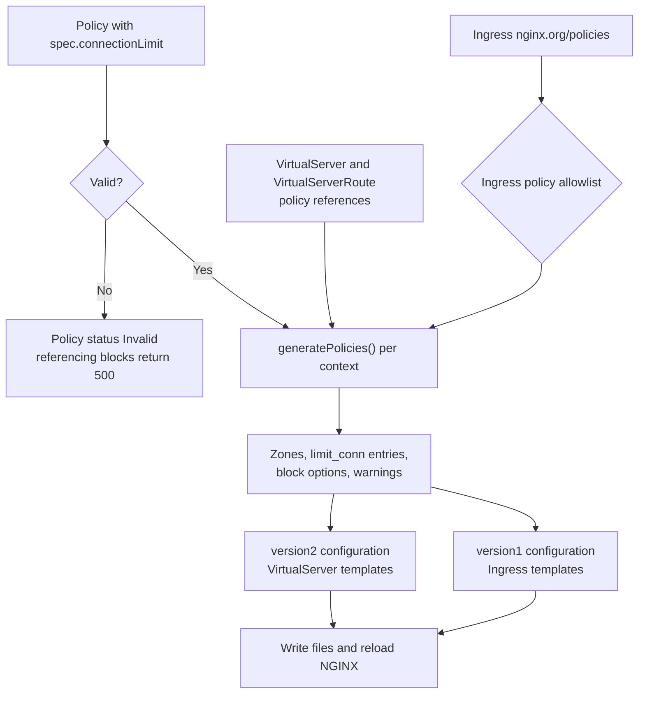

# High-Level Design: ConnectionLimit Policy

> Status: Proposal
>
> Milestone: 5.8.0

## Overview

NGINX Ingress Controller (NIC) cannot cap how many requests a client, or a whole
application, has in flight at the same time. Traffic spikes, slow clients, and
long-lived requests can therefore exhaust backend capacity. NGINX provides this
protection in
[`ngx_http_limit_conn_module`](https://nginx.org/en/docs/http/ngx_http_limit_conn_module.html).

This design adds a `connectionLimit` Policy type. A VirtualServer,
VirtualServerRoute, or Ingress that references the Policy gets its own zone
(`limit_conn_zone`), and `limit_conn` directives in the server or location
blocks generated for it. The Policy works with both NGINX and NGINX Plus.

The community ingress-nginx project offers this protection through the
[`nginx.ingress.kubernetes.io/limit-connections`](https://github.com/kubernetes/ingress-nginx/blob/main/docs/user-guide/nginx-configuration/annotations.md#rate-limiting)
annotation. This design gives users migrating from it an equivalent. The key
and the status code, which ingress-nginx sets for the whole controller in its
ConfigMap, are set per Policy, and the Policy adds a log level and a dry-run
mode.

## Goals

- Cap concurrent requests per key, by default per client IP address, on
  VirtualServer, VirtualServerRoute, and Ingress, including mergeable Ingress.
- Use one Policy API for every resource type. Ingress references the Policy
  through the existing `nginx.org/policies` annotation, like the other policy
  types that work with both NGINX and NGINX Plus. See
  [Attachment Points](#attachment-points).
- Keep every limit scoped to the object that references it. Never configure
  `limit_conn` at `http` level. See [Zone Identity](#zone-identity).
- Make the rejection status code (default 503), log level, dry-run mode, and
  replica scaling configurable per Policy. See [Policy API](#policy-api).
- Reject invalid input during validation, so that every accepted Policy renders
  configuration NGINX can load. See [Input Validation](#input-validation).
- Never block reloads when a Policy changes, including when its key changes.
  See [Zones Across Reloads](#zones-across-reloads).

## Non-Goals

- Global defaults through the ConfigMap, or limits at `http` level.
- Synchronizing counters between replicas. NGINX does not support zone
  synchronization for `limit_conn_zone`.
- Limiting connections to upstream servers. The VirtualServer upstream
  `max-conns` field and the `nginx.org/max-conns` annotation already do this.
  They complement ConnectionLimit: they protect each backend, while
  ConnectionLimit controls admission per key.
- New `nginx.org/limit-conn-*` annotations.
- Changing RateLimit behavior.

## Background: How NGINX Limits Connections

The design relies on the following NGINX behavior, verified against the
[module documentation](https://nginx.org/en/docs/http/ngx_http_limit_conn_module.html)
and the
[module source](https://github.com/nginx/nginx/blob/master/src/http/modules/ngx_http_limit_conn_module.c).

```nginx
http {
    # One counter per key value, here per client IP address.
    limit_conn_zone $binary_remote_addr zone=perip:10m;

    server {
        limit_conn_status 503;      # status code for rejected requests
        limit_conn_log_level error; # log level for rejections
        limit_conn_dry_run off;     # on: count and log, but never reject

        location /downloads/ {
            limit_conn perip 2;     # at most 2 requests per client at a time
        }
    }
}
```

- **Directives.** `limit_conn_zone` defines a zone, a table of counters in
  shared memory with one counter per key value. It is allowed only at `http`
  level. `limit_conn` sets which zone a block uses and the maximum count per
  key. NGINX also allows it at `http` level, but this design only uses `server`
  and `location` blocks. `limit_conn_status`, `limit_conn_log_level`, and
  `limit_conn_dry_run` decide what happens to a request over the limit.
- **What counts.** NGINX counts requests in progress, not open TCP connections.
  A request is counted from when its headers have been read until NGINX
  finishes it, including the upload of its body. Idle keepalive connections are
  not counted.
- **HTTP/2 and HTTP/3.** Each request in progress on a connection is counted
  separately, so a low per-client limit on a whole server can reject the
  parallel requests of a browser. Size per-client limits for browser
  parallelism, or attach low limits to specific routes.
- **Counted once.** NGINX does not count a request again when it passes it to
  another location, for example for an error page or a split or match route,
  or when it makes a subrequest such as an authentication check.
- **Empty and long keys.** A request with an empty key is not counted. A
  request whose key is longer than 255 bytes is logged and not counted. Keys
  built from headers, cookies, or arguments therefore skip counting when the
  value is missing or too long.
- **When the check runs.** Standard NGINX builds first resolve the real client
  address, if real-IP handling is configured, and run `return` directives. In
  the preaccess phase they then check rate limits (`limit_req`) and connection
  limits (`limit_conn`). Access control and authentication (`allow`, `deny`,
  `auth_*`) run after that, and the request is proxied last. A request answered
  by `return`, such as a TLS redirect or the 500 response for an invalid
  Policy, or rejected by `limit_req`, is never counted. A request that access
  control or authentication rejects has already been counted, and keeps its
  place until the rejection is sent.
- **Inheritance.** A block with its own `limit_conn` ignores every `limit_conn`
  of the enclosing block, so limits from different levels do not add up: the
  inner one replaces the outer one. `limit_conn_status`, `limit_conn_log_level`,
  and `limit_conn_dry_run` are inherited separately, so a location with its own
  `limit_conn` still runs with the server's dry-run mode, log level, and status
  code unless it sets them too.
- **Zone names.** Zone names are shared by all NGINX modules and all
  configuration files. The configuration fails to load if a zone is defined
  twice, if another module already uses its name, or if a `limit_conn` refers
  to a zone that is never defined. Listing the same zone twice in one block
  fails with `is duplicate`.
- **Zone memory.** A counter for an IP address key takes about 64 bytes on
  64-bit platforms, and is freed when its count drops to zero. A zone only
  needs room for the keys that are active at the same time: about 16,000 per
  megabyte, or 160,000 for the 10m default. When a zone is full, requests with a
  new key are rejected, so an undersized zone rejects legitimate clients.
- **No synchronization.** `limit_conn_zone` has no `sync` parameter, so every
  NGINX instance keeps its own counters, even with zone synchronization enabled.
- **Reloads.** On reload, NGINX keeps a zone whose name and size have not
  changed, together with its counters, and the kept zone must also keep its
  key. If the key changed, the reload fails with
  `uses the "…" key while previously it used the "…" key`. Every later reload
  fails the same way until the key is restored, the size changes, or NGINX
  restarts, and `nginx -t` cannot detect the problem. A zone whose size changes
  is recreated empty.

## User Contract

### Policy API

A Policy that sets `spec.connectionLimit` is a ConnectionLimit Policy. As with
other Policy types, `spec` must set exactly one policy field.

| Field | Type | Default | Validation | NGINX directive |
| --- | --- | --- | --- | --- |
| `connections` | integer, required | — | 1–65535 | `limit_conn <zone> <connections>` |
| `key` | string | `${binary_remote_addr}` | One unquoted token of text and allowed variables, see [Key](#key) | `limit_conn_zone <key> …` |
| `zoneSize` | string | `10m` | Bytes, or a number with a `k`, `K`, `m`, or `M` suffix; at least eight memory pages; at most 2^63 − 1 bytes | `limit_conn_zone … zone=<name>:<zoneSize>` |
| `rejectCode` | integer | 503 | 400–599 | `limit_conn_status <rejectCode>` |
| `logLevel` | string | `error` | `info`, `notice`, `warn`, or `error` | `limit_conn_log_level <logLevel>` |
| `dryRun` | boolean | `false` | — | `limit_conn_dry_run on` or `off` |
| `scale` | boolean | `false` | — | Divides `connections` by the number of NIC replicas |

Every bound in the table is NGINX's own. NGINX accepts no size units other than
`k` and `m`, in either case, and needs a zone of at least eight memory pages:
32k with 4 KiB pages, 128k with 16 KiB pages, or 512k with 64 KiB pages. NIC
reads the page size at startup, as NGINX does. In a cluster that mixes page
sizes, a Policy with a small zone can therefore be valid on some NIC pods and
invalid on others.

Validation runs at two layers, as for other policies. The CRD schema enforces
the types, the required field, the ranges, the enumeration, the `zoneSize` and
`key` patterns, and the defaults, so the API server rejects most invalid input
at admission. NIC validation repeats these checks with its existing validators,
such as `validateSize()`, and adds the variable allowlist and the zone size
range. A Policy that fails is marked `Invalid`, and its status and an event
give the reason. NIC applies the same defaults as the CRD schema when a field
is empty.

#### Key

The key decides which requests share a counter. The default,
`${binary_remote_addr}`, gives each client IP address its own counter. A key
made only of literal text gives every request the same key, so the Policy caps
the total concurrent requests of each object that references it.

The key is a single NGINX token made of literal text and `${name}` variable
references. Whitespace, quotes, backslashes, `#`, `;`, backticks, and `$` or
braces outside a variable reference are rejected. A key never needs them:
variables can be written next to each other, and characters such as `:` or `-`
can separate them. See [Input Validation](#input-validation).

NGINX rejects the whole configuration if a key uses a variable that nothing
defines, and every later reload fails until the Policy is fixed. NIC therefore
accepts only variables that NGINX always defines: `${binary_remote_addr}`,
`${request_uri}`, `${uri}`, `${args}`, `${request_method}`, and the
`${arg_<name>}`, `${http_<name>}`, and `${cookie_<name>}` families.

#### Replicas and `scale`

Limits apply per NIC pod. With several replicas, a key can hold up to
`connections` requests on every pod. With `scale` enabled, NIC divides
`connections` by the replica count to approximate a cluster-wide limit. This
assumes that the requests for a key spread evenly across pods. HTTP/2
multiplexing and sticky load balancing keep a client on one pod, which makes a
scaled per-client limit stricter than intended, so `scale` suits constant keys
best.

#### Examples

```yaml
# At most 10 requests in progress per client IP address.
apiVersion: k8s.nginx.org/v1
kind: Policy
metadata:
  name: per-client
spec:
  connectionLimit:
    connections: 10
---
# At most 200 requests in progress in total, for each object that references it.
apiVersion: k8s.nginx.org/v1
kind: Policy
metadata:
  name: downloads-total
spec:
  connectionLimit:
    connections: 200
    key: total
---
# Dry run of a limit of 2 requests per client: NGINX logs, at warn level, the
# requests it would reject with 429, but lets them through.
apiVersion: k8s.nginx.org/v1
kind: Policy
metadata:
  name: coffee-strict
  namespace: coffee
spec:
  connectionLimit:
    connections: 2
    zoneSize: 1m
    rejectCode: 429
    logLevel: warn
    dryRun: true
```

An Ingress references the Policy with an annotation:

```yaml
apiVersion: networking.k8s.io/v1
kind: Ingress
metadata:
  name: cafe-ingress
  annotations:
    nginx.org/policies: per-client
spec:
  ingressClassName: nginx
  rules:
  - host: cafe.example.com
    http:
      paths:
      - path: /coffee
        pathType: Prefix
        backend:
          service:
            name: coffee-svc
            port:
              number: 80
```

### Attachment Points

| Reference | NGINX block | Counter owner | Effect |
| --- | --- | --- | --- |
| VirtualServer `spec.policies` | `server` | VirtualServer | Applies to every location without its own `limit_conn`, including VirtualServerRoute subroutes. |
| VirtualServer `spec.routes[].policies` | Every location generated for the route, including split and match locations | VirtualServer | Replaces the server limit for the route. Also applies to the subroutes of a delegated VirtualServerRoute that reference no policies, following the existing route-to-subroute inheritance. |
| VirtualServerRoute `spec.subroutes[].policies` | Every location generated for the subroute | VirtualServerRoute | Replaces the server limit for the subroute. |
| `nginx.org/policies` on a standard Ingress | Every `server` generated by the Ingress | Ingress | All hosts of the Ingress share one counter per Policy. |
| `nginx.org/policies` on a mergeable master | The merged `server` | Master Ingress | Applies to every minion location without its own `limit_conn`. |
| `nginx.org/policies` on a mergeable minion | Every location generated by the minion | Minion Ingress | Replaces the master limit for the minion's paths. |

ConnectionLimit works with both NGINX and NGINX Plus, so an Ingress references
it through `nginx.org/policies` as per existing pattern.

A VirtualServer or VirtualServerRoute policy list cannot reference the same
Policy twice.

The counter owner decides which requests share a count:

- All references made by the same object share one counter per Policy. For
  example, a Policy referenced in `spec.policies` and again on a route of the
  same VirtualServer counts both against one budget.
- References from different objects never share a counter. A
  VirtualServerRoute or minion that references the same Policy as its
  VirtualServer or master gets its own budget instead of joining the parent's.

### Policy Status and Warnings

- A ConnectionLimit Policy that fails validation is marked `Invalid`. Blocks
  that reference an invalid or missing Policy return 500, as for every other
  Policy type.
- `dryRun`, `rejectCode`, and `logLevel` apply to a whole block in NGINX, so
  ConnectionLimit Policies that share a block share these options. The first
  reference decides. NIC adds a warning to the referencing resource for each
  later Policy whose options differ.
- When `scale` reduces the limit below one connection, NIC uses one and adds a
  warning to the referencing resource.

## Architecture



ConnectionLimit follows the existing policy pipeline:

1. The controller validates the Policy and updates its status.
2. A Policy change finds the VirtualServers, VirtualServerRoutes, and Ingresses
   that reference it, and regenerates their configuration in one reload.
3. `generatePolicies()` turns the references of one context into zones,
   `limit_conn` entries, and block options. It runs once per context: the
   VirtualServer spec, each route and subroute, and each Ingress, where a
   mergeable master and each minion count as separate Ingresses. Warnings are
   therefore reported once, not once per host or path.
4. VirtualServer generation writes them into the version2 configuration.
   Ingress generation writes them into the version1 configuration, reusing the
   version2 types as it already does for other policies.
5. The NGINX and NGINX Plus templates render the same directives.

The Policy references no Secrets or Services, so the controller needs no new
indexes. It needs two changes:

- Ingress support adds the type to the Ingress policy allowlist,
  `IsPolicySupportedOnIngress()`.
- `scale` needs the replica-count handler,
  `updateNumberOfIngressControllerReplicas()` in `internal/k8s/controller.go`,
  to regenerate resources that reference a scaled ConnectionLimit Policy. It
  regenerates VirtualServers whose Policy sets `rateLimit.scale`
  (`findVirtualServersUsingRatelimitScaling()`), and Ingresses with the
  `nginx.org/limit-req-scale` annotation, because Ingress rate limits are set
  by annotation. Pull request 3 extends the VirtualServer check to
  `connectionLimit.scale`, and pull request 4 adds Ingresses and mergeable
  Ingresses that reference a scaled ConnectionLimit Policy.

### Zone Identity

Each zone name has this form:

```text
pol_cl_<policy-namespace>_<policy-name>_<parent-type>_<parent-namespace>_<parent-name>[_<owner-type>_<owner-namespace>_<owner-name>]_<key-hash>
```

- `parent` is the VirtualServer (`vs`), or the standard or master Ingress
  (`ing`), whose configuration file contains the zone.
- The owner segment appears only when the referencing object is a
  VirtualServerRoute (`vsr`) or a minion (`ing`). NIC decides this from the
  type of the referencing object, not by comparing names, because a
  VirtualServerRoute can have the same namespace and name as its
  VirtualServer.
- `key-hash` is the 32-bit FNV-1a hash of the rendered key, written as eight
  lowercase hexadecimal characters. The rest of the name is already unique;
  the hash makes a key change produce a new zone. NGINX reuses a zone whose
  name and size are unchanged and fails the reload if its key differs, so
  without the hash, editing the key of an attached Policy would fail every
  later reload.
- Kubernetes names are used unchanged. They cannot contain `_`, so a zone name
  has only one reading.
- The `pol_cl_` prefix keeps these names apart from RateLimit (`pol_rl_`),
  Ingress `limit_req` (`<namespace>/<name>`), cache, upstream, and key-value
  zones.

Because the parent is part of every name, two configuration files never define
the same zone. Within one file, zones are deduplicated by name wherever they
are collected: across the VirtualServer spec, routes, and subroutes, and across
a master Ingress and its minions.

The merged configuration of a mergeable Ingress must define the master's zones
as well as the minions'. Today `generateNginxCfgForMergeableIngresses()` copies
only minion `limit_req` zones, because Ingress `limit_req` is rendered per
location and a master has no locations. A master ConnectionLimit renders
`limit_conn` in the merged `server`, so without its `limit_conn_zone` NGINX
rejects the configuration with `zero size shared memory zone`.

#### Zones Across Reloads

A Policy change affects zones at the next reload as follows:

| Policy change | Zone after reload | Counters |
| --- | --- | --- |
| `connections`, `rejectCode`, `logLevel`, `dryRun`, or `scale` | Same zone | Kept |
| `zoneSize` | Same name, recreated at the new size | Reset |
| `key` | New zone name | Reset |
| Policy renamed, or reference moved to another object | New zone name | Reset |
| NIC replica count changes and the Policy uses `scale` | Same zone | Kept, limit recalculated |

When a zone is recreated, requests that started before the reload are not
counted in the new zone, so a key can briefly exceed its limit.

With `-enable-config-safety`, NIC runs `nginx -t` before a reload. That test
starts from empty shared memory, so it cannot detect a key mismatch on a reused
zone. The key hash in the zone name is what prevents this failure.

### Rendering Rules

- `limit_conn_zone` is rendered at `http` level at the top of the resource's
  configuration file, next to `limit_req_zone`.
- Each block lists one `limit_conn` for each distinct ConnectionLimit Policy it
  references, in reference order.
- Every block that renders at least one `limit_conn` also renders
  `limit_conn_dry_run`, `limit_conn_log_level`, and `limit_conn_status`
  explicitly. A route that overrides a server limit therefore never inherits
  the dry-run mode, log level, or status code of the server Policy.
- With `scale` enabled, the rendered limit is
  `max(1, floor(connections / replicas))`. The replica count is the value NIC
  already tracks for `rateLimit.scale`. When it is unknown, the limit is not
  scaled. A change in the replica count regenerates every resource that
  references a scaled Policy.

### Rendered Examples

VirtualServer `default/cafe` references `per-client` in `spec.policies`, and
its `/downloads` route references both `per-client` and `downloads-total`.
A route `limit_conn` replaces the server one, so the route lists `per-client`
again to keep the per-client limit. VirtualServerRoute `tea/tea-routes`
references `per-client` on its subroute and gets its own counter.

```yaml
apiVersion: k8s.nginx.org/v1
kind: VirtualServer
metadata:
  name: cafe
  namespace: default
spec:
  host: cafe.example.com
  policies:
  - name: per-client
  upstreams:
  - name: coffee
    service: coffee-svc
    port: 80
  - name: files
    service: files-svc
    port: 80
  routes:
  - path: /coffee
    action:
      pass: coffee
  - path: /downloads
    policies:
    - name: per-client
    - name: downloads-total
    action:
      pass: files
  - path: /tea
    route: tea/tea-routes
---
apiVersion: k8s.nginx.org/v1
kind: VirtualServerRoute
metadata:
  name: tea-routes
  namespace: tea
spec:
  host: cafe.example.com
  upstreams:
  - name: tea
    service: tea-svc
    port: 80
  subroutes:
  - path: /tea
    policies:
    - name: per-client
      namespace: default
    action:
      pass: tea
```

Rendered configuration, abridged:

```nginx
limit_conn_zone ${binary_remote_addr} zone=pol_cl_default_per-client_vs_default_cafe_4460bcb9:10m;
limit_conn_zone total zone=pol_cl_default_downloads-total_vs_default_cafe_04d092fd:10m;
limit_conn_zone ${binary_remote_addr} zone=pol_cl_default_per-client_vs_default_cafe_vsr_tea_tea-routes_4460bcb9:10m;

server {
    server_name cafe.example.com;

    limit_conn_dry_run off;
    limit_conn_log_level error;
    limit_conn_status 503;
    limit_conn pol_cl_default_per-client_vs_default_cafe_4460bcb9 10;

    location /coffee {
        # No limit_conn here: the server limit applies.
    }

    location /downloads {
        limit_conn_dry_run off;
        limit_conn_log_level error;
        limit_conn_status 503;
        limit_conn pol_cl_default_per-client_vs_default_cafe_4460bcb9 10;
        limit_conn pol_cl_default_downloads-total_vs_default_cafe_04d092fd 200;
    }

    location /tea {
        # Subroute of tea/tea-routes: its own counter for per-client.
        limit_conn_dry_run off;
        limit_conn_log_level error;
        limit_conn_status 503;
        limit_conn pol_cl_default_per-client_vs_default_cafe_vsr_tea_tea-routes_4460bcb9 10;
    }
}
```

The mergeable Ingress below has the master `default/cafe-master`, which
references `per-client`, and two minions: `tea/tea-minion` references no
policies, and `coffee/coffee-minion` references `coffee-strict`.

```nginx
limit_conn_zone ${binary_remote_addr} zone=pol_cl_default_per-client_ing_default_cafe-master_4460bcb9:10m;
limit_conn_zone ${binary_remote_addr} zone=pol_cl_coffee_coffee-strict_ing_default_cafe-master_ing_coffee_coffee-minion_4460bcb9:1m;

server {
    server_name cafe.example.com;

    limit_conn_dry_run off;
    limit_conn_log_level error;
    limit_conn_status 503;
    limit_conn pol_cl_default_per-client_ing_default_cafe-master_4460bcb9 10;

    location /tea {
        # tea-minion has no ConnectionLimit Policy: the master limit applies.
    }

    location /coffee {
        # coffee-minion's own Policy replaces the master limit.
        limit_conn_dry_run on;
        limit_conn_log_level warn;
        limit_conn_status 429;
        limit_conn pol_cl_coffee_coffee-strict_ing_default_cafe-master_ing_coffee_coffee-minion_4460bcb9 2;
    }
}
```

## Comparison with RateLimit

RateLimit limits how often requests arrive. ConnectionLimit limits how many
requests are in progress at the same time.

| | RateLimit (`limit_req`) | ConnectionLimit (`limit_conn`) |
| --- | --- | --- |
| Limits | Request rate, for example 10 per second | Requests in progress at once |
| A long request | Counts once, when it arrives | Holds a slot until it finishes |
| Over the limit | Delayed (`burst`) or rejected | Rejected |
| Typical use | Floods, brute-force attempts, API quotas | Slow clients and uploads, long downloads, WebSockets, gRPC streaming, server-sent events, backends that handle few requests at once |
| Full zone | Evicts the least recently used key | Rejects requests with a new key |
| Zone synchronization (NGINX Plus) | Supported | Not supported |

Both Policy types can be attached to the same object and apply to the same
request. NGINX checks `limit_req` first, so a request that RateLimit rejects is
never counted, and a request that it delays is counted only after the delay.

## Interactions with Other Features

| Feature | Interaction | Guidance |
| --- | --- | --- |
| AccessControl and authentication policies | They run after `limit_conn`, so denied and unauthenticated requests hold a slot while they are answered. | Use `${binary_remote_addr}` when the limit must resist clients that choose their own key. |
| VirtualServer `errorPages` and the `nginx.org/custom-http-errors` annotation | The reject status is an NGINX error, so a matching `error_page` handles it. With `custom-http-errors`, rejected requests are sent to the default backend and are not counted again. | Choose a `rejectCode` that these rules do not intercept if rejected requests must not reach a backend. |
| gRPC | VirtualServer maps 429 and 503 to gRPC `UNAVAILABLE`. Ingress maps 503 but not 429, so a 429 reaches gRPC clients as a plain HTTP error. | Use 503 for gRPC paths on Ingress. |
| Snippets | A snippet that sets `limit_conn_status`, `limit_conn_log_level`, or `limit_conn_dry_run` in a block where a Policy renders them fails the reload as a duplicate directive. A `limit_conn` set at a higher level, for example in `http-snippets` or `server-snippets`, no longer applies in a lower block where a Policy renders its own `limit_conn`. | NIC does not parse snippets. Users who limit connections through snippets should move to the Policy. |
| Client address behind load balancers, NAT, or proxies | Without PROXY protocol or real-IP settings, `${binary_remote_addr}` is the load balancer address, and one counter covers many clients. Clients behind shared NAT share a counter. | Configure `proxy-protocol`, or `set-real-ip-from`, `real-ip-header`, and `real-ip-recursive`. |
| VirtualServer `action.return` and `action.redirect` | Implemented by proxying to NIC's internal 418 server, so the request is counted for its short lifetime. | — |

## Security Model

- **No new privileges.** The Policy references no Secrets or Services, and adds
  no snippets or RBAC rules. As for other policies, a resource can reference a
  Policy in another namespace.
- **No configuration injection.** No Policy value can end a directive, add a
  directive, or open or close a block. See [Input Validation](#input-validation).
- **Shared memory.** `zoneSize` has no upper bound other than the 2^63 − 1
  bytes NGINX can parse. NGINX
  allocates every zone when it loads the configuration, and the load fails if
  the memory is not available, so the permission to create Policies also
  controls how much shared memory each NIC pod allocates.

### Input Validation

Each field is checked twice, by the CRD schema and by NIC validation, and NIC
renders a Policy only after both pass. Numbers reach NGINX only as validated
integers, `logLevel` only as one of its four values, and booleans only as `on`
or `off`; `scale` only changes the rendered `connections` integer. `zoneSize`
must match `^[0-9]+[kKmM]?$` in the CRD schema, so it reaches NGINX only as
digits and a unit letter, and NIC converts it to bytes to check the range. The
key and the zone names are the only other strings built from user input.

The CRD schema admits a key only if it matches this pattern, which allows
`${name}` variable references and characters that cannot end the directive,
open or close a block, start a comment, start a quoted string, escape the next
character, or split the token:

```text
^(?:[^\s"'\\#;{}$`]|\$\{[A-Za-z_][A-Za-z0-9_]*\})+$
```

NIC validation repeats the check with existing helpers and a quote check.
`ValidateDirectiveToken()` runs the scanner that mirrors how NGINX reads a
directive, and keeps the key one token. `validateStringWithVariables()`
accepts `$` only in a `${name}` reference and checks each name against the
allowlist. With the quote check, they reject every character that
`ContainsDangerousChars()` rejects, except `$` in a variable reference, which a
key needs.

Zone names contain only Kubernetes names, which the API server limits to
lowercase letters, digits, `-`, and `.`, fixed type tokens, and the
hexadecimal key hash.

## Observability and Scale

- **Logs.** Rejections are logged at `logLevel` as
  `limiting connections by zone "<zone>"`, or
  `limiting connections, dry run, by zone "<zone>"` in dry-run mode. Messages
  less severe than the ConfigMap `error-log-level` (default `notice`) are
  dropped, so `logLevel: info` needs `error-log-level: info` to be visible.
  Rejected requests appear in the access log with `rejectCode`, and
  `$limit_conn_status` (`PASSED`, `REJECTED`, or `REJECTED_DRY_RUN`) can be
  added to `log-format`.
- **NGINX Plus.** Each zone appears in the NGINX Plus API under
  `http/limit_conns`, and in the dashboard. With Prometheus metrics enabled, NIC
  exports `nginx_ingress_nginxplus_limit_connection_passed`,
  `nginx_ingress_nginxplus_limit_connection_rejected`, and
  `nginx_ingress_nginxplus_limit_connection_rejected_dry_run`, labeled by zone.
- **Status and events.** The Policy status reports validation failures. The
  referencing resources report option conflicts and scaling adjustments as
  warnings.
- **Telemetry.** A `ConnectionLimitPolicies` count joins the existing per-type
  Policy counts.
- **Memory.** Each referencing object gets its own zone, so shared memory grows
  with the number of references. Size zones for the peak number of concurrent
  keys, about 16,000 per megabyte for address keys. A constant key needs only
  the minimum size.

## Delivery Plan

| Order | Pull request | Contents |
| --- | --- | --- |
| 1 | High-level design | This document |
| 2 | Policy API | `ConnectionLimit` type and kubebuilder markers, generated code and CRDs, CRD reference docs, validation and its tests, telemetry count |
| 3 | VirtualServer and VirtualServerRoute | Configuration builder in `policy.go`, version2 template types, both VirtualServer templates, `scale` regeneration for VirtualServers in the controller, unit and snapshot tests, example, integration tests |
| 4 | Ingress | Ingress policy allowlist, version1 configuration reusing the version2 types, both Ingress templates, master and minion zones in the merged mergeable configuration, `scale` regeneration for Ingresses and mergeable Ingresses in the controller, tests, standard and mergeable examples, integration tests |

Once pull request 2 merges, a VirtualServer accepts a reference to a
ConnectionLimit Policy but renders nothing for it. Until pull request 4 merges,
an Ingress that references one gets the existing "unsupported type" warning and
returns 500. All four pull requests are planned for the 5.8.0 milestone.

### Requirements Traceability

| #11138 definition of done | Addressed by |
| --- | --- |
| Per-client limit on an Ingress through an annotation | `nginx.org/policies` referencing a ConnectionLimit Policy with the default key `${binary_remote_addr}` |
| A Policy resource for VirtualServer and VirtualServerRoute | [Policy API](#policy-api) and [Attachment Points](#attachment-points) |
| Configurable rejection status code, default 503 | `rejectCode` |
| Invalid values rejected and reported through events or status | Validation and [Policy Status and Warnings](#policy-status-and-warnings) |
| Correct `limit_conn_zone` and `limit_conn`, checked by unit tests | [Rendering Rules](#rendering-rules) and [Verification](#verification) |
| End-to-end tests showing that connections over the limit are rejected | [Verification](#verification) |
| Docs and an example for the annotation and the Policy | Pull requests 3 and 4 |

## Verification

- Validation tests for every field at and beyond its bounds, including
  `connections` of 0 and 65536; the
  [NGINX zone minimum](https://github.com/nginx/nginx/blob/82f5fd93b99bc3e0fcdb7532ea181a36571d5407/src/http/modules/ngx_http_limit_conn_module.c#L619-L621)
  with 4 KiB pages (`32768` and `32k` accepted, `32767` and `31k` rejected)
  and with 64 KiB pages (`512k` accepted, `511k` rejected); a size above
  2^63 − 1 bytes; keys with whitespace, quotes, `\`, `#`, `;`, backticks,
  braces, or a bare `$`; and variables outside the allowlist. The tests set
  the page size, so they do not depend on the machine that runs them.
- Configuration generation tests for zone names at every attachment point,
  including a VirtualServerRoute with the same namespace and name as its
  VirtualServer, deduplication, the master's zones in a merged mergeable
  configuration, a new zone name after a key change, option conflict warnings
  reported once per Ingress, and `scale` rounding, clamping, and unknown
  replica counts.
- Snapshot tests for the NGINX and NGINX Plus VirtualServer and Ingress
  templates that show the new directives.
- Controller tests for the Ingress policy allowlist, and for regenerating
  VirtualServers, Ingresses, and mergeable Ingresses that reference a scaled
  Policy when the replica count changes.
- Integration tests with a backend that holds requests open:
  - concurrent requests up to the limit succeed, and the next one is rejected
    with `rejectCode`;
  - dry-run mode lets every request through and logs the rejections;
  - route and minion Policies replace the server and master limits;
  - a VirtualServerRoute and a minion count separately from their parent;
  - changing the key of an attached Policy reloads successfully.
- Gates: `make test`, `make lint`, `make test-update-snaps` with non-empty
  snapshot changes, and `make update-codegen`, `make update-crds`, and
  `make telemetry-schema` with no further changes.
