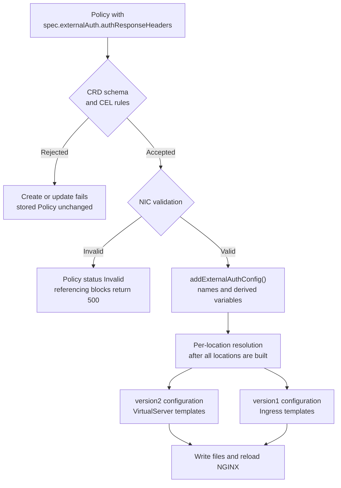

# High-Level Design: ExternalAuth Response Headers

> Status: Proposal
>
> Milestone: 5.8.0
>
> Related work: [#10525](https://github.com/nginx/kubernetes-ingress/issues/10525)

## Overview

The ExternalAuth Policy makes NGINX send a subrequest to an authentication
service before a request reaches its backend. NGINX Ingress Controller (NIC)
uses only the status code of the reply: a 2xx response lets the request
through, and 401 or 403 rejects it. Every header the service returns is
discarded, so backends receive authenticated requests without the identity
the service established, such as a tenant or user ID.

Without snippets or a custom template, there is no way to forward these
headers. They exist only in the auth subrequest, and only `auth_request_set`
can copy them into the main request. `action.proxy.requestHeaders.set` and
the `nginx.org/proxy-set-headers` annotation are evaluated in the main
request, where `$upstream_http_*` refers to the backend's response, which
does not exist yet when NGINX sends the request.

The community ingress-nginx controller offers this through the
[`nginx.ingress.kubernetes.io/auth-response-headers`](https://github.com/kubernetes/ingress-nginx/blob/main/docs/user-guide/nginx-configuration/annotations.md#external-authentication)
annotation. Users who migrate from it with snippets disabled have no
equivalent.

This design adds an optional `authResponseHeaders` list to the ExternalAuth
Policy. After a successful auth subrequest, NGINX copies each listed header
from the auth response to the request it sends to the backend. The auth
service is the only source of the listed headers: its value replaces a value
from the client or from other NIC configuration, and a listed header that the
service does not return reaches the backend from no other source. Policies
without the field, and the configuration NIC generates for them, do not
change.

## Goals

- Forward an explicit allowlist of auth response headers at every
  ExternalAuth attachment point: VirtualServer spec and routes,
  VirtualServerRoute subroutes, and standard and mergeable Ingress, with
  NGINX and NGINX Plus, to HTTP and gRPC backends. See
  [Attachment Points](#attachment-points).
- Make the auth service the only source of the listed headers. See
  [Policy API](#policy-api).
- Work without snippets, custom templates, or NGINX Plus.
- Reject at admission every name that could break the NGINX configuration,
  corrupt request framing, or override a header NIC manages. See
  [Input Validation](#input-validation).
- Keep the change additive: no existing field, default, or behavior changes,
  and Policies without the field render the same configuration as before.
  See [Compatibility](#compatibility).

## Background: How NGINX Forwards Auth Response Headers

The design relies on the following NGINX behavior, verified against the
documentation and against the source at commit
[`867aefd`](https://github.com/nginx/nginx/tree/867aefddbce17efd0e1e6ab1bfd5522e6e4cdc7d).

```nginx
server {
    auth_request /_auth;    # or set in the location

    location /tea {
        auth_request_set $auth_resp_tenant_uuid $upstream_http_tenant_uuid;
        proxy_set_header Tenant-UUID $auth_resp_tenant_uuid;
        proxy_pass http://tea;
    }
}
```

- **Capture.**
  [`auth_request_set`](https://nginx.org/en/docs/http/ngx_http_auth_request_module.html#auth_request_set)
  sets a variable when the auth subrequest completes. The value is evaluated
  in the subrequest
  ([source](https://github.com/nginx/nginx/blob/867aefddbce17efd0e1e6ab1bfd5522e6e4cdc7d/src/http/modules/ngx_http_auth_request_module.c#L262-L268)),
  so `$upstream_http_<name>` reads the auth service's response header, not
  the backend's. NGINX sets the variables as soon as the subrequest is done,
  before it checks the status, so they hold the service's values even when
  it rejects the request, and keep them across internal redirects such as
  `error_page`
  ([source](https://github.com/nginx/nginx/blob/867aefddbce17efd0e1e6ab1bfd5522e6e4cdc7d/src/http/modules/ngx_http_auth_request_module.c#L127-L139)).
- **Unset variables.** In a request where no auth subrequest ran, a variable
  declared by `auth_request_set` is not found and evaluates to an empty
  string
  ([source](https://github.com/nginx/nginx/blob/867aefddbce17efd0e1e6ab1bfd5522e6e4cdc7d/src/http/modules/ngx_http_auth_request_module.c#L296-L302)).
- **Inheritance of capture.** A block inherits `auth_request_set` only if it
  declares none, and inherits the `auth_request` URI separately
  ([source](https://github.com/nginx/nginx/blob/867aefddbce17efd0e1e6ab1bfd5522e6e4cdc7d/src/http/modules/ngx_http_auth_request_module.c#L337)).
  A location can therefore capture the headers of an `auth_request` it
  inherits from its `server`, as in the example above.
- **Variable names.** `$upstream_http_<name>` uses the header name in lower
  case with `-` replaced by `_`
  ([docs](https://nginx.org/en/docs/http/ngx_http_upstream_module.html#var_upstream_http_),
  [source](https://github.com/nginx/nginx/blob/867aefddbce17efd0e1e6ab1bfd5522e6e4cdc7d/src/http/ngx_http_variables.c#L978)),
  so `X-Session-ID` and `X_Session_ID` read the same variable. Since nginx
  1.23.0, several response lines with the same name are combined into one
  value separated by commas ([CHANGES](https://nginx.org/en/CHANGES)).
- **Inheritance of forwarding.**
  [`proxy_set_header`](https://nginx.org/en/docs/http/ngx_http_proxy_module.html#proxy_set_header)
  and
  [`grpc_set_header`](https://nginx.org/en/docs/http/ngx_http_grpc_module.html#grpc_set_header)
  are inherited only by a block that sets none. Every location NIC generates
  for a backend sets its own, at least `Host`, so the directives must be
  rendered in each location.
- **Replacement.** A header named in `proxy_set_header` or `grpc_set_header`
  is never copied from the client request, and a header whose value
  evaluates to an empty string is not sent
  ([proxy source](https://github.com/nginx/nginx/blob/867aefddbce17efd0e1e6ab1bfd5522e6e4cdc7d/src/http/modules/ngx_http_proxy_module.c#L4300-L4302),
  [gRPC source](https://github.com/nginx/nginx/blob/867aefddbce17efd0e1e6ab1bfd5522e6e4cdc7d/src/http/modules/ngx_http_grpc_module.c#L4882)).
  A listed header that the auth service does not return is therefore
  removed, not passed through from the client. Names are compared ignoring
  case.
- **Name length.** NGINX stores the header names set in a location in a hash
  with 64-byte buckets: the `proxy_headers_hash_bucket_size` default, which
  NIC does not change
  ([source](https://github.com/nginx/nginx/blob/867aefddbce17efd0e1e6ab1bfd5522e6e4cdc7d/src/http/modules/ngx_http_proxy_module.c#L4077-L4085)),
  and a fixed size for gRPC
  ([source](https://github.com/nginx/nginx/blob/867aefddbce17efd0e1e6ab1bfd5522e6e4cdc7d/src/http/modules/ngx_http_grpc_module.c#L4951)).
  With the element layout of
  [`ngx_hash_init()`](https://github.com/nginx/nginx/blob/867aefddbce17efd0e1e6ab1bfd5522e6e4cdc7d/src/core/ngx_hash.c#L248-L287),
  a name longer than 46 bytes on a 64-bit platform fails the configuration
  load with `could not build proxy_headers_hash` or
  `could not build grpc_headers_hash`.
- **Underscores.** NGINX ignores client header fields whose names contain
  `_`, because
  [`underscores_in_headers`](https://nginx.org/en/docs/http/ngx_http_core_module.html#underscores_in_headers)
  is `off` by default, and NIC does not change it. A client cannot send
  `Tenant_UUID` to a backend that treats it as `Tenant-UUID`. A snippet that
  sets `underscores_in_headers on` lets it through, and the user
  documentation warns about this.

## User Contract

### Policy API

`authResponseHeaders` is a new optional field of `spec.externalAuth`.

| Field | Type | Default | Validation |
| --- | --- | --- | --- |
| `authResponseHeaders` | list of strings | empty | At most 32 names. Each name has 1 to 46 letters, digits, or `-`, is unique ignoring case, and is not [reserved](#reserved-names). |

When the Policy authenticates a request with a 2xx response, NGINX sends each
listed header from the auth response to the backend:

- Only listed headers are forwarded. NIC never forwards other auth response
  headers.
- The auth service's value replaces a header of the same name from the
  client, from `action.proxy.requestHeaders.set`, from
  `nginx.org/proxy-set-headers`, or from the legacy OIDC Policy on NGINX
  Plus. Names are compared ignoring case. The backend receives the name as
  written in the Policy.
- If the auth response has no header with a listed name, the backend receives
  none either. Listing a header that clients send themselves, such as
  `Authorization`, therefore removes the client's value unless the auth
  service returns one.
- Several response lines with the same name reach the backend as one header,
  with the values separated by commas.
- Headers are forwarded only after a 2xx response. Requests that the auth
  service rejects are handled as today and never carry forwarded headers,
  even when `nginx.org/custom-http-errors` sends them to the default backend.

#### Reserved Names

| Names | Reason |
| --- | --- |
| `Host`, `Connection`, `Proxy-Connection`, `Content-Length`, `Transfer-Encoding`, `TE`, `Keep-Alive`, `Expect`, `Upgrade` | NGINX manages these for every proxied and gRPC request. A `Content-Length` or `Transfer-Encoding` taken from another response would corrupt the framing of the backend request. |
| `X-Real-IP`, `X-Forwarded-For`, `X-Forwarded-Host`, `X-Forwarded-Port`, `X-Forwarded-Proto` | NIC sets these on every backend request. |

Names are reserved ignoring case.

#### Examples

The Policy from the issue:

```yaml
apiVersion: k8s.nginx.org/v1
kind: Policy
metadata:
  name: external-auth-policy
  namespace: application
spec:
  externalAuth:
    authURI: /v1/auth
    authServiceName: application/auth-service
    authServicePorts:
    - 80
    authResponseHeaders:
    - Tenant-UUID
    - User-UUID
    - Permissions
    - Licenses
    - License-Constraints
    - X-Session-ID
```

The mergeable minion from the forum thread references it as before:

```yaml
apiVersion: networking.k8s.io/v1
kind: Ingress
metadata:
  name: app-minion
  namespace: application
  annotations:
    nginx.org/mergeable-ingress-type: minion
    nginx.org/policies: external-auth-policy
spec:
  ingressClassName: nginx
  rules:
  - host: app.example.com
    http:
      paths:
      - path: /api
        pathType: Prefix
        backend:
          service:
            name: app-svc
            port:
              number: 80
```

### Attachment Points

Headers are forwarded exactly where the ExternalAuth `auth_request` runs.
Attaching the Policy works as it does today.

| Reference | Where the ExternalAuth `auth_request` runs | Locations that forward the list |
| --- | --- | --- |
| VirtualServer `spec.policies` | `server` | Every route and subroute location without an `auth_request` of its own, including split and match locations. A route with its own ExternalAuth or APIKey Policy follows that Policy instead. |
| VirtualServer `spec.routes[].policies` | Every location generated for the route | The same locations. Also the subroutes of a delegated VirtualServerRoute that reference no policies, following the existing route-to-subroute inheritance. |
| VirtualServerRoute `spec.subroutes[].policies` | Every location generated for the subroute | The same locations. |
| `nginx.org/policies` on a standard Ingress | `server` | Every path location, and the location generated for `spec.defaultBackend`. |
| `nginx.org/policies` on a mergeable master | The merged `server` | Every minion location without an ExternalAuth Policy of its own. |
| `nginx.org/policies` on a mergeable minion | Every location of the minion | The same locations. A minion that references the same Policy as its master already relies on the master's `server`-level `auth_request`, and forwards the same list. |

These locations never forward headers, because they do not proxy an
authenticated request to a backend: the internal auth location, the OAuth2
sign-in location (`authSigninRedirectBasePath`), the `@external_auth_*`
named locations, ACME HTTP-01 challenge locations, and locations for
`action.redirect`, `action.return`, and error pages.

With `nginx.org/custom-http-errors`, NGINX re-sends a failed request to the
Ingress default backend through the `@custom_default_backend` named
location. The failure can be an auth rejection, such as a 403 from the auth
service when the annotation lists 403. By then NGINX has already captured
the headers of the rejected response, so the location forwards no values. It
only removes client copies of every name listed by its server's locations.
The default backend therefore never receives these headers, and a name
listed for one path is also removed from requests of other paths that fail
over to it.

### Policy Status and Warnings

- The API server rejects an invalid list when a Policy is created or updated,
  so an edit cannot turn a working Policy into an invalid one. NIC validation
  repeats the checks. A Policy that still fails is `Invalid`, and blocks that
  reference it return 500, as for every other Policy error.
- When a listed name replaces a header configured on a resource, NIC adds a
  warning to the VirtualServer, VirtualServerRoute, or Ingress that
  configured it, naming the header and the Policy.
- Headers sent by clients are replaced without a warning. That is the purpose
  of the feature.
- Existing ExternalAuth warnings, such as several ExternalAuth Policies in
  one context or a duplicate `authURI`, are unchanged.

## Acceptance Scenarios

Each scenario below becomes a test named after it, for example
`test_client_values_are_replaced`. What NIC decides, such as the rendered
configuration, warnings, and admission, is tested in Go and tagged *unit*.
End-to-end tests cover what NGINX does with that configuration, plus one base
case for each attachment point. Unless a scenario says otherwise, an
end-to-end test uses the [fixtures](#fixtures) and a VirtualServer, sends
valid credentials, and runs with the NGINX and NGINX Plus images and
snippets disabled. The end-to-end tests join the existing ExternalAuth suites
in `tests/suite`, next to their current cases:
`test_external_auth_policies_vs.py`, `test_external_auth_policies_vsr.py`,
and `test_external_auth_policies_ingress.py`. Their data joins the existing
`tests/data/external-auth/` folders. Two tags qualify a scenario:

- *unit*: a Go test of configuration generation, templates, validation, the
  CRD schema, or injection. It is a case of an existing table-driven
  ExternalAuth test, or a sibling test in the same file.
- *guard*: the behavior already holds, so the test also passes before the
  change.

### Fixtures

- **Auth service:** the test auth service answers 2xx to valid credentials
  and 401 to invalid ones. A 2xx response carries `Tenant-UUID: tenant-123`,
  `User-UUID: user-456`, `X-Session-ID: session-789`, two `X-Group` lines
  with `a` and `b`, and one header whose name has 46 characters. It never
  returns `Permissions`.
- **Policy P:** uses the auth service and lists `Tenant-UUID`, `User-UUID`,
  `X-Session-ID`, `X-Group`, `Permissions`, and the 46-character name.
- **Echo backend:** reports every request header line as it arrives: its
  name, its value, and how many there are, including names that contain `_`.
  Reading `$http_*` variables would not do: NGINX merges repeated lines into
  one value and by default drops names that contain `_`, so a test built on
  them could pass whether or not NIC leaks a header.
- **gRPC echo backend:** reports the metadata of each call in the same way.

### Forwarding

- **Every attachment point forwards**: with P on a VirtualServer spec, route,
  or VirtualServerRoute subroute, on a standard Ingress, or on a mergeable
  minion, the backend receives one line for each listed header that the auth
  service returned, named as P spells it, with the service's value.
- **Every generated location forwards** *(unit)*: split and match
  locations, the subroutes of a delegated VirtualServerRoute without
  policies, the Ingress `spec.defaultBackend` location, the locations under a
  mergeable master with P or with P on both master and minion, Ingress
  backends listed in `nginx.org/grpc-services`, and locations whose P sets
  `sslEnabled` and `sslVerify` all forward P's list, the same way for NGINX
  and NGINX Plus.
- **Unlisted headers stay behind** *(unit)*: a location renders
  `auth_request_set` only for the names that its Policy lists.
- **Repeated lines are joined**: the backend receives one `X-Group: a, b`.
- **gRPC backends**: on a VirtualServer route with a gRPC upstream, a call
  with `tenant-uuid: spoofed` metadata reaches the backend with one
  `tenant-uuid: tenant-123`.
- **The closer Policy wins** *(unit)*: with P on the VirtualServer spec and
  a Policy Q that lists only `X-Session-ID` on a route, or P on a master and
  Q on a minion, the route and the minion forward only Q's list, and clear
  names that only P lists.
- **APIKey on a route** *(unit)*: with P on the VirtualServer spec, a route
  with an APIKey Policy forwards nothing, and clears every name that P lists.
- **Non-backend locations forward nothing** *(unit)*: the internal auth,
  OAuth2 sign-in (P with `authSigninURI`), `@external_auth_*`, ACME
  challenge, `action.redirect`, and `action.return` locations render no
  `auth_request_set`.

### Precedence and Spoofing

- **Client values are replaced**: a request with `Tenant-UUID: spoofed`
  reaches the backend with one `Tenant-UUID: tenant-123`, and the
  VirtualServer reports no warning.
- **In any letter case**: requests with `tenant-uuid: spoofed` and with
  `TENANT-UUID: spoofed` also reach the backend with one
  `Tenant-UUID: tenant-123`.
- **Underscore variants are dropped** *(guard)*: a request with
  `Tenant_UUID: spoofed` reaches the backend without it. The test first
  sends it straight to the echo backend, to show that the backend would
  report the line.
- **Omitted headers are removed**: a request with `Permissions: admin`
  reaches the backend without it, because the auth service never returns
  `Permissions`.
- **Configured values are replaced, with one warning** *(unit)*:
  `User-UUID: anonymous`, set through `requestHeaders.set` on a route with
  two splits and through `nginx.org/proxy-set-headers` on an Ingress with two
  hosts, is removed from those locations, which forward the auth service's
  `User-UUID` instead. The resource that owns the location reports the
  replacement once: the VirtualServer, the VirtualServerRoute for a
  subroute, or the minion for a mergeable path.
- **Legacy OIDC headers are replaced** *(unit, NGINX Plus)*: where P lists
  `username`, or `Authorization` with `accessTokenEnable`, on a location
  with the legacy OIDC Policy, the location renders no OIDC line for it, and
  the resource reports the replacement once.

### Rejection and Fallback

- **Rejections are unchanged** *(unit)*: a location that forwards a list
  renders the same `auth_request` and 401 handling as one without it. The
  existing credential tests cover the runtime behavior.
- **Shared default backend location** *(unit)*: under a master with
  `spec.defaultBackend`, only minion A references P, and minion B sets
  `nginx.org/custom-http-errors`. `@custom_default_backend` removes every
  name that P lists, also from minion B's requests, and reads no
  `$auth_resp_` variable. So the default backend receives neither client
  copies nor values from a rejected auth response, whether the auth service
  or the backend failed.

### Validation and Admission

- **Invalid lists are rejected** *(unit)*: a name with `_`, a space, `:`,
  `$`, `;`, a brace, or a line break; a reserved name in any case; two names
  that differ only in case; a 47-character name; 33 names; or an empty name.
  The shipped CRD rejects them as the API server applies it, naming the rule,
  and Go validation rejects the same lists. A list of 32 distinct
  46-character names is accepted. So an edit that adds a bad name to a
  Policy in use fails at admission, and the working Policy stays in place.
- **The longest name loads**: with P, NGINX loads the configuration, the
  VirtualServer is `Valid`, and both an HTTP and a gRPC backend receive the
  46-character header.
- **No injection** *(unit)*: no payload of the configuration injection suite
  reaches the NGINX configuration through the list.

### Compatibility

- **No field, no change** *(unit, guard)*: after the template changes and
  before any new fixture, every existing snapshot passes unchanged.
- **Existing tests pass** *(guard)*: the existing cases of the ExternalAuth
  Go tests and of `test_external_auth_policies_*.py` pass unchanged; the
  scenario cases are only added next to them.

## Architecture



The feature extends the existing ExternalAuth pipeline:

1. The API server applies the CRD schema and CEL rules. NIC validates the
   Policy and updates its status.
2. `addExternalAuthConfig()` copies the list into `version2.ExternalAuth`,
   with the variable names derived for each header.
3. After VirtualServer or Ingress generation has built every location of a
   server, a resolution pass decides which list each location forwards. See
   [Location Resolution](#location-resolution).
4. The NGINX and NGINX Plus templates render the same directives.

The controller needs no changes. The Policy references no new Secrets or
Services, and the Policy update handler already resyncs every referencing
resource when anything in `spec` changes.

### Data Model

| Package | Change |
| --- | --- |
| `pkg/apis/configuration/v1` | `ExternalAuth.AuthResponseHeaders []string` with kubebuilder markers. Regenerated deep copy, apply configurations, and CRDs. |
| `pkg/apis/configuration/validation` | `validateAuthResponseHeaders()`, called from `validateExternalAuth()`. |
| `internal/configs/version2` | `AuthResponseHeader` with `Name`, `Variable`, and `Source`. `ExternalAuth.ResponseHeaders` and `Location.AuthResponseHeaders`. |
| `internal/configs/version1` | `Location.AuthResponseHeaders`, and a `Server` field with the union of listed names for `@custom_default_backend`. |
| `internal/configs` | Variable derivation in `addExternalAuthConfig()`. The resolution pass in VirtualServer and Ingress generation. |

For `X-Session-ID`, `Variable` is `$auth_resp_x_session_id` and `Source` is
`$upstream_http_x_session_id`: the name in lower case with `-` replaced by
`_`. Names cannot contain `_` and are unique ignoring case, so two names
never derive the same variable.

### Location Resolution

Today the ExternalAuth `auth_request` reaches a location in one of two ways:
the location sets its own, or it inherits the `server` one. The resolution
pass follows the same rules for each location of a server:

1. Skip the internal auth location, OAuth2 sign-in locations, ACME challenge
   locations, and locations that do not proxy to a backend.
2. If the location has its own ExternalAuth, use that Policy's list.
3. Otherwise, if the location has an `auth_request` from another feature,
   use no list. Today that is only an APIKey Policy on a VirtualServer route
   or subroute, whose `auth_request` replaces the inherited one.
4. Otherwise, use the list of the `server`-level ExternalAuth, if there is
   one.
5. Remove headers with a listed name from the location's other request
   headers, and record a warning for each.

The pass runs at the end of VirtualServer generation, after ACME challenge
locations are added. For Ingress, it runs at the end of `generateNginxCfg()`,
and again at the end of `generateNginxCfgForMergeableIngresses()`. That
function overwrites minion request headers when it merges the master and
minion `nginx.org/proxy-set-headers`, and clears a minion's ExternalAuth when
it duplicates the master's, so the pass must run after both. It assigns
rather than appends, so running it twice gives the same result. For each
Ingress server, it also collects the union of the listed names for
`@custom_default_backend`.

Resolution happens in Go rather than in the templates. Configuration
generation tests can then assert the list of each location directly, and the
pass follows existing post-processing such as
`addHSTSToLocationsWithAddHeaders()`.

### Rendering Rules

- Each location with a list renders one pair of directives per name, in
  Policy order, after its other request header directives:

  ```nginx
  auth_request_set $auth_resp_tenant_uuid $upstream_http_tenant_uuid;
  proxy_set_header Tenant-UUID $auth_resp_tenant_uuid;
  ```

- Locations with a gRPC backend render `grpc_set_header`. The VirtualServer
  templates reuse their existing `$proxyOrGRPC` selection. The Ingress
  templates add the block to both the proxy and the gRPC branch.
- `@custom_default_backend` renders `proxy_set_header <Name> "";` for each
  name in the union, sorted ignoring case. The empty value removes the
  client's header and sends nothing in its place. The location never reads
  `$auth_resp_<name>`, because after an auth rejection the variables hold
  the rejected response's values:

  ```nginx
  location @custom_default_backend {
      internal;
      proxy_intercept_errors off;
      proxy_set_header Tenant-UUID "";
      proxy_set_header User-UUID "";
      proxy_pass http://...;
  }
  ```

  NGINX inherits `proxy_set_header` only into a location that sets none, so
  these lines stop `@custom_default_backend` from inheriting any that a
  server or http snippet sets. No template sets them at those levels, and a
  server without a list renders the location as today.

- The NGINX Plus VirtualServer template omits the legacy OIDC `username` and
  `Authorization` headers when the location lists them.
- All four templates change: `nginx.virtualserver.tmpl`,
  `nginx-plus.virtualserver.tmpl`, `nginx.ingress.tmpl`, and
  `nginx-plus.ingress.tmpl`. The directives are the same for NGINX and NGINX
  Plus.
- New template blocks use whitespace-trimming actions, so an empty list
  renders nothing, not even a blank line.

Variables are named after the header rather than numbered, as ingress-nginx
does with `$authHeader<N>`. A variable then has one meaning in every
location, so `nginx -T` output stays readable and a custom `log-format` can
refer to a specific header.

### Rendered Examples

VirtualServer `default/cafe` references `auth-tenant` in `spec.policies`. Its
`/tea` route sets `User-UUID` through `requestHeaders.set`, and its `/coffee`
route references `auth-session`.

```yaml
apiVersion: k8s.nginx.org/v1
kind: Policy
metadata:
  name: auth-tenant
spec:
  externalAuth:
    authURI: /v1/auth
    authServiceName: auth-svc
    authResponseHeaders:
    - Tenant-UUID
    - User-UUID
---
apiVersion: k8s.nginx.org/v1
kind: Policy
metadata:
  name: auth-session
spec:
  externalAuth:
    authURI: /v1/session
    authServiceName: session-svc
    authResponseHeaders:
    - X-Session-ID
---
apiVersion: k8s.nginx.org/v1
kind: VirtualServer
metadata:
  name: cafe
spec:
  host: cafe.example.com
  policies:
  - name: auth-tenant
  upstreams:
  - name: tea
    service: tea-svc
    port: 80
  - name: coffee
    service: coffee-svc
    port: 80
  routes:
  - path: /tea
    action:
      proxy:
        upstream: tea
        requestHeaders:
          set:
          - name: User-UUID
            value: anonymous
  - path: /coffee
    policies:
    - name: auth-session
    action:
      pass: coffee
```

Rendered configuration, abridged:

```nginx
server {
    server_name cafe.example.com;

    # Spec-level Policy, unchanged.
    auth_request "/_external_auth/v1/auth";

    location "/_external_auth/v1/auth" {
        # Auth subrequest location, unchanged. Forwards nothing.
        internal;
        ...
    }

    location /tea {
        # Inherits the server auth_request, so it forwards the list of
        # auth-tenant. The route's "User-UUID: anonymous" is dropped, and the
        # VirtualServer gets a warning.
        ...
        proxy_set_header Host "$host";
        auth_request_set $auth_resp_tenant_uuid $upstream_http_tenant_uuid;
        proxy_set_header Tenant-UUID $auth_resp_tenant_uuid;
        auth_request_set $auth_resp_user_uuid $upstream_http_user_uuid;
        proxy_set_header User-UUID $auth_resp_user_uuid;
        proxy_pass http://vs_default_cafe_tea;
    }

    location "/_external_auth/v1/session" {
        internal;
        ...
    }

    location /coffee {
        # The route Policy replaces the server one, so only its list applies.
        auth_request "/_external_auth/v1/session";
        error_page 401 = @external_auth_unauthorized;
        ...
        auth_request_set $auth_resp_x_session_id $upstream_http_x_session_id;
        proxy_set_header X-Session-ID $auth_resp_x_session_id;
        proxy_pass http://vs_default_cafe_coffee;
    }
}
```

For the mergeable Ingress from the forum thread, the master references no
Policy and the minion `application/app-minion` references
`external-auth-policy`:

```nginx
server {
    server_name app.example.com;

    location "/_external_auth/v1/auth" {
        internal;
        ...
    }

    location /api {
        # location for minion application/app-minion
        auth_request "/_external_auth/v1/auth";
        error_page 401 = @external_auth_unauthorized;
        ...
        proxy_set_header Host $host;
        proxy_set_header X-Real-IP $remote_addr;
        ...
        auth_request_set $auth_resp_tenant_uuid $upstream_http_tenant_uuid;
        proxy_set_header Tenant-UUID $auth_resp_tenant_uuid;
        auth_request_set $auth_resp_user_uuid $upstream_http_user_uuid;
        proxy_set_header User-UUID $auth_resp_user_uuid;
        # ... one pair for each remaining name in the Policy
        proxy_pass http://...;
    }
}
```

## Security Model

- **No spoofing.** Every location that forwards a list, and
  `@custom_default_backend`, removes the listed names from the client
  request, including when the auth service does not return them. Every
  location that proxies to a backend also clears the names that its server's
  Policies list and that it does not forward. Names are compared ignoring
  case, and NGINX ignores underscore variants by default.
- **Only after a 2xx response.** Captured values can come from a rejected
  auth response, so NIC forwards them only where a request arrives after the
  auth subrequest allowed it. NIC renders no `satisfy` directive, so the
  NGINX default `satisfy all` applies, and a location that forwards a list
  proxies only after a 2xx response. `@custom_default_backend`, which can
  receive rejected requests, forwards no values. A `satisfy any` added
  through snippets would let a rejected request through with the rejected
  values.
- **No framing or proxy header override.** Reserved names keep the auth
  response from setting `Content-Length`, `Transfer-Encoding`, `Host`, the
  connection headers, or the forwarding headers NIC sets.
- **No configuration injection.** Names contain only letters, digits, and
  `-`, and variable names are derived from them. Values never appear in the
  configuration: NGINX reads them from the parsed auth response at request
  time, and a parsed header value cannot contain a line break.
- **No new privileges.** The field references no Secrets or Services, needs
  no RBAC changes, and does not depend on `-enable-snippets`.

### Input Validation

Each rule is checked twice, by the CRD schema and by NIC validation.

| Rule | CRD schema | NIC validation |
| --- | --- | --- |
| At most 32 names | `maxItems` | Count check |
| Letters, digits, and `-` only | `items.pattern` `^[A-Za-z0-9-]+$` | `IsHTTPHeaderName()` from Kubernetes apimachinery, as for VirtualServer header names |
| 1 to 46 characters | `items.pattern` and `items.maxLength` | Length check |
| Unique ignoring case | CEL rule | Duplicate check |
| Not reserved, ignoring case | CEL rule | Reserved-name check |
| No NGINX special characters | Implied by the pattern | `ContainsDangerousChars()` |

Rejecting invalid names at admission matters more for this field than for
most. NIC marks a Policy that fails its own validation `Invalid`, and every
route that references it returns 500. With the CEL rules, an edit that adds a
bad name fails at `kubectl apply`, and the working Policy stays in place.

The shipped CRD, including its CEL rules, is tested through the
`crdSchemaGate` harness in `internal/k8s/crdschema_test.go`. The field also
gets an entry in the configuration injection tests in
`internal/k8s/policy_injection_test.go`.

### Downgrade

An older NIC ignores the field: it forwards nothing, and client-supplied
headers with the listed names reach backends. Backends must stop trusting
those headers before a downgrade. The release notes must say this.

## Observability and Scale

- **Configuration.** `nginx -T` shows the rendered directives. Warnings about
  replaced headers appear as events and in the status of the VirtualServer,
  VirtualServerRoute, or Ingress. The Policy status reports validation
  failures.
- **Logs.** The captured values are NGINX variables named `$auth_resp_<name>`.
  NIC does not log them. A custom `log-format` can reference one only while
  some Policy lists the header; otherwise NGINX rejects the configuration
  because of an unknown variable.
- **Cost.** Each listed name adds two directives to each affected location
  and one variable to each NGINX instance. The feature adds no shared memory,
  upstreams, locations, or subrequests: the auth subrequest already runs.
- **Telemetry.** Unchanged. ExternalAuth Policies are counted as before.

## Delivery Plan

| Order | Pull request | Contents |
| --- | --- | --- |
| 1 | High-level design | This document |
| 2 | Implementation | The [acceptance scenario](#acceptance-scenarios) tests and their fixtures first; then the API field and markers, generated code and CRDs, Go validation and CEL rules, configuration generation and resolution for VirtualServer, VirtualServerRoute, and Ingress, all four templates, the remaining unit tests, and examples |
| 3 | Documentation, in `nginx/documentation` | Policy reference, ExternalAuth guide, and the ingress-nginx migration mapping |

### Requirements Traceability

| Requirement | Source | Design | Scenarios |
| --- | --- | --- | --- |
| Optional allowlist under `spec.externalAuth` | Issue | [Policy API](#policy-api) | [Forwarding](#forwarding), [Compatibility](#compatibility) |
| Listed headers copied to the backend request only after a 2xx response | Issue | [Rendering Rules](#rendering-rules), [Security Model](#security-model) | [Forwarding](#forwarding), [Rejection and Fallback](#rejection-and-fallback) |
| Auth values replace client-provided headers, and only listed headers are forwarded | Issue | [Policy API](#policy-api), [Security Model](#security-model) | [Forwarding](#forwarding), [Precedence and Spoofing](#precedence-and-spoofing) |
| Works with snippets disabled | Issue, forum | [Goals](#goals) | Every end-to-end scenario |
| Policy on a mergeable minion | Forum | [Attachment Points](#attachment-points), [Rendered Examples](#rendered-examples) | [Forwarding](#forwarding), [Rejection and Fallback](#rejection-and-fallback) |
| Field `authResponseHeaders` as a list of strings | Maintainer notes | [Policy API](#policy-api) | [Validation and Admission](#validation-and-admission) |
| `auth_request_set` and `proxy_set_header` in each backend location | Maintainer notes | [Rendering Rules](#rendering-rules) | [Forwarding](#forwarding) |
| Names restricted to `[A-Za-z0-9-]` | Maintainer notes | [Input Validation](#input-validation) | [Validation and Admission](#validation-and-admission) |
| Auth value wins over client and VirtualServer headers | Maintainer notes | [Policy API](#policy-api) | [Precedence and Spoofing](#precedence-and-spoofing) |
| Plain list, no renaming | Maintainer notes | [Policy API](#policy-api) | [Forwarding](#forwarding) |
| All five attachment paths | Maintainer notes | [Attachment Points](#attachment-points) | [Forwarding](#forwarding) |

## Verification

- **Scenarios.** The first commit of the implementation pull request adds
  the [scenario](#acceptance-scenarios) tests and their fixtures. On that
  commit, every end-to-end test that is not a guard must fail at its
  assertion, not during setup: the fixtures install the Policy CRD from the
  working tree (`CRDS` in `tests/settings.py`) and create Policies without
  setting field validation, so the API server drops the unknown field and
  still creates the Policy. The pull request description lists each scenario
  with its result on the first and the final commit.
- **Test changes.** Deleting a scenario test, weakening its assertion, or
  re-recording a snapshot that this feature does not render needs a written
  justification in the pull request.
- **Gates:** `make test`, `make lint`, `make test-update-snaps` with only new
  snapshots, and `make update-codegen` and `make update-crds` with no
  further changes.
