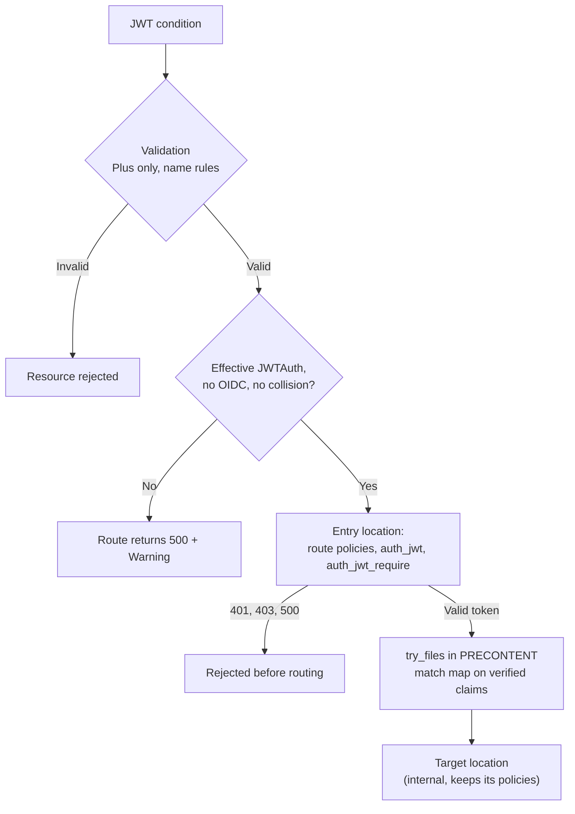
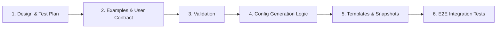

# High-Level Design: JWT Claim Routing for VirtualServer and VirtualServerRoute

> Status: Proposal (revision 3)
>
> Related work: [#11175](https://github.com/nginx/kubernetes-ingress/issues/11175) (parent [#6829](https://github.com/nginx/kubernetes-ingress/issues/6829), companion [#11174](https://github.com/nginx/kubernetes-ingress/issues/11174), plan [PR #11187](https://github.com/nginx/kubernetes-ingress/pull/11187))

Revision 3 restructures the plan as a high-level design with numbered
[acceptance scenarios](#acceptance-scenarios). It keeps revision 2's
validate-then-route design, aligned with #11174 and the security requirements
of #6829, and replaces the `$jwt_custom_<path>` variable with typed `jwtClaim`
and `jwtHeader` condition fields. Revision 1 routed in the REWRITE phase, on
claims that had not been validated yet. The R1 to R11 and V1 to V8 numbering
is kept because #11174 refers to it.

## Overview

VirtualServer (VS) and VirtualServerRoute (VSR) `matches` cannot route on the
contents of a JWT. Users who want to send premium users, staff, or one tenant
to a different upstream have to use snippets or an external service
([discussion #4417](https://github.com/nginx/kubernetes-ingress/discussions/4417)).

This design adds two optional fields to `Condition`: `jwtClaim`, a claim path
such as `realm_access.roles`, and `jwtHeader`, a JOSE header name such as `kid`.
The existing `$jwt_claim_<name>` and `$jwt_header_<name>` variables are also
accepted in `variable`. All of them are NGINX Plus only, and are called *JWT
conditions* in this document. A route with a JWT condition (a *JWT route*)
first authenticates and authorizes the request in its entry location
(`auth_jwt`, and `auth_jwt_require` from #11174), then routes with `try_files`
in the PRECONTENT phase. Routing therefore never uses claims from a token that
has not been validated. Users never write or see the NGINX variable that NIC
generates for a claim path.

NGINX Plus decodes claim variables without validating the token, so routing in
the REWRITE phase, as `matches` do today, would use unverified claims. See
[Why validate first](#why-validate-first).

## Goals

- Route on claims and JOSE headers of a validated token, with the VS
  `matches` semantics users already know. See [User Contract](#user-contract).
- **Validate, then route.** The entry location authenticates and authorizes
  before it routes. See [R1 to R11](#requirements).
- **Enforce the route's own policies in the entry location**, the same set its
  target locations enforce, so route-level policies keep precedence over
  spec-level ones. See [Entry location contents](#entry-location-contents).
- **Fail closed.** JWT conditions on a route without an effective
  `JWTAuth` policy, or on an OIDC route, return `500` with a Warning. See
  [Responses and warnings](#responses-and-warnings).
- **A missing claim never matches**, unless the condition value is `""`. This
  is the same invariant as #11174.
- Use the dotted claim-path syntax of #11174 and RateLimit (`jwtClaim`) for
  nested and array claims.
- Reject at validation every name that could inject configuration, and reject
  every JWT condition on NGINX OSS. See
  [Input Validation](#input-validation).
- Leave routes without JWT conditions, and every `splits` route,
  unchanged: no snapshot changes.

## Non-Goals

- `$jwt_payload`. NIC renders no `auth_jwt_type`, so the variable is always
  empty. If it were allowed in `responseHeaders.add`, it would return decrypted
  payloads to clients.
- OIDC claims, and JWE tokens. OIDC routes with JWT conditions fail
  closed.
- `kind: Ingress`. Ingress has no match conditions
  ([#10661](https://github.com/nginx/kubernetes-ingress/issues/10661)).
- `Contains`, or case-sensitive matching, built into JWT conditions only. That
  would be inconsistent with every other condition. Authorization (#11174)
  provides strict matching.
- Claim names containing `.`, `/` or `:`, for example Auth0
  `https://example.com/roles`. This is a documented limitation shared with
  #11174.
- Counting only validated tokens in spec-level rate limits, and keeping the
  last valid configuration after an invalid resource. Both are follow-ups. See
  [Requirements Traceability](#requirements-traceability).

## Background: How NGINX Validates and Routes

The design relies on the following NGINX behaviour. Gates V1 to V8 in
[Verification](#verification) confirm the parts that are not yet proven
against a running NGINX Plus.

### Why validate first

Today a route with `matches` is served by two kinds of location:

- an **entry location** (`InternalRedirectLocation`):
  `location /coffee { rewrite ^ $vs_default_cafe_matches_0 last; }`;
- **target locations**
  (`location ~ ^/internal_location_matches_0_match_0$ { internal; ... }`),
  which carry the route's policies.

`rewrite` runs in the REWRITE phase, so the match map is evaluated before any
ACCESS-phase check, and the entry location never reaches ACCESS:

```text
SERVER_REWRITE → FIND_CONFIG → REWRITE → POST_REWRITE → PREACCESS → ACCESS → POST_ACCESS → PRECONTENT → CONTENT
                               rewrite                  limit_req    auth_jwt               try_files
```

NGINX Plus decodes claim variables without validating the token. NIC's tiered
rate-limit e2e tests apply different limits by `user_details.level` on a
VirtualServer without any JWT policy, using tokens signed with an arbitrary key
(`tests/suite/test_rl_policies.py`).
`examples/custom-resources/rate-limit-tiered-jwt-claim/README.md` states that
the token is not validated. Routing on JWT claims in the REWRITE phase therefore
uses unverified claims.

Every target runs ACCESS before it responds (`return` and `redirect` targets
proxy to `nginx418Server`), so a response would not leak. But routing before
validation would:

- break #6829's routing criteria;
- route with no validation at all when no JWT policy applies to the route;
- route on a different token than the one validated when the token sources
  differ, for example on OIDC routes (`auth_jwt "" token=$session_jwt` exists
  only in the targets);
- let forged tokens increment `limit_req` counters
  ([discussion #10371](https://github.com/nginx/kubernetes-ingress/discussions/10371)).

### NGINX facts the design depends on

- **`try_files` runs in PRECONTENT**, after ACCESS. Its last parameter is an
  internal redirect to a URI that may contain variables, so the existing match
  map can be reused. A probe that fails with `ENOTDIR` is skipped without a log
  entry, and the fallback goes through `ngx_http_split_args`, which replaces the
  request arguments with those of the fallback URI
  ([source](https://github.com/nginx/nginx/blob/master/src/http/modules/ngx_http_try_files_module.c)).
- **`limit_req` runs at most once per request** (`r->main->limit_req_status`)
  and is inherited only by levels that define none
  ([source](https://github.com/nginx/nginx/blob/master/src/http/modules/ngx_http_limit_req_module.c)).
- **`map` checks exact string keys before regexes**, so `""` always wins for a
  missing claim.
- **A variable name ends at `.`** (`ngx_http_script_compile`), so a VS named
  `cafe.v1` yields `$vs_default_cafe.v1_matches_0`, which fails the reload.
  Today this already breaks every `matches` and `splits` route, and every
  RateLimit JWT condition, on such a VS.
- **Array claims:** `auth_jwt_claim_set` documents comma-joined arrays, while the
  format of `$jwt_claim_<name>` for arrays is unverified (V8).

References:
[`ngx_http_auth_jwt_module`](https://nginx.org/en/docs/http/ngx_http_auth_jwt_module.html),
[`map`](https://nginx.org/en/docs/http/ngx_http_map_module.html),
[`try_files`](https://nginx.org/en/docs/http/ngx_http_core_module.html#try_files),
[`limit_req`](https://nginx.org/en/docs/http/ngx_http_limit_req_module.html#limit_req),
[HTTP phases](https://nginx.org/en/docs/dev/development_guide.html#http_phases),
[`ngx_http_parse.c`](https://github.com/nginx/nginx/blob/master/src/http/ngx_http_parse.c),
and the NIC
[`Condition`](https://docs.nginx.com/nginx-ingress-controller/configuration/virtualserver-and-virtualserverroute-resources/#condition)
reference.

## User Contract

### Condition fields

With NGINX Plus, `routes[].matches[].conditions[]` (VS) and
`subroutes[].matches[].conditions[]` (VSR) accept two new fields. As with
`header`, `cookie`, `argument` and `variable`, a condition sets exactly one of
them.

| Field | Validation | Evaluated from | Notes |
|---|---|---|---|
| `jwtClaim` | `validateJWTClaimPath`: `.`-separated segments, each non-empty `[a-zA-Z0-9_-]+` | An `auth_jwt_claim_set` variable that NIC generates, shared with `RateLimit` and #11174 | Top-level and nested claims (`sub`, `user_details.level`) and arrays (elements joined with `,`). Nested claims use a dotted path, as in `rateLimit.condition.jwt.claim` and #11174 `claims[].name`. |
| `jwtHeader` | `[a-zA-Z0-9_]+` | NGINX Plus built-in `$jwt_header_<name>` | JOSE header, for example `kid`. |

`variable` also accepts `$jwt_claim_<name>` and `$jwt_header_<name>`
(`[a-zA-Z0-9_]+`, `validateSpecialVariable`). These are real NGINX Plus
variables and work only for top-level claims: NGINX cannot evaluate nested
claims or names containing `.` with them. Use `jwtClaim` for nested claims and
arrays.

- Users never write or see the variable NIC generates for a `jwtClaim`. It is
  derived from the VS and the claim path, and is not meant to be guessed.
- NGINX OSS: every JWT condition is rejected with
  `field.Forbidden(..., "is only supported in NGINX Plus")`.
- `$jwt_payload` stays rejected everywhere.
- Unchanged: `action.proxy.requestHeaders` and `responseHeaders.add` already
  accept `${jwt_claim_*}` and `${jwt_header_*}`
  (`actionProxyHeaderSpecialVariables`). `return.body` accepts no JWT
  variables.
- Prefer `jwtClaim` for array claims (see V8).

### Example

```yaml
apiVersion: k8s.nginx.org/v1
kind: Policy
metadata:
  name: cafe-jwt
spec:
  jwt:
    realm: cafe
    secret: jwk-secret
    token: $http_token
    authorization:                     # #11174
      rules:
        - claims:
            - name: aud
              match: Contains
              values: [cafe-api]
---
apiVersion: k8s.nginx.org/v1
kind: VirtualServer
metadata:
  name: cafe
spec:
  host: cafe.example.com
  upstreams:
    - name: staff
      service: staff-svc
      port: 80
    - name: premium
      service: premium-svc
      port: 80
    - name: regular
      service: regular-svc
      port: 80
  routes:
    - path: /coffee
      policies:
        - name: cafe-jwt
      matches:
        - conditions:                  # array claim contains "barista"
            - jwtClaim: realm_access.roles
              value: "~(^|[ ,])barista([ ,]|$)"
          action:
            pass: staff
        - conditions:                  # nested claim, case-sensitive
            - jwtClaim: user_details.level
              value: "~^Premium$"
          action:
            proxy:
              upstream: premium
              requestHeaders:
                set:
                  - name: X-Client
                    value: ${jwt_claim_sub}
      action:
        pass: regular
```

| Token | Result | Why | Scenario |
|---|---|---|---|
| valid; `aud: [cafe-api]`; `realm_access.roles: ["staff","barista"]` | `staff` | First match | S2 |
| valid; `aud: [cafe-api]`; `user_details.level: Premium` | `premium` | Second match | S1 |
| valid; `aud: [cafe-api]`; `user_details.level: premium` | `regular` | `~^Premium$` is case-sensitive | S3 |
| valid; `aud: [cafe-api]`; no `user_details` | `regular` | A missing claim never matches (R9) | S4 |
| valid; `aud: [other]` | `403` from the entry location | #11174 authorization fails before routing | S9 |
| expired, badly signed, or no token | `401` from the entry location | `auth_jwt` fails before routing | S8 |
| badly signed; `user_details.level: Premium` | `401` from the entry location | Claims of an invalid token are never evaluated | S8 |

### Matching semantics

Routing conditions keep the semantics of every other VS condition.
Authorization (#11174) is stricter. Both are documented side by side:

| | Routing condition (#11175) | Authorization (#11174) |
|---|---|---|
| Purpose | Choose a target | Accept or reject the request |
| Case | Case-insensitive (quoted `map` string, `generateValueForMatchesRouteMap`); use `~^value$` for case-sensitive | Case-sensitive |
| Negation | `!value` | `negate: true` |
| Array or space-delimited claim | No `Contains`; use `~(^\|[ ,])value([ ,]\|$)`, the pattern `Contains` generates | `Contains` |
| Missing or empty claim | Matches only `value: ""`; negated values and regexes never match (R9) | Value checks fail; `Present` with `negate: true` matches |
| Regex | `~` (case-sensitive) or `~*` (case-insensitive) | `match: Regex` (case-sensitive) |

Recipes:

| Intent | `value` |
|---|---|
| Equals `Premium`, case-sensitive | `~^Premium$` |
| Array or space-delimited claim contains `barista` | `~(^\|[ ,])barista([ ,]\|$)` |
| Claim present and non-empty | `!` |
| Claim missing or empty | `""` |
| Claim present and not `guest` | `!guest` (R9 makes a missing claim fail) |

Notes:

- **Routing is not an access boundary between the targets of one route.**
  Policies, including #11174 `authorization`, apply to the whole route. To
  restrict an upstream to certain claims, give it its own route with its own
  `authorization`.
- Anchor regexes: `~admin` also matches `superadmin`.
- Don't route on claims that users can edit at the IdP, such as `email`, `name`
  or `preferred_username`.

### Responses and warnings

| Situation | Response | Where |
|---|---|---|
| Missing, malformed, expired or badly signed token | `401` | Entry location, before routing |
| #11174 claim check fails | `errorCode` (default `403`) | Entry location, before routing |
| Keys can't be loaded (JWKS endpoint down, no cached keys) | `500` | Entry location, before routing |
| JWT conditions without an effective `JWTAuth` policy, or with OIDC (R3) | `500` and a Warning | Entry and target locations |
| Invalid or missing policy reference | `500` (existing behaviour) | Entry and target locations |
| Claim-variable collision (R10) | `500` and a Warning | Affected routes |
| Missing claim | Default route; the token is valid | After validation |
| NGINX OSS | Rejected | Validation |

## Acceptance Scenarios

Scenarios are written before the code. Each one is proven by at least one
test, listed in [Verification](#verification). A scenario marked *depends on
#11174* stays pending until that plan lands. Every scenario assumes NGINX Plus
and a route with an effective `JWTAuth` policy unless it says otherwise.

### Routing on validated claims

| ID | Scenario |
|---|---|
| S1 | **Given** a match on `jwtClaim: user_details.level` with `~^Premium$`, **when** a valid token carries `Premium`, **then** the request goes to the premium upstream. |
| S2 | **Given** an array-claim regex match on `jwtClaim: realm_access.roles`, **when** a valid token's roles include `barista`, **then** the request goes to the staff upstream. |
| S3 | **Given** the `~^Premium$` match, **when** a valid token carries `premium`, **then** the request goes to the default route. |
| S4 | **Given** a JWT condition with a value such as `!x` or a regex, **when** a valid token does not carry the claim, **then** the request goes to the default route (R9). |
| S5 | **Given** a `jwtHeader: kid` condition, or a `variable: $jwt_claim_sub` or `variable: $jwt_header_kid` condition, **when** a valid token matches it, **then** the request is routed on it. |
| S6 | **Given** a match with a JWT condition and a header or argument condition, **when** only one of them holds, **then** the match fails: conditions are ANDed. |
| S7 | **Given** a match whose action is `return` or `redirect`, **when** a valid token matches, **then** the response is served after validation. |

### Validation before routing

| ID | Scenario |
|---|---|
| S8 | **Given** a token that is missing, expired, or badly signed, including one whose claims would match, **when** the request arrives, **then** the entry location returns `401` and no upstream receives the request. |
| S9 | **Given** a #11174 `authorization` rule the token fails, **when** the request arrives, **then** the entry location returns `errorCode` before routing. *Depends on #11174.* |
| S10 | **Given** a valid token in the configured source and a forged token with other claims in `Authorization`, **when** the request arrives, **then** routing and `auth_jwt_require` use the valid token (V1). |
| S11 | **Given** a `jwksURI` policy whose endpoint is down and with no cached keys, **when** the request arrives, **then** the entry location returns `500`. |

### The entry location enforces the route's own policies

| ID | Scenario |
|---|---|
| S12 | **Given** the JWT policy is referenced at spec, route, subroute, or inherited VS-route level, **when** the request arrives, **then** it is validated in the entry location before routing. |
| S13 | **Given** BasicAuth at both spec and route level, **when** the request arrives, **then** the entry location applies the route's BasicAuth, not the spec's. |
| S14 | **Given** CORS on the route, **when** a preflight `OPTIONS` arrives without a token, **then** the response is `204`, and `401` or `403` responses from the entry location carry the CORS headers (V6). |
| S15 | **Given** route `errorPages`, **when** the entry location returns `401`, `403`, `500` or the rate-limit code, **then** the error pages apply, and gRPC clients receive gRPC statuses (V7). |

### Fail closed

| ID | Scenario |
|---|---|
| S16 | **Given** JWT conditions and no effective `JWTAuth` policy, **when** the request arrives, **then** it returns `500` and a Warning event names the route (R3). |
| S17 | **Given** JWT conditions on a route that uses OIDC, **when** the request arrives, **then** it returns `500` and a Warning is emitted (R3). |
| S18 | **Given** two features that map the same claim variable to different claim paths, **when** configuration is generated, **then** the affected routes return `500` with a Warning and the rest of the host keeps serving (R10). |

### Request handling

| ID | Scenario |
|---|---|
| S19 | **Given** a request with a query string, **when** it is routed to a plain, `rewritePath`, or gRPC target, **then** the upstream URI, `$args` and `${arg_*}` are the same as with `rewrite ... last` (R7, V3). |
| S20 | **Given** a route-level claim-keyed rate limit and no spec-level limit, **when** a badly signed token is rejected in the entry location, **then** it is not counted by the limit (V4). |
| S21 | **Given** spec-level and route-level rate limits, **when** requests arrive, **then** the route limit applies (R8, V4). |

### Validation, unit level

| ID | Scenario |
|---|---|
| S22 | **Given** NGINX OSS, **when** a condition uses `jwtClaim`, `jwtHeader`, `$jwt_claim_<name>` or `$jwt_header_<name>`, **then** validation returns Forbidden. |
| S23 | **Given** NGINX Plus, **when** claim paths and header names are valid or invalid as listed under [Input Validation](#input-validation), **then** they are accepted or rejected accordingly, setting `jwtClaim` together with another condition field is rejected, and `$jwt_payload` is always rejected. |
| S24 | **Given** a claim path, header name, variable or value with an injection attempt (`;`, space, braces, or an unescaped `"`), **when** validation runs, **then** it is rejected. |

### Compatibility

| ID | Scenario |
|---|---|
| S25 | **Given** a route without JWT conditions, or any `splits` route, **when** configuration is rendered, **then** the output is unchanged and no existing snapshot changes. |
| S26 | **Given** a VirtualServer named `cafe.v1` using `matches`, `splits`, or a RateLimit JWT condition, **when** NGINX loads the configuration, **then** it loads, and undotted names render as before (R11). |
| S27 | **Given** a JWT route, **when** targets are rendered, **then** they keep their policies (R5), and a `jwksURI` policy without `keyCache` produces a Warning. |
| S28 | **Given** WAF or DoS on a JWT route, **when** the request is redirected from the entry to a target, **then** it is inspected exactly once. **TBD:** the behaviour is decided by V5. |

### Documented, not tested

- D1: spec-level rate limits still count unvalidated tokens until the
  rate-limiting follow-up lands.
- D2: tokens passed as query arguments appear in `$request`. Pass tokens in a
  header or cookie.
- D3: routing is not an access boundary between the targets of one route.
- D4: claim names containing `.`, `/` or `:` are unsupported.

## Architecture



### 1. Claim extraction (`http` context)

- `jwtClaim` becomes
  `auth_jwt_claim_set $<claim_var> <segment> ...;` through
  `generateAuthJwtClaimSetVariable` / `generateAuthJwtClaimSetClaim`
  (`internal/configs/policy.go`), with the parent VS `policyOwnerDetails`
  (`parentType: "vs"`; VSR subroutes also use the parent VS). The variable is
  shared with `RateLimit` and #11174 for the same claim.
- Claim sets are collected in `routingCfg.AuthJWTClaimSets` and appended to
  `authJWTClaimSets` at both match call sites in `GenerateVirtualServerConfig`.
- `removeDuplicateAuthJWTClaimSets` deduplicates them. #11174's collision check
  (same variable, different claim path, for example `jwtClaim: a.b` and a
  Policy claim `a_b`) covers all three features (R10).
- `jwtHeader` and the `$jwt_claim_*` and `$jwt_header_*` variables are used
  directly as map sources (`getNameForSourceForMatchesRouteMapFromCondition`),
  with `jwtHeader: kid` mapped to `$jwt_header_kid`.
- **Dotted resource names (R11).** `NewVSVariableNamer` and
  `generateAuthJwtClaimSetVariable` only replace `-` with `_`. When the
  namespace/name contains `.`, replace `.` with `_` and append
  `_<first 8 hex chars of sha256("<ns>/<name>")>`. Names without `.` keep their
  current form, so existing snapshots don't change. The hash keeps `cafe.v1`
  distinct from `cafe-v1`. The existing `-`/separator ambiguity (ns `a-b`/name
  `c` vs ns `a`/name `b-c`) is pre-existing and out of scope.

### 2. Condition maps (`http` context)

The existing map chain is unchanged. Each condition map's matching key yields
the next condition's variable, and the last condition yields `1`. The route's
main map selects the target from the first condition variable of each match
(`~^1`, `~^01`, …). R9 adds an empty-string key to JWT condition maps. For
the example:

```nginx
auth_jwt_claim_set $jwt_default_cafe_vs_realm_access_roles realm_access roles;
auth_jwt_claim_set $jwt_default_cafe_vs_user_details_level user_details level;

map $jwt_default_cafe_vs_realm_access_roles $vs_default_cafe_matches_0_match_0_cond_0 {
    ""                           0;    # R9: a missing claim never matches
    "~(^|[ ,])barista([ ,]|$)"   1;
    default                      0;
}

map $jwt_default_cafe_vs_user_details_level $vs_default_cafe_matches_0_match_1_cond_0 {
    ""             0;
    "~^Premium$"   1;
    default        0;
}

map $vs_default_cafe_matches_0_match_0_cond_0$vs_default_cafe_matches_0_match_1_cond_0 $vs_default_cafe_matches_0 {
    ~^1      /internal_location_matches_0_match_0;
    ~^01     /internal_location_matches_0_match_1;
    default  /internal_location_matches_0_default;
}
```

### 3. Entry location (`server` context)

For a JWT route:

```nginx
location /coffee {
    # route policies, rendered by the same template defines as the target locations (R2)
    auth_jwt "cafe" token=$http_token;                                      # jwtAuth define (#11174)
    auth_jwt_key_file /etc/nginx/secrets/<jwk>;
    auth_jwt_require $jwt_authz_default_cafe_vs_default_cafe_jwt error=403;
    # route errorPages (R4)
    client_max_body_size 0;
    root /dev/null;                                                         # R6
    try_files /nic-route $vs_default_cafe_matches_0$is_args$args;           # R1, R7
}
```

`try_files` runs in PRECONTENT, after the ACCESS phase, so the match map is
reused unchanged.

| Step | `rewrite ... last` (today; still used by all other routes) | Validate-then-route |
|---|---|---|
| Route policies, including `auth_jwt` and `auth_jwt_require` | Target location, ACCESS | **Entry location, ACCESS**; again in the target (R5) |
| Match map evaluated, target chosen | Entry location, REWRITE: **unverified** claims | Entry location, PRECONTENT: **verified** claims |
| Route `limit_req` | Target location, PREACCESS: before `auth_jwt` | Target location, after the entry validated the token, unless spec-level limits also exist (R8) |
| CORS preflight (`OPTIONS`) | Target location, REWRITE (`204`) | Entry location, REWRITE (`204`) |

#### Requirements

R1 to R6 keep the numbering of #11174's
[Required: validate-then-route](https://github.com/nginx/kubernetes-ingress/blob/feat/jwt-policy-claims/docs/developer/jwt-claim-validation-plan.md#required-validate-then-route).

| # | Requirement | Scenarios |
|---|---|---|
| R1 | Use `try_files` instead of `rewrite ... last` only for a JWT route (including matches that use `splits`). All other `matches` routes and every `splits` route keep `rewrite`, so existing configs and snapshots don't change. Flag: `InternalRedirectLocation.ValidateBeforeRouting`. | S1, S8, S25 |
| R2 | The entry location enforces the same route-scoped policies as the target locations. See [Entry location contents](#entry-location-contents). | S12, S13, S14 |
| R3 | Fail closed: when a route is a JWT route and its effective JWT validation is not a `JWTAuth` policy, set the route's error return to `500` (entry and targets) and emit a Warning. Triggers: no `JWTAuth` at spec, route, subroute or inherited VS-route level; `oidc` or native OIDC in effect for the route. `GenerateVirtualServerConfig` has no reject path, and `PoliciesErrorReturn` is NIC's existing fail-closed mechanism that keeps the rest of the host serving. | S16, S17 |
| R4 | The entry location renders all of the route's `errorPages`, plus the gRPC status mapping when every target is gRPC. The entry can also return `500` (key retrieval) and the rate-limit reject code. | S15 |
| R5 | Target locations keep their policies (defence in depth). Config generation warns when a `jwksURI` policy without `keyCache` is used on such a route: `/_jwks_uri_server_*` has no `proxy_cache`, so every validation fetches the JWKS and the second check doubles IdP requests. External auth and API key subrequests also run twice. | S27 |
| R6 | `root /dev/null;` makes the probe `/dev/null/nic-route` fail with `ENOTDIR`, which `try_files` skips without logging. Cost: one `stat` per request. | S1 |
| R7 | The `try_files` fallback is `$vs_..._matches_N$is_args$args`. `try_files` replaces the request arguments with those of the fallback URI, while `rewrite` keeps them. Plain targets proxy `$request_uri` and are unaffected, but `rewritePath` targets and `${args}` / `${arg_*}` in headers or return bodies would lose the query string. | S19 |
| R8 | When the route has its own rate limits and spec-level limits also exist, render the route's `limit_req` (and its options) in the entry location. Otherwise don't: route limits stay in the targets, and spec-level limits are inherited by both. A spec-level limit inherited by the entry would run there, and the target's route limit would be skipped: fail open if the route limit is stricter. | S20, S21 |
| R9 | For JWT conditions, emit `"" 0;` before the value key, unless the un-negated value is `""` (which would duplicate the key). | S4 |
| R10 | `jwtClaim` claim sets go through #11174's collision check in `removeDuplicateAuthJWTClaimSets`. On a collision, the affected routes fail closed as in R3. | S18 |
| R11 | Variable names generated from a VS namespace/name are valid NGINX variable names when the name contains `.`. | S26 |

#### Entry location contents

The entry location carries everything route-scoped that runs before a target's
proxy or content handler, from the same `routePoliciesCfg` as the targets, so
route-over-spec precedence is identical:

| Rendered in the entry location | Why |
|---|---|
| `PoliciesErrorReturn` (invalid policy, R3, R10) | Fail before any other processing. |
| `allow` / `deny`, `auth_basic`, external auth (`auth_request` and its sign-in `error_page`), API key (`set` and `auth_request`), JWT (`jwtAuth` define, including `auth_jwt_require`) | The ACCESS phase now runs in the entry. A spec-level policy inherited there would otherwise replace the route's own: a route-level BasicAuth user would get `401` from the entry. |
| `limit_req` and its options, per R8 | `limit_req` runs once per request. |
| WAF, DoS | Inspection before validation. Double processing is checked in V5. |
| CORS preflight (`if ($request_method = 'OPTIONS') { … return 204; }`) and CORS headers | Without them, browser preflights (sent without a token) get `401` from the entry. Today the target answers them before any auth check. |
| HSTS, `add_header_inherit` | A CORS `add_header` in the entry stops inheritance of server-level `add_header` (same rule as `addHSTSToLocationsWithAddHeaders`). |
| Route `errorPages`; gRPC status mapping when every target is gRPC (R4) | Errors can now originate in the entry. |

| Not rendered in the entry location | Why |
|---|---|
| Action settings: proxy directives, action `responseHeaders`, rewrites, cache, EgressMTLS | No target has been chosen yet. |
| `location-snippets` | A snippet's `rewrite` or `return` could change routing. The targets still apply them. |

Implementation:

- **Template:** move the route-policy sections of the target `location` block
  into named defines, next to #11174's `jwtAuth`, and call them from both the
  target and the entry location. The target calls them in the current order, so
  existing snapshots don't change.
- **Define contract:** `{{ template "name" $l }}` passes only the location as
  `.`. Caller variables (`$`, `$s`) are not visible, and a field missing from the
  struct aborts rendering, which fails the whole VirtualServer update. So each
  define reads only `.` fields that exist on both `Location` and
  `InternalRedirectLocation`. These stay in the caller, outside the defines:
  - the `ACMEChallenge` / `AuthRequestOff` guards (`auth_request off`,
    `auth_jwt off`, `auth_basic off`, `auth_oidc off`). The target wraps the
    define call as `{{ if <guard> }}… off;{{ else }}{{ template … $l }}{{ end }}`.
    The entry location calls the define directly: `AuthRequestOff` is only set
    on the OAuth2 helper location (`virtualserver.go`) and ACME challenge
    locations are separate, so both guards are always false for an entry
    location.
  - the server-level API key fallback
    (`{{ else }}{{ with $s.APIKey }}set $header_query_value …`), which both
    callers render after the API key define.
  - blocks the entry location doesn't render: OIDC (`$s.OIDC`, excluded by R3),
    EgressMTLS (`$.StaticSSLPath`), and `DisableWAF` (`$.AppProtectLoadModule`).
- **Go:** `InternalRedirectLocation` gets fields with the same names as on
  `Location`, so the defines work with both structs. A helper shared with
  `addPoliciesCfgToLocation` fills them, and a unit test checks that the entry
  and a target carry identical policy fields for the same `routePoliciesCfg`.

### 4. Target locations

Unchanged. They keep `routePoliciesCfg` through `addPoliciesCfgToLocations`
(R5). They are `internal`, so they are only reachable through the entry
location.

### 5. Routes without JWT conditions

No change. The entry location stays `client_max_body_size 0; rewrite ^ … last;`
and renders no policies, as in #11174.

### Generation steps in `internal/configs/virtualserver.go`

1. `routeHasJWTConditions` is true if any condition sets `jwtClaim` or
   `jwtHeader`, or has a `variable` starting with `$jwt_`.
2. `generateMatchesConfig` takes a new `policyOwnerDetails` parameter (the
   parent VS). It adds `jwtClaim` claim sets to
   `routingCfg.AuthJWTClaimSets`, uses the claim variable as the map source,
   and adds the R9 keys.
3. At both match call sites (VS routes and VSR subroutes), when the route has
   JWT conditions:
   - run the R3 guard on the route's effective policies (`routePoliciesCfg`,
     including inherited VS-route policies, plus spec-level `JWTAuth` and
     OIDC). If it trips, set `routePoliciesCfg.ErrorReturn` to `500` and call
     `vsc.addWarningf`;
   - set `ValidateBeforeRouting` and fill the entry location from
     `routePoliciesCfg` through the helper shared with
     `addPoliciesCfgToLocation` (CORS headers only, no action headers), HSTS,
     `Dos`, `AddHeaderInherit`, `ErrorPages` from `generateErrorPages`, and
     `GRPCErrorPages` when every target has `GRPCPass`;
   - R8: copy the route's `LimitReqs` into the entry location only when
     spec-level limits exist;
   - R5: warn for a `jwksURI` policy without `keyCache`.
4. R11 lands first, as its own bug-fix commit, because it also fixes existing
   `matches`, `splits` and RateLimit JWT configs.

### Rejected alternatives

| Option | Why not |
|---|---|
| Revision 1: `rewrite ... last` with `auth_jwt` added to the entry location | `rewrite ... last` leaves the location before ACCESS, so the entry's `auth_jwt` never runs and claims stay unverified. |
| Entry location with the JWT block only, rejecting JWT routes whose policies override spec-level ones | Smaller, but rejects valid configurations such as spec-level plus route-level rate limits. |
| `proxy_pass http://$upstream_from_claim` | Only switches the upstream. Match actions can be `return` or `redirect`, or carry different proxy settings. |
| Content-phase proxy to `nginx418Server` with `error_page 418 = $vs_..._matches_N;` (in-tree pattern) | Works, but adds a proxied hop per request. `try_files` costs one `stat`. |
| `auth_request` or `js_set` verifying the JWT | `auth_request` also runs in ACCESS, after `rewrite`. `js_set` reimplements `auth_jwt`. |
| `$jwt_custom_<path>` in `variable` | Looks like an NGINX variable but isn't, so a dotted path in a `$` name is hard to read. Users can't guess the generated variable name. `jwtClaim` sits beside `header`, `cookie` and `argument` and uses #11174's claim syntax. |
| An underscore name (`$jwt_custom_realm_access_roles`) with nesting inferred | Claim names contain `_`, so `realm_access_roles` can't be told apart from a nested path. |
| Claim path as a list, for names containing `.`, `/` or `:` | Adds a union type. The dotted string covers almost every case and matches RateLimit and #11174. Limitation D4 stays. |
| Case-sensitive or `Contains` semantics for JWT conditions only | Inconsistent with every other condition. Authorization (#11174) provides strict matching. |

## Security Model

- **Validate, then route.** Routing never uses claims from an unvalidated
  token (R1, R2). Claims of an invalid token are never evaluated.
- **Fail closed.** No effective `JWTAuth`, an OIDC route, or a claim-variable
  collision returns `500` with a Warning (R3, R10).
- **No configuration injection.** Condition values keep the existing guard,
  `ValidateEscapedString` (through `isValidMatchValue`): every `"` must be
  escaped and the value cannot end with `\`, so it cannot leave its quoted `map`
  key. NGINX does not interpolate `map` keys, so `$`, `{`, `}` and `;` inside
  them are literal. `ContainsDangerousChars`
  (`pkg/apis/configuration/validation/policy.go`) is deliberately not applied:
  it would reject the `$` anchors in the regexes above (the same issue raised
  on PR #11187). The `jwtClaim` path is rendered unquoted in
  `auth_jwt_claim_set`, and `validateJWTClaimPath` only allows `[a-zA-Z0-9_-]`
  in each segment.
- **No `$jwt_payload`.** See [Non-Goals](#non-goals).
- **Logging.** NIC's default log format contains no claim variables. Tokens
  passed as query arguments appear in `$request` (D2).
- **Known residual risk.** Spec-level claim-keyed rate limits still count
  unvalidated tokens (D1, R8).

### Input Validation

`Condition` gets two fields in `pkg/apis/configuration/v1/types.go`, with
kubebuilder patterns that repeat the Go checks: `jwtClaim`
`^[a-zA-Z0-9_-]+(\.[a-zA-Z0-9_-]+)*$` and `jwtHeader` `^[a-zA-Z0-9_]+$`.

`validateCondition` in `pkg/apis/configuration/validation/virtualserver.go`
gets a branch for each field. It receives `isPlus` (`validateMatch` already has
`vsv.isPlus`), returns Forbidden on NGINX OSS, validates `jwtClaim` with
`validateJWTClaimPath` and `jwtHeader` with the header-name pattern, and counts
both toward the existing "exactly one of" rule, whose message lists them.

`validateVariableName` keeps `jwt_claim_` and `jwt_header_` through
`validateSpecialVariable` (Plus check, `[a-zA-Z0-9_]+`). Anything else that
starts with `$jwt_`, including `$jwt_payload` and `$jwt_custom_*`, gets the
existing "is not allowed" error.

`validateJWTClaimPath` is a shared helper in package `validation` (for example
in `common.go`), added by whichever of #11174 and #11175 lands first.

## Observability and Scale

- **Events and status.** The R3 and R10 Warnings, and the R5 `keyCache`
  warning, appear as events on the VirtualServer or VirtualServerRoute.
- **Cost.** One `stat` per request on JWT routes (R6). Policies run twice,
  in the entry and again in the target (R5). Without `keyCache`, a `jwksURI`
  policy fetches the JWKS twice per request. External auth and API key
  subrequests also run twice.
- **Variables.** One `auth_jwt_claim_set` variable per (parent VS, claim),
  shared with RateLimit and #11174.
- **Telemetry.** Unchanged.

## Dependencies

| Concern | Owner | Notes |
|---|---|---|
| Claim-path syntax and validation | Shared `validateJWTClaimPath` | `claims[].name`, `jwtClaim` and `rateLimit.condition.jwt.claim` |
| `auth_jwt_claim_set` variables, deduplication and collision detection | `removeDuplicateAuthJWTClaimSets` | One variable per (parent VS, claim); R10 |
| JWT directive block | Shared `jwtAuth` define | Rendered at `server`, `location`, and the entry location of JWT routes |
| Other route-policy blocks | Shared defines added by this design (R2) | Rendered by the target `location` and the entry location |
| Order of validation and routing | This design (R1 to R11) | Required by #11174 for #6829's routing criteria |
| Upstream claim headers | Route `requestHeaders` win over `proxySetHeader` | #11174 |
| Matching semantics | Both plans | Side-by-side table in [Matching semantics](#matching-semantics) |

Changes needed in the #11174 plan to keep the two consistent are tracked on
[PR #11187](https://github.com/nginx/kubernetes-ingress/pull/11187), not in
this document. If step 3 of the stack (validation) lands alone, `authorization`
from #11174 is accepted but not enforced: fail open. Both stacks merge as one
unit.

## Delivery Plan

Merge the six steps as one unit, for example through a feature branch. If
validation lands before config generation, `jwtClaim` is accepted but renders
nothing, and `$jwt_claim_` routes on unvalidated claims. User docs are a separate PR in `nginx/documentation`.

**Tests first, within each step.** The first commits of a step are the tests
for its scenarios. They fail against the previous step's code, then pass when
the implementation commits land. Reviewers check the **Turns green** column
instead of reading every line.



| Order | Scope | Turns green | Files |
| :---: | --- | --- | --- |
| **1** | **Design & Test Plan.** Agree the variables, R1 to R11, the entry location contents, matching semantics, scenarios, and the gaps vs #6829. | None. S1 to S28 are agreed here. | • [`docs/developer/jwt-claim-routing-high-level-design.md`](jwt-claim-routing-high-level-design.md) |
| **2** | **Examples & User Contract.** Show the user experience before implementation. Include a Policy with #11174 `authorization`, a VS, a VSR with a subroute-level policy, a JWK Secret, apps, and a README with the token outcome table. | None. The README table cites S1 to S4 and S8. | • `examples/custom-resources/jwt-claim-routing/` |
| **3** | **Validation.** NGINX Plus-only `jwtClaim` and `jwtHeader` condition fields, and `$jwt_claim_` / `$jwt_header_` in `variable`; shared `validateJWTClaimPath`; new fields in `types.go`, then `make update-codegen` and `make update-crds` (check `deploy/crds*.yaml` and `docs/crd/` by hand; CI does not diff them). | S22, S23, S24 | • [`pkg/apis/configuration/validation/virtualserver.go`](../../pkg/apis/configuration/validation/virtualserver.go)<br>• [`pkg/apis/configuration/validation/common.go`](../../pkg/apis/configuration/validation/common.go)<br>• [`pkg/apis/configuration/validation/virtualserver_test.go`](../../pkg/apis/configuration/validation/virtualserver_test.go)<br>• [`pkg/apis/configuration/v1/types.go`](../../pkg/apis/configuration/v1/types.go) (`Condition.JWTClaim`, `Condition.JWTHeader`)<br>• `config/crd/bases/`, `deploy/crds*.yaml`, `docs/crd/` (regenerated) |
| **4** | **Config Generation Logic.** R11 dotted-name fix (first commit), claim sets, R9 keys, entry location contents, R3 guard, R8, collision handling. | S4, S12, S13, S16, S17, S18, S20 and S21 (config level), S25, S26 (unit level), S27 | • [`internal/configs/version2/http.go`](../../internal/configs/version2/http.go)<br>• [`internal/configs/virtualserver.go`](../../internal/configs/virtualserver.go)<br>• [`internal/configs/policy.go`](../../internal/configs/policy.go)<br>• [`internal/configs/virtualserver_routing_test.go`](../../internal/configs/virtualserver_routing_test.go)<br>• [`internal/configs/virtualserver_policy_test.go`](../../internal/configs/virtualserver_policy_test.go)<br>• [`internal/configs/virtualserver_config_test.go`](../../internal/configs/virtualserver_config_test.go)<br>• [`internal/configs/virtualserver_helpers_test.go`](../../internal/configs/virtualserver_helpers_test.go) |
| **5** | **Template Rendering & Snapshots.** Shared defines with no change to existing snapshots, entry location rendering, new fixtures, verification gates V1 to V8. | S12, S13, S14, S15, S25, S26 (template fixture), S27 (snapshot) | • [`internal/configs/version2/nginx-plus.virtualserver.tmpl`](../../internal/configs/version2/nginx-plus.virtualserver.tmpl)<br>• [`internal/configs/version2/templates_test.go`](../../internal/configs/version2/templates_test.go)<br>• [`internal/configs/version2/__snapshots__/templates_test.snap`](../../internal/configs/version2/__snapshots__/templates_test.snap) |
| **6** | **End-to-End Tests.** Runtime behaviour. Scenario IDs go in each test's docstring. | S1 to S3, S5 to S8, S10 to S17, S19 to S21, S26 (reload); S9 once #11174 lands; S28 once V5 decides | • [`tests/suite/test_jwt_policies.py`](../../tests/suite/test_jwt_policies.py)<br>• [`tests/suite/test_jwt_policies_vsr.py`](../../tests/suite/test_jwt_policies_vsr.py)<br>• [`tests/data/jwt-policy/`](../../tests/data/jwt-policy/)<br>• [`hack/secrets.json`](../../hack/secrets.json) |

The OSS template is not modified: JWT conditions are rejected on NGINX OSS.

### Cross-plan and cross-project actions

- **#11174:** apply the requested changes tracked on PR #11187, including
  replacing its references to `$jwt_custom_` with `jwtClaim`. Its
  `$jwt_authz_*` and claim-set variable names also need R11.
- **Rate limiting** (follow-up issue, shared with #11174): count only validated
  tokens for spec-level limits and for routes without JWT conditions
  ([discussion #10371](https://github.com/nginx/kubernetes-ingress/discussions/10371)).
- **#6829:** decide how invalid resources keep the last valid configuration.
- **#11175:** update the issue scope and acceptance criteria to match this
  design. The issue says no new CRD fields are needed on `Condition`, and this
  design adds `jwtClaim` and `jwtHeader`.
- **Documentation** (`nginx/documentation`): the `jwtClaim` and `jwtHeader` fields, the
  `$jwt_*` variables, and the JWT policy requirement; the example with token outcomes; the matching semantics
  table and recipes; and the security guidance (validate-then-route, fail
  closed, D1 to D4, set `keyCache` with `jwksURI`).

## Requirements Traceability

| #6829 requirement | Status | Scenarios |
|---|---|---|
| A validated claim can be used in a route match condition | Covered: conditions are evaluated in PRECONTENT, after `auth_jwt` and `auth_jwt_require` (R1, R2). | S1, S5, S8 |
| Different claim values route to different upstreams | Covered. | S1, S2 |
| A request that matches no claim-based route follows the default route | Covered, including missing claims (R9). | S3, S4 |
| Claims are never trusted before JWT validation succeeds | Covered for routing (R1 to R3). Spec-level claim-keyed rate limits still count unvalidated tokens (R8): follow-up issue. | S8, S10, D1 |
| Claim-based routing works alongside header, cookie, argument and variable matching | Covered: conditions in a match are ANDed. | S6 |
| Authentication failures return `401` | Existing `auth_jwt` behaviour, now in the entry location. | S8 |
| Authorization failures return `403` or a configurable code | #11174 `errorCode`, now in the entry location. | S9 |
| JWT processing and key-retrieval failures fail closed | Covered: the entry location rejects before routing; guards R3 and R10. | S11, S16, S17, S18 |
| Invalid configuration is rejected without replacing the last valid configuration | Partial: R3 and R10 fail closed per route and keep the rest of the host serving. Validation errors keep NIC's current behaviour (the configuration is removed). Epic-level item, shared with #11174. | S16, S18 |
| Tokens and sensitive claim values are not exposed or logged by default | `$jwt_payload` is not added. NIC's default log format contains no claim variables; tokens passed as query arguments appear in `$request` (D2). | S23 |
| Only authenticated claims affect rate-limit counters | Partial: route-level limits on JWT routes when no spec-level limits exist (R8). Everything else: follow-up issue. | S20, S21, D1 |
| NGINX Plus only | Covered. | S22 |
| Nested and array claims | Nested: `jwtClaim` dotted path. Arrays: documented regex. | S1, S2 |
| Claim names containing `.`, `/` or `:` | Documented limitation, shared with #11174. | D4 |
| OIDC claims | Out of scope; guarded by R3. | S17 |
| `kind: Ingress` | Not applicable: Ingress has no match conditions ([#10661](https://github.com/nginx/kubernetes-ingress/issues/10661)). | — |
| JWE tokens | Not applicable: NIC renders no `auth_jwt_type`. | — |

## Verification

### Checks against a running NGINX Plus (before the design is final)

1. **V1: Token source. Blocks both plans.** `$jwt_claim_*`, `$jwt_header_*` and
   `auth_jwt_claim_set` variables are read from the token selected by
   `auth_jwt … token=`. Send a valid token in the configured source
   (`token: $http_token`) and a forged token with different claims in
   `Authorization: Bearer`. Routing, and #11174's `auth_jwt_require`, must use
   the valid token. *Scenario S10.*
2. **V2: `try_files`.** With `root /dev/null`, the probe falls through without a
   `crit` log and reaches prefix, exact and regex internal locations, including
   `internal` ones. *Scenario S1.*
3. **V3: Query string.** Upstream URI, `$args` and `$arg_*` are identical to
   `rewrite ... last` for plain, `rewritePath` and gRPC targets. *Scenario S19.*
4. **V4: Rate limits.** With spec-level and route-level limits, the route limit
   applies (R8). Without spec-level limits, requests rejected in the entry
   location are not counted by the target's limit. *Scenarios S20, S21.*
5. **V5: WAF and DoS.** Check whether requests are inspected or logged twice
   across the internal redirect. Then decide whether the entry location keeps
   them (inspection before JWT parsing) or sets `app_protect_enable off` and
   `app_protect_dos_enable off` (one inspection in the target, as today).
   *Scenario S28, TBD.*
6. **V6: CORS.** The entry location answers preflights with `204` without a
   token, and `401`/`403` responses from the entry carry the CORS headers.
   *Scenario S14.*
7. **V7: Errors from the entry location.** Route `errorPages` apply to `401`,
   `403`/`errorCode`, `500` and the rate-limit reject code. gRPC clients receive
   gRPC statuses. *Scenario S15.*
8. **V8: Arrays.** Compare `$jwt_claim_<name>` and `auth_jwt_claim_set` output
   for array and object claims. The docs recommend whichever is defined.
   *Scenario S2.*

### Tests by scenario

Add each test before its implementation, as described in the
[Delivery Plan](#delivery-plan). Test tokens are generated from
`hack/secrets.json`; the outputs are gitignored. Add `tests/data/jwt-policy/`
symlinks to the existing `basic-jwt-token.yaml` and `premium-jwt-token.yaml`
entries: they carry `user_details.level` and are signed with `fantasticjwt`
(`kid` `0001`), the key in `jwk-secret-valid`. Add entries for a token with a
roles array and for a premium token signed with a different key.

| Scenario | Unit or config generation | Snapshot | E2E |
|---|---|---|---|
| S1 | `virtualserver_routing_test.go`: map source for `jwtClaim` | Entry with `try_files` | `test_jwt_policies.py` |
| S2 | Map source, claim sets keyed on the parent VS | Array regex map | `test_jwt_policies.py` |
| S3 | | | `test_jwt_policies.py` (case-sensitive regex) |
| S4 | R9 keys for `""`, `!`, `!x`, plain and regex values | Map with `"" 0;` | `test_jwt_policies.py` (missing claim) |
| S5 | Map sources for `$jwt_claim_` and `$jwt_header_` | | `test_jwt_policies.py` |
| S6 | | | `test_jwt_policies.py` (combined with header and argument conditions) |
| S7 | | | `test_jwt_policies.py` (`return` and `redirect` targets) |
| S8 | | Entry location with `auth_jwt` before `try_files` | `test_jwt_policies.py`, `test_jwt_policies_vsr.py` (missing, expired, bad signature, matching claims) |
| S9 | Entry carries `auth_jwt_require` | Entry with `auth_jwt_require` | `test_jwt_policies.py` once #11174 lands |
| S10 | | | `test_jwt_policies.py` (token confusion) |
| S11 | | | `test_jwt_policies_jwksuri.py` (endpoint down, no cache) |
| S12 | `virtualserver_policy_test.go`, `virtualserver_config_test.go`: spec, route, subroute, inherited VS-route level | Entry with spec-level JWT inherited | `test_jwt_policies.py`, `test_jwt_policies_vsr.py` |
| S13 | Precedence: spec and route BasicAuth | Entry with route BasicAuth | `test_jwt_policies.py` |
| S14 | CORS fields on the entry | Entry with CORS preflight | `test_jwt_policies.py` (preflight without a token) |
| S15 | `ErrorPages`, `GRPCErrorPages` | Entry with error pages and gRPC mapping | `test_jwt_policies.py` (entry errors) |
| S16 | R3 guard: no JWT policy | | `test_jwt_policies.py` (500 and Warning event) |
| S17 | R3 guard: OIDC route; spec-level `JWTAuth` with route-level OIDC | | `test_jwt_policies.py` (OIDC route) |
| S18 | `virtualserver_helpers_test.go` (`TestRemoveDuplicateAuthJWTClaimSets`): `jwtClaim: a.b` vs Policy claim `a_b` vs rate-limit claim `a-b` | | |
| S19 | | Entry `try_files` fallback with `$is_args$args` | `test_jwt_policies.py` (query string, `rewritePath` target) |
| S20 | R8: no route limit in the entry without spec-level limits | | `test_jwt_policies.py` (rate limits) |
| S21 | R8: route limit in the entry with spec-level limits | Entry with `limit_req` | `test_jwt_policies.py` (rate limits) |
| S22 | `virtualserver_test.go`: Forbidden on OSS for each prefix | | |
| S23 | `virtualserver_test.go`: valid on Plus (`jwtClaim`: `sub`, `user_details.level`, `user-details.level`; `jwtHeader`: `kid`; `variable`: `$jwt_claim_sub`, `$jwt_header_kid`); invalid (`jwtClaim`: `.a`, `a.`, `a..b`, `a$b`, `a/b`, `a:b`; `jwtHeader`: `a-b`, `a.b`; `variable`: `$jwt_claim_`, `$jwt_claim_a.b`, `$jwt_claim_a-b`, `$jwt_header_`, `$jwt_payload`, `$jwt_payload_x`, `$jwt_custom_a.b`, `$jwt_foo`); `jwtClaim` set together with `header`, `cookie`, `argument` or `variable` is rejected, and so is `jwtHeader` | | |
| S24 | `virtualserver_test.go`: `jwtClaim` values `a;b`, `a b`, `a{b}`; `jwtHeader` values `a;b`, `a b`; and a JWT condition `value` with an unescaped `"` | | |
| S25 | Non-JWT `matches` and `splits` unchanged | `make test` passes with no snapshot changes after the define extraction, before any new fixture | |
| S26 | Both namers with `cafe.v1` (valid name, distinct from `cafe-v1`); unchanged output for undotted names | Fixture with a dotted VS name and a `jwtClaim` match | One reload test with a dotted VS name |
| S27 | Entry and target carry identical policy fields; the `jwksURI` without `keyCache` warning | Targets keep their policies | |
| S28 | TBD after V5 | TBD | TBD |

Also: the existing ACME challenge and `AuthRequestOff` fixtures must render
unchanged. No new pytest markers are expected; register any new ones in
`pyproject.toml`.

### Gates

`make test`, `make lint`, and `make test-update-snaps` with only new
snapshots: the existing snapshots must not change, which proves the define
extraction preserves behaviour. After the types change, `make update-codegen`
and `make update-crds` with no further changes.
