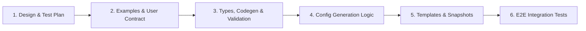

# Plan: Expand `JWTAuth` Policy to Include Claim Validation (#11174)

## Status: Draft

## Summary

**Goal:** Expand the `JWTAuth` policy (`spec.jwt`) in NGINX Ingress Controller (NIC) to support declarative JWT claim validation (`spec.jwt.authorization`), following the same API design and NGINX Plus directive semantics as [NGINX Gateway Fabric (NGF) JWT Claim Validation](https://docs.nginx.com/nginx-gateway-fabric/traffic-security/jwt-claim-validation/#understanding-the-configuration), while using `.` as the nested claim delimiter (e.g., `user_details.level`) to stay consistent with NIC's existing tiered rate limiting feature (`spec.rateLimit.condition.jwt.claim` in `JWTCondition`).

**References:**
- Issue: [#11174](https://github.com/nginx/kubernetes-ingress/issues/11174) (parent: [#6829](https://github.com/nginx/kubernetes-ingress/issues/6829))
- NGF Documentation: [JWT Claim Validation](https://docs.nginx.com/nginx-gateway-fabric/traffic-security/jwt-claim-validation/#understanding-the-configuration)
- NGINX Plus Documentation: [`ngx_http_auth_jwt_module`](https://nginx.org/en/docs/http/ngx_http_auth_jwt_module.html)

---

## API Design

Extend `JWTAuth` (`spec.jwt`) in `pkg/apis/configuration/v1/types.go` with an optional `authorization` field:

```yaml
apiVersion: k8s.nginx.org/v1
kind: Policy
metadata:
  name: jwt-policy
spec:
  jwt:
    realm: MyProductAPI
    secret: jwk-secret # or jwksURI
    token: $http_token
    authorization:
      require: All # Optional: "Any" | "All" (default: "Any") — how rules are combined
      rules:
        - require: All # Optional: "Any" | "All" (default: "Any") — how claims in this rule are combined
          claims:
            - name: aud
              match: Exact # Optional: "Exact" | "Regex" (default: "Exact")
              values:
                - https://api.example.com
                - https://admin.example.com
            - name: scope
              match: Regex
              values:
                - "^(read|write):users$"
              proxySetHeader: X-Token-Scope # Optional: forward matched claim to upstream
        - require: Any
          claims:
            - name: user_details.level # Nested claims separated by '.'
              match: Exact
              values:
                - Premium
                - Enterprise
```

### Field Specification

| Field | Type | Required | Default | Validation / Constraints | Description |
|---|---|---|---|---|---|
| `jwt.authorization` | `*JWTAuthorization` | No | — | — | Defines claim-based authorization rules for validated JWT tokens. |
| `authorization.require` | `*JWTRequireType` (`string`) | No | `"Any"` | Enum: `Any`, `All` | Controls whether **any** rule (`Any`) or **all** rules (`All`) in `rules` must pass. |
| `authorization.rules` | `[]JWTAuthorizationRule` | Yes | — | `MinItems: 1`, `MaxItems: 16` | List of authorization rules evaluated against JWT claims. |
| `rules[].require` | `*JWTRequireType` (`string`) | No | `"Any"` | Enum: `Any`, `All` | Controls whether **any** claim (`Any`) or **all** claims (`All`) in this rule must match. |
| `rules[].claims` | `[]JWTClaim` | Yes | — | `MinItems: 1`, `MaxItems: 32` | List of JWT claims to validate within the rule. |
| `claims[].name` | `string` | Yes | — | Length `1..253`, pattern `^[a-zA-Z0-9_.-]+$`, non-empty `.`-separated segments | Name of the JWT claim. Supports nested claims using `.` as a delimiter (e.g., `user_details.level`, `realm_access.roles`) and array claims. |
| `claims[].match` | `*JWTClaimMatchType` (`string`) | No | `"Exact"` | Enum: `Exact`, `Regex` | Matching strategy for `values`: exact string match (`Exact`) or regular expression match (`Regex`). |
| `claims[].values` | `[]string` | Yes | — | `MinItems: 1`, `MaxItems: 64`, valid NGINX map string / regex | Expected claim values. A claim check succeeds if the token's claim matches **any** value in this list. |
| `claims[].proxySetHeader` | `string` | No | — | Length `1..253`, pattern `^[-A-Za-z0-9]+$` | Optional HTTP header name used to forward the extracted claim value to the upstream service via `proxy_set_header`. |

---

## NGINX Plus Configuration Design

Using NGINX Plus `ngx_http_auth_jwt_module` and `ngx_http_map_module`:

1. **Claim Extraction (`http` context)**:
   - Extract each referenced claim via `auth_jwt_claim_set $<claim_var> <claim_path...>;` (splitting nested paths on `.`, e.g., `user_details.level` renders `auth_jwt_claim_set $<claim_var> user_details level;`). This handles top-level claims, nested claims, and array-valued claims.
   - Reuse `generateAuthJwtClaimSetVariable` and `generateAuthJwtClaimSetClaim` in `internal/configs/policy.go` so claims shared between `JWTAuth` and `RateLimit` policies on the same parent are deduplicated by `removeDuplicateAuthJWTClaimSets`.
2. **Claim & Rule Evaluation (`http` context)**:
   - **Claim Map**: Compare `$<claim_var>` against `values` (`"<value>" 1;` for `Exact`, `~"<pattern>" 1;` for `Regex`, `default 0;`).
   - **Rule Map**: Combine claim map variables for each rule (`"~^1+$" 1;` when `rules[].require: All`; `"~1" 1;` when `rules[].require: Any`; `default 0;`).
   - **Top-Level Policy Map**: When multiple rules are configured, combine rule map variables (`"~^1+$" 1;` when `authorization.require: All`; `"~1" 1;` when `authorization.require: Any`; `default 0;`). When only a single rule is configured, the rule map variable can be referenced directly by `auth_jwt_require`.
3. **Authorization Enforcement (`server` or `location` context)**:
   - Render `auth_jwt_require $<require_var>;` alongside `auth_jwt`. Requests that fail claim validation are rejected with `401 Unauthorized`.
4. **Claim Header Forwarding (`location` context)**:
   - When `proxySetHeader` is set on a claim, render `proxy_set_header <proxySetHeader> $<claim_var>;` (or `grpc_set_header` for gRPC upstreams) inside proxied `location` blocks.
   - Because every proxied `location` block in `internal/configs/version2/nginx-plus.virtualserver.tmpl` emits `proxy_set_header` directives (which override any `server`-level `proxy_set_header` in NGINX), `proxySetHeader` directives must be emitted at the `location` level for both route-level `JWTAuth` policies and inherited server-level `JWTAuth` policies.

---

## Implementation Phases

### Phase 1: Examples & User Contract

1. **Create / Update Example Manifests**:
   - Add concrete user-facing example manifests and walkthrough in `examples/custom-resources/jwt/` (or `examples/custom-resources/jwt-claim-validation/`) demonstrating `spec.jwt.authorization` (`require`, `rules`, `claims`, nested `.` claims, `match`, `values`, and `proxySetHeader`) before implementation begins.

### Phase 2: CRD Type Definitions, Code Generation & Validation

1. **Update `pkg/apis/configuration/v1/types.go`**:
   - Add `Authorization *JWTAuthorization` (`json:"authorization,omitempty"`) to `JWTAuth`.
   - Define `JWTRequireType` (`JWTRequireAny = "Any"`, `JWTRequireAll = "All"`), `JWTClaimMatchType` (`JWTClaimMatchExact = "Exact"`, `JWTClaimMatchRegex = "Regex"`), `JWTAuthorization`, `JWTAuthorizationRule`, and `JWTClaim` with Kubebuilder validation markers.
2. **Regenerate Code & Manifests**:
   - Run `make update-codegen` to regenerate `pkg/apis/configuration/v1/zz_generated.deepcopy.go` and `pkg/client/**`.
   - Run `make update-crds` to regenerate `config/crd/bases/k8s.nginx.org_policies.yaml`, `deploy/crds*.yaml`, and `docs/crd/`.
3. **Update `pkg/apis/configuration/validation/policy.go` & `policy_test.go`**:
   - Extend `validateJWTPolicy` to call `validateJWTAuthorization(jwt.Authorization, fieldPath.Child("authorization"))` when `jwt.Authorization != nil`.
   - Validate `authorization.require` (`Any` or `All`) and `authorization.rules` (`1..16` items).
   - For each rule, validate `rule.require` (`Any` or `All`), `rule.claims` (`1..32` items), and check for duplicate claim names within the rule.
   - For each claim:
     - Validate `claim.name`: length `1..253`, matches `^[a-zA-Z0-9_.-]+$`, and each `.`-separated segment passes `validation2.ValidateDirectiveToken(segment)` (matching `validateRateLimitJWTCondition`).
     - Validate `claim.match`: `Exact` or `Regex`.
     - Validate `claim.values`: `1..64` items, non-empty, passes `containsDangerousChars` / `ValidateEscapedString`, and compiles with `regexp.Compile` when `match: Regex`.
     - Validate `claim.proxySetHeader`: optional, length `1..253`, matches `^[-A-Za-z0-9]+$`.
   - Add table-driven unit tests in `pkg/apis/configuration/validation/policy_test.go`.

### Phase 3: NGINX Plus Configuration Generation

1. **Update Template Structs in `internal/configs/version2/http.go`**:
   - Extend `JWTAuth` with `RequireVariable string` and `ProxySetHeaders []Header`.
2. **Update Policy Config Generation in `internal/configs/policy.go`**:
   - Extend `jwtAuthCfg` and `generateJWTConfig` to produce `[]version2.AuthJWTClaimSet` and `[]version2.Map` alongside `RequireVariable` and `ProxySetHeaders`.
   - Reuse `generateAuthJwtClaimSetVariable` and `generateAuthJwtClaimSetClaim` for `.`-delimited claim extraction.
3. **Wire Config in `internal/configs/virtualserver.go`**:
   - Append `JWTAuth` claim sets and maps to `authJWTClaimSets` and `maps` for both spec-level (`policiesCfg`) and route/subroute-level (`routePoliciesCfg`) policies.
   - Add unit tests in `internal/configs/policy_test.go` and `internal/configs/virtualserver_test.go`.

### Phase 4: Template Rendering & Snapshots

1. **Update `internal/configs/version2/nginx-plus.virtualserver.tmpl`**:
   - Render `auth_jwt_require {{ .RequireVariable }};` in `server` and `location` blocks when `.RequireVariable` is set.
   - Render `{{ $proxyOrGRPC }}_set_header {{ $h.Name }} {{ $h.Value }};` in proxied `location` blocks from `$l.JWTAuth.ProxySetHeaders` (or `$s.JWTAuth.ProxySetHeaders` when inherited from the server block).
2. **Update Snapshot Tests**:
   - Add template test cases in `internal/configs/version2/http_test.go` and `internal/configs/virtualserver_test.go`.
   - Run `make test-update-snaps` and `make test` to verify golden snapshot diffs.

### Phase 5: End-to-End Integration Tests

1. **Python Integration Tests**:
   - Extend `tests/suite/test_jwt_policies.py` and `tests/suite/test_jwt_policies_vsr.py` (with test manifests in `tests/data/jwt-policy/policies/`) to verify runtime behavior across `Any`/`All` rules, `Exact`/`Regex` claim matching, nested `.` claims, `proxySetHeader` forwarding, and `401` rejection on invalid claims.

---

## PR / Commit Stack Structure

To keep reviews focused and incremental, the change can be structured as a 6-part commit / PR stack:



| Order | Scope | Purpose for Reviewers | Files Included |
| :---: | --- | --- | --- |
| **1** | **Design & Test Plan** | Align on API schema (`jwt.authorization`), nested `.` claim delimiter semantics, NGINX Plus directive mapping (`auth_jwt_claim_set`, `map`, `auth_jwt_require`, `proxy_set_header`), and verification plan before reviewing code. | • [`docs/developer/jwt-claim-validation-plan.md`](jwt-claim-validation-plan.md)<br>• [`docs/developer/README.md`](README.md) |
| **2** | **Examples & User Contract** | Demonstrate the end-user UX (`Policy` CRD with `spec.jwt.authorization` + `VirtualServer` + JWK `Secret`) concretely before implementation begins. | • [`examples/custom-resources/jwt/README.md`](../../examples/custom-resources/jwt/README.md)<br>• [`examples/custom-resources/jwt/jwt.yaml`](../../examples/custom-resources/jwt/jwt.yaml)<br>• [`examples/custom-resources/jwt/virtual-server.yaml`](../../examples/custom-resources/jwt/virtual-server.yaml)<br>• [`examples/custom-resources/jwt/webapp.yaml`](../../examples/custom-resources/jwt/webapp.yaml) |
| **3** | **Types, Codegen & Validation** | Review CRD API types (`JWTAuthorization`, `JWTAuthorizationRule`, `JWTClaim`), internal template structs (`version2.JWTAuth`), regenerated CRD manifests/docs, and policy validation rules + unit tests. | • [`pkg/apis/configuration/v1/types.go`](../../pkg/apis/configuration/v1/types.go)<br>• [`pkg/apis/configuration/v1/zz_generated.deepcopy.go`](../../pkg/apis/configuration/v1/zz_generated.deepcopy.go)<br>• [`config/crd/bases/k8s.nginx.org_policies.yaml`](../../config/crd/bases/k8s.nginx.org_policies.yaml)<br>• [`deploy/crds.yaml`](../../deploy/crds.yaml) & [`deploy/crds-nap-dos.yaml`](../../deploy/crds-nap-dos.yaml)<br>• [`docs/crd/k8s.nginx.org_policies.md`](../crd/k8s.nginx.org_policies.md)<br>• [`pkg/apis/configuration/validation/policy.go`](../../pkg/apis/configuration/validation/policy.go)<br>• [`pkg/apis/configuration/validation/policy_test.go`](../../pkg/apis/configuration/validation/policy_test.go)<br>• [`internal/configs/version2/http.go`](../../internal/configs/version2/http.go) |
| **4** | **Config Generation Logic** | Review `auth_jwt_claim_set` extraction, claim/rule/policy `map` chain generation, `proxySetHeader` propagation to VirtualServer/VirtualServerRoute locations, and unit tests. | • [`internal/configs/policy.go`](../../internal/configs/policy.go)<br>• [`internal/configs/policy_test.go`](../../internal/configs/policy_test.go)<br>• [`internal/configs/virtualserver.go`](../../internal/configs/virtualserver.go)<br>• [`internal/configs/virtualserver_test.go`](../../internal/configs/virtualserver_test.go) |
| **5** | **Template Rendering & Snapshots** | Review NGINX Plus VirtualServer template changes (`auth_jwt_require` in `server`/`location` blocks and `proxy_set_header` / `grpc_set_header` for forwarded claims) and golden snapshot output. | • [`internal/configs/version2/nginx-plus.virtualserver.tmpl`](../../internal/configs/version2/nginx-plus.virtualserver.tmpl)<br>• [`internal/configs/version2/http_test.go`](../../internal/configs/version2/http_test.go)<br>• [`internal/configs/version2/__snapshots__/http_test.snap`](../../internal/configs/version2/__snapshots__/http_test.snap)<br>• [`internal/configs/__snapshots__/virtualserver_test.snap`](../../internal/configs/__snapshots__/virtualserver_test.snap) |
| **6** | **End-to-End Tests** | Verify full runtime behavior in pytest across `Any`/`All` rules, `Exact`/`Regex` claim matching, nested `.` claims, `proxySetHeader` forwarding, and `401` rejection on invalid claims. | • [`tests/suite/test_jwt_policies.py`](../../tests/suite/test_jwt_policies.py)<br>• [`tests/suite/test_jwt_policies_vsr.py`](../../tests/suite/test_jwt_policies_vsr.py)<br>• [`tests/data/jwt-policy/policies/`](../../tests/data/jwt-policy/policies/) |
