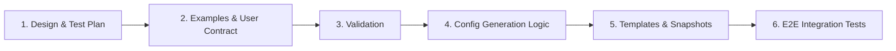

# Plan: Route VirtualServer & VirtualServerRoute Matches on Validated JWT Claims (#11175)

## Status: Draft (revision 2)

Revision 2 aligns this plan with the [#11174 plan (revision 2)](https://github.com/nginx/kubernetes-ingress/blob/feat/jwt-policy-claims/docs/developer/jwt-claim-validation-plan.md) ([PR #11187](https://github.com/nginx/kubernetes-ingress/pull/11187)) and with the security requirements of [#6829](https://github.com/nginx/kubernetes-ingress/issues/6829). Revision 1 routed in the REWRITE phase, on claims that had not been validated yet.

## Summary

**Goal:** Let `VirtualServer` (VS) and `VirtualServerRoute` (VSR) match conditions route on JWT claims and JOSE headers with NGINX Plus, using only claims from a token that has already passed `auth_jwt` (authentication) and `auth_jwt_require` (authorization, #11174).

| Decision | Reason |
|---|---|
| **Validate, then route.** When a route's match conditions reference `$jwt_*`, its entry location authenticates and authorizes the request, then routes in the PRECONTENT phase with `try_files` instead of `rewrite ... last`. | #6829: *"claims are never trusted before JWT validation succeeds"*; *"routing based on unvalidated JWT data"* is out of scope. |
| **The entry location enforces the route's policies**, the same set its target locations enforce. | Once the entry location runs the ACCESS phase, policies inherited from `server` would otherwise apply there instead of the route's own. |
| **Fail closed.** `$jwt_*` conditions on a route without an effective `JWTAuth` policy, or with OIDC, return `500` with a Warning. | Claim variables are decoded without `auth_jwt` (see [Why validate first](#why-validate-first)), so nothing would ever validate the token. |
| **A missing claim never matches**, unless the condition value is `""`. | Same invariant as #11174: negated values and regexes never pass on a missing claim. |
| **`$jwt_custom_<path>`** for nested claims, validated by the shared `validateJWTClaimPath`. | Same claim-path syntax and variables as #11174 `claims[].name` and `RateLimit` `condition.jwt.claim`. |
| **Values keep VS condition semantics** (case-insensitive, `!` negation, `~` regex), with documented regexes for case-sensitive and array matching. | Consistent with header, cookie and argument conditions. Authorization (#11174) is the strict check. |
| **`$jwt_payload` is not supported.** | NIC only validates signed tokens (it never renders `auth_jwt_type`), so the variable is always empty. Allowed in `responseHeaders.add`, it would return decrypted payloads to clients. |

**Dependency:** #11174 owns the shared pieces: `validateJWTClaimPath`, claim-variable collision detection, and the `jwtAuth` template define. Whichever PR lands first adds them; the other reuses them. #11174's routing criteria depend on R1–R3 of this plan.

**References:**

- Issue: [#11175](https://github.com/nginx/kubernetes-ingress/issues/11175) (parent: [#6829](https://github.com/nginx/kubernetes-ingress/issues/6829), companion: [#11174](https://github.com/nginx/kubernetes-ingress/issues/11174), plan on branch `feat/jwt-policy-claims`, [PR #11187](https://github.com/nginx/kubernetes-ingress/pull/11187))
- User requests: [discussion #4417](https://github.com/nginx/kubernetes-ingress/discussions/4417) (claims-based validation and routing), [discussion #10371](https://github.com/nginx/kubernetes-ingress/discussions/10371) (JWT validation before per-user rate limiting)
- NIC: [VirtualServer and VirtualServerRoute `Condition`](https://docs.nginx.com/nginx-ingress-controller/configuration/virtualserver-and-virtualserverroute-resources/#condition)
- NGINX: [`ngx_http_auth_jwt_module`](https://nginx.org/en/docs/http/ngx_http_auth_jwt_module.html), [`map`](https://nginx.org/en/docs/http/ngx_http_map_module.html), [`try_files`](https://nginx.org/en/docs/http/ngx_http_core_module.html#try_files), [`limit_req`](https://nginx.org/en/docs/http/ngx_http_limit_req_module.html#limit_req), [HTTP phases](https://nginx.org/en/docs/dev/development_guide.html#http_phases)
- NGINX source checked for R6–R8: [`ngx_http_try_files_module.c`](https://github.com/nginx/nginx/blob/master/src/http/modules/ngx_http_try_files_module.c) (`ENOTDIR` is skipped; the fallback goes through `ngx_http_split_args`), [`ngx_http_parse.c`](https://github.com/nginx/nginx/blob/master/src/http/ngx_http_parse.c) (`ngx_http_split_args`), [`ngx_http_limit_req_module.c`](https://github.com/nginx/nginx/blob/master/src/http/modules/ngx_http_limit_req_module.c) (`r->main->limit_req_status`)

---

## Why validate first

Today a route with `matches` is served by two kinds of location:

- an **entry location** (`InternalRedirectLocation`): `location /coffee { rewrite ^ $vs_default_cafe_matches_0 last; }`;
- **target locations** (`location ~ ^/internal_location_matches_0_match_0$ { internal; ... }`), which carry the route's policies.

`rewrite` runs in the REWRITE phase, so the match map is evaluated before any ACCESS-phase check, and the entry location never reaches ACCESS:

```text
SERVER_REWRITE → FIND_CONFIG → REWRITE → POST_REWRITE → PREACCESS → ACCESS → POST_ACCESS → PRECONTENT → CONTENT
                               rewrite                  limit_req    auth_jwt               try_files
```

NGINX Plus decodes claim variables without validating the token. NIC's tiered rate-limit e2e tests apply different limits by `user_details.level` on a VirtualServer without any JWT policy, using tokens signed with an arbitrary key (`tests/suite/test_rl_policies.py`). `examples/custom-resources/rate-limit-tiered-jwt-claim/README.md` states that the token is not validated. Routing on `$jwt_*` in the REWRITE phase therefore uses unverified claims.

Every target runs ACCESS before it responds (`return` and `redirect` targets proxy to `nginx418Server`), so revision 1 would not have leaked a response. But it would:

- break #6829's routing criteria;
- route with no validation at all when no JWT policy applies to the route;
- route on a different token than the one validated when the token sources differ, for example on OIDC routes (`auth_jwt "" token=$session_jwt` exists only in the targets);
- let forged tokens increment `limit_req` counters ([discussion #10371](https://github.com/nginx/kubernetes-ingress/discussions/10371)).

---

## API Design

No new CRD fields. With NGINX Plus, `routes[].matches[].conditions[].variable` (VS) and `subroutes[].matches[].conditions[].variable` (VSR) also accept:

| Variable | Validation of `<…>` | Evaluated from | Notes |
|---|---|---|---|
| `$jwt_claim_<name>` | `[a-zA-Z0-9_]+` (`validateSpecialVariable`) | NGINX Plus built-in variable | Top-level claims. NGINX cannot evaluate nested claims or names containing `.` with this variable. |
| `$jwt_custom_<path>` | `validateJWTClaimPath`: `.`-separated segments, each non-empty `[a-zA-Z0-9_-]+`, a single NGINX token, no `$` | `auth_jwt_claim_set` variable, shared with `RateLimit` and #11174 | Nested claims (`user_details.level`) and arrays (elements joined with `,`). NIC syntax, not an NGINX variable: only valid in `condition.variable`. |
| `$jwt_header_<name>` | `[a-zA-Z0-9_]+` (`validateSpecialVariable`) | NGINX Plus built-in variable | JOSE header, for example `kid`. |

- NGINX OSS: all three are rejected with `field.Forbidden(..., "is only supported in NGINX Plus")`.
- `$jwt_payload` stays rejected everywhere.
- Unchanged: `action.proxy.requestHeaders` and `responseHeaders.add` already accept `${jwt_claim_*}` and `${jwt_header_*}` (`actionProxyHeaderSpecialVariables`). `return.body` accepts no JWT variables.
- Condition values keep the existing guard, `ValidateEscapedString` (through `isValidMatchValue`): every `"` must be escaped and the value cannot end with `\`, so it cannot leave its quoted `map` key. NGINX does not interpolate `map` keys, so `$`, `{`, `}` and `;` inside them are literal. `ContainsDangerousChars` (`pkg/apis/configuration/validation/policy.go`) is deliberately not applied: it would reject the `$` anchors in the regexes below (the same issue Copilot raised on PR #11187).
- The `$jwt_custom_` claim path is rendered unquoted in `auth_jwt_claim_set`. `validateJWTClaimPath` only allows `[a-zA-Z0-9_-]` in each segment, so it cannot inject directives.

### Example

```yaml
apiVersion: k8s.nginx.org/v1
kind: Policy
metadata:
  name: cafe-jwt
spec:
  jwt:
    realm: cafe
    secret: jwk-secret
    token: $http_token
    authorization:                     # #11174
      rules:
        - claims:
            - name: aud
              match: Contains
              values: [cafe-api]
---
apiVersion: k8s.nginx.org/v1
kind: VirtualServer
metadata:
  name: cafe
spec:
  host: cafe.example.com
  upstreams:
    - name: staff
      service: staff-svc
      port: 80
    - name: premium
      service: premium-svc
      port: 80
    - name: regular
      service: regular-svc
      port: 80
  routes:
    - path: /coffee
      policies:
        - name: cafe-jwt
      matches:
        - conditions:                  # array claim contains "barista"
            - variable: $jwt_custom_realm_access.roles
              value: "~(^|[ ,])barista([ ,]|$)"
          action:
            pass: staff
        - conditions:                  # nested claim, case-sensitive
            - variable: $jwt_custom_user_details.level
              value: "~^Premium$"
          action:
            proxy:
              upstream: premium
              requestHeaders:
                set:
                  - name: X-Client
                    value: ${jwt_claim_sub}
      action:
        pass: regular
```

| Token | Result | Why |
|---|---|---|
| valid; `aud: [cafe-api]`; `realm_access.roles: ["staff","barista"]` | `staff` | First match |
| valid; `aud: [cafe-api]`; `user_details.level: Premium` | `premium` | Second match |
| valid; `aud: [cafe-api]`; `user_details.level: premium` | `regular` | `~^Premium$` is case-sensitive |
| valid; `aud: [cafe-api]`; no `user_details` | `regular` | A missing claim never matches (R9) |
| valid; `aud: [other]` | `403` from the entry location | #11174 authorization fails before routing |
| expired, badly signed, or no token | `401` from the entry location | `auth_jwt` fails before routing |
| badly signed; `user_details.level: Premium` | `401` from the entry location | Claims of an invalid token are never evaluated |

### Matching semantics

Routing conditions keep the semantics of every other VS condition. Authorization (#11174) is stricter. Both are documented side by side:

| | Routing condition (#11175) | Authorization (#11174) |
|---|---|---|
| Purpose | Choose a target | Accept or reject the request |
| Case | Case-insensitive (quoted `map` string, `generateValueForMatchesRouteMap`); use `~^value$` for case-sensitive | Case-sensitive |
| Negation | `!value` | `negate: true` |
| Array or space-delimited claim | No `Contains`; use `~(^\|[ ,])value([ ,]\|$)`, the pattern `Contains` generates | `Contains` |
| Missing or empty claim | Matches only `value: ""`; negated values and regexes never match (R9) | Value checks fail; `Present` with `negate: true` matches |
| Regex | `~` (case-sensitive) or `~*` (case-insensitive) | `match: Regex` (case-sensitive) |

Recipes:

| Intent | `value` |
|---|---|
| Equals `Premium`, case-sensitive | `~^Premium$` |
| Array or space-delimited claim contains `barista` | `~(^\|[ ,])barista([ ,]\|$)` |
| Claim present and non-empty | `!` |
| Claim missing or empty | `""` |
| Claim present and not `guest` | `!guest` (R9 makes a missing claim fail) |

Notes:

- **Routing is not an access boundary between the targets of one route.** Policies, including #11174 `authorization`, apply to the whole route. To restrict an upstream to certain claims, give it its own route with its own `authorization`.
- Anchor regexes: `~admin` also matches `superadmin`.
- Don't route on claims that users can edit at the IdP, such as `email`, `name` or `preferred_username`.
- Prefer `$jwt_custom_<name>` for array claims: `auth_jwt_claim_set` documents comma-joined arrays, while the `$jwt_claim_<name>` format for arrays is unverified (V8).

---

## NGINX Plus Configuration Design

### 1. Claim extraction (`http` context)

- `$jwt_custom_<path>` becomes `auth_jwt_claim_set $<claim_var> <segment> ...;` through `generateAuthJwtClaimSetVariable` / `generateAuthJwtClaimSetClaim` (`internal/configs/policy.go`), with the parent VS `policyOwnerDetails` (`parentType: "vs"`; VSR subroutes also use the parent VS). The variable is therefore shared with `RateLimit` and #11174 for the same claim.
- Claim sets are collected in `routingCfg.AuthJWTClaimSets` and appended to `authJWTClaimSets` at both match call sites in `GenerateVirtualServerConfig`.
- `removeDuplicateAuthJWTClaimSets` deduplicates them. #11174's collision check (same variable, different claim path, for example `$jwt_custom_a.b` and a Policy claim `a_b`) covers all three features (R10).
- `$jwt_claim_*` and `$jwt_header_*` are used directly as map sources (`getNameForSourceForMatchesRouteMapFromCondition`).
- **Dotted resource names (prerequisite fix, R11).** `NewVSVariableNamer` and `generateAuthJwtClaimSetVariable` only replace `-` with `_`. A VS named `cafe.v1` yields `$vs_default_cafe.v1_matches_0` and `$jwt_default_cafe.v1_vs_sub`. NGINX ends a variable name at `.` (`ngx_http_script_compile`), so the reload fails. Today this already breaks every `matches` and `splits` route and every RateLimit JWT condition on such a VS. Fix it once, in both helpers. When the namespace/name contains `.`, replace `.` with `_` and append `_<first 8 hex chars of sha256("<ns>/<name>")>`. Names without `.` keep their current form, so existing snapshots don't change. The hash keeps `cafe.v1` distinct from `cafe-v1`. The existing `-`/separator ambiguity (ns `a-b`/name `c` vs ns `a`/name `b-c`) is pre-existing and out of scope.

### 2. Condition maps (`http` context)

The existing map chain is unchanged. Each condition map's matching key yields the next condition's variable, and the last condition yields `1`. The route's main map selects the target from the first condition variable of each match (`~^1`, `~^01`, …). R9 adds an empty-string key to `$jwt_*` condition maps. For the example:

```nginx
auth_jwt_claim_set $jwt_default_cafe_vs_realm_access_roles realm_access roles;
auth_jwt_claim_set $jwt_default_cafe_vs_user_details_level user_details level;

map $jwt_default_cafe_vs_realm_access_roles $vs_default_cafe_matches_0_match_0_cond_0 {
    ""                           0;    # R9: a missing claim never matches
    "~(^|[ ,])barista([ ,]|$)"   1;
    default                      0;
}

map $jwt_default_cafe_vs_user_details_level $vs_default_cafe_matches_0_match_1_cond_0 {
    ""             0;
    "~^Premium$"   1;
    default        0;
}

map $vs_default_cafe_matches_0_match_0_cond_0$vs_default_cafe_matches_0_match_1_cond_0 $vs_default_cafe_matches_0 {
    ~^1      /internal_location_matches_0_match_0;
    ~^01     /internal_location_matches_0_match_1;
    default  /internal_location_matches_0_default;
}
```

`map` checks exact string keys before regexes, so `""` always wins for a missing claim.

### 3. Entry location (`server` context)

For a route whose match conditions reference `$jwt_*`:

```nginx
location /coffee {
    # route policies, rendered by the same template defines as the target locations (R2)
    auth_jwt "cafe" token=$http_token;                                      # jwtAuth define (#11174)
    auth_jwt_key_file /etc/nginx/secrets/<jwk>;
    auth_jwt_require $jwt_authz_default_cafe_vs_default_cafe_jwt error=403;
    # route errorPages (R4)
    client_max_body_size 0;
    root /dev/null;                                                         # R6
    try_files /nic-route $vs_default_cafe_matches_0$is_args$args;           # R1, R7
}
```

`try_files` runs in PRECONTENT, after the ACCESS phase. Its last parameter is an internal redirect to a URI that may contain variables, so the match map is reused unchanged.

| Step | `rewrite ... last` (today; still used by all other routes) | Validate-then-route |
|---|---|---|
| Route policies, including `auth_jwt` and `auth_jwt_require` | Target location, ACCESS | **Entry location, ACCESS**; again in the target (R5) |
| Match map evaluated, target chosen | Entry location, REWRITE: **unverified** claims | Entry location, PRECONTENT: **verified** claims |
| Route `limit_req` | Target location, PREACCESS: before `auth_jwt` | Target location, after the entry validated the token, unless spec-level limits also exist (R8) |
| CORS preflight (`OPTIONS`) | Target location, REWRITE (`204`) | Entry location, REWRITE (`204`) |

#### Requirements

R1–R6 keep the numbering of #11174's [Required: validate-then-route](https://github.com/nginx/kubernetes-ingress/blob/feat/jwt-policy-claims/docs/developer/jwt-claim-validation-plan.md#required-validate-then-route). The last column lists what #11174 needs to pick up (see [Requested changes to the #11174 plan](#requested-changes-to-the-11174-plan)).

| # | Requirement | Change vs #11174 revision 2 |
|---|---|---|
| R1 | Use `try_files` instead of `rewrite ... last` only when a route's match conditions reference `$jwt_*` (including matches that use `splits`). All other `matches` routes and every `splits` route keep `rewrite`, so existing configs and snapshots don't change. Flag: `InternalRedirectLocation.ValidateBeforeRouting`. | — |
| R2 | The entry location enforces the same route-scoped policies as the target locations. See [Entry location contents](#entry-location-contents). | Was: JWT block only. |
| R3 | Fail closed: when a route's conditions reference `$jwt_*` and its effective JWT validation is not a `JWTAuth` policy, set the route's error return to `500` (entry and targets) and emit a Warning. Triggers: no `JWTAuth` at spec, route, subroute or inherited VS-route level; `oidc` or native OIDC in effect for the route. | Was: "resource invalid". `GenerateVirtualServerConfig` has no reject path (it returns config and warnings). `PoliciesErrorReturn` is NIC's existing fail-closed mechanism for invalid policies, and it keeps the rest of the host serving. |
| R4 | The entry location renders all of the route's `errorPages`, plus the gRPC status mapping when every target is gRPC. | Was: `401` and `errorCode` only. The entry can also return `500` (key retrieval) and the rate-limit reject code. |
| R5 | Target locations keep their policies (defence in depth). Config generation warns when a `jwksURI` policy without `keyCache` is used on such a route. | Clarified: `/_jwks_uri_server_*` has no `proxy_cache`, so without `keyCache` every validation fetches the JWKS and the second check doubles IdP requests. External auth and API key subrequests also run twice. |
| R6 | `root /dev/null;` makes the probe `/dev/null/nic-route` fail with `ENOTDIR`, which `try_files` skips without logging. Cost: one `stat` per request. | — |
| R7 | The `try_files` fallback is `$vs_..._matches_N$is_args$args`. | New. `try_files` replaces the request arguments with those of the fallback URI (`ngx_http_split_args`), while `rewrite` keeps them. Plain targets proxy `$request_uri` and are unaffected, but `rewritePath` targets (`rewrite ^ $request_uri_no_args`) and `${args}` / `${arg_*}` in headers or return bodies would lose the query string. |
| R8 | When the route has its own rate limits and spec-level limits also exist, render the route's `limit_req` (and its options) in the entry location. Otherwise don't: route limits stay in the targets, and spec-level limits are inherited by both. | New. `limit_req` runs at most once per request (`r->main->limit_req_status`) and is inherited only by levels that define none. A spec-level limit inherited by the entry would run there, and the target's route limit would be skipped: fail open if the route limit is stricter. |
| R9 | For `$jwt_*` conditions, emit `"" 0;` before the value key, unless the un-negated value is `""` (which would duplicate the key). | New. #11174's missing-claim invariant. |
| R10 | `$jwt_custom_` claim sets go through #11174's collision check in `removeDuplicateAuthJWTClaimSets`. On a collision, the affected routes fail closed as in R3. | New; shared mechanism. |
| R11 | Variable names generated from a VS namespace/name are valid NGINX variable names when the name contains `.` (see [Claim extraction](#1-claim-extraction-http-context)). | New; pre-existing bug in the shared namers, also affects #11174. |

#### Entry location contents

The entry location carries everything route-scoped that runs before a target's proxy or content handler, from the same `routePoliciesCfg` as the targets, so route-over-spec precedence is identical:

| Rendered in the entry location | Why |
|---|---|
| `PoliciesErrorReturn` (invalid policy, R3, R10) | Fail before any other processing. |
| `allow` / `deny`, `auth_basic`, external auth (`auth_request` and its sign-in `error_page`), API key (`set` and `auth_request`), JWT (`jwtAuth` define, including `auth_jwt_require`) | The ACCESS phase now runs in the entry. A spec-level policy inherited there would otherwise replace the route's own: a route-level BasicAuth user would get `401` from the entry. |
| `limit_req` and its options, per R8 | `limit_req` runs once per request. |
| WAF, DoS | Inspection before validation. Double processing is checked in V5. |
| CORS preflight (`if ($request_method = 'OPTIONS') { … return 204; }`) and CORS headers | Without them, browser preflights (sent without a token) get `401` from the entry. Today the target answers them before any auth check. |
| HSTS, `add_header_inherit` | A CORS `add_header` in the entry stops inheritance of server-level `add_header` (same rule as `addHSTSToLocationsWithAddHeaders`). |
| Route `errorPages`; gRPC status mapping when every target is gRPC (R4) | Errors can now originate in the entry. |

| Not rendered in the entry location | Why |
|---|---|
| Action settings: proxy directives, action `responseHeaders`, rewrites, cache, EgressMTLS | No target has been chosen yet. |
| `location-snippets` | A snippet's `rewrite` or `return` could change routing. The targets still apply them. |

Implementation:

- **Template:** move the route-policy sections of the target `location` block into named defines, next to #11174's `jwtAuth`, and call them from both the target and the entry location. The target calls them in the current order, so existing snapshots don't change.
- **Define contract:** `{{ template "name" $l }}` passes only the location as `.`. Caller variables (`$`, `$s`) are not visible, and a field missing from the struct aborts rendering. That error fails the whole VirtualServer update. So each define reads only `.` fields that exist on both `Location` and `InternalRedirectLocation`. These stay in the caller, outside the defines:
  - the `ACMEChallenge` / `AuthRequestOff` guards (`auth_request off`, `auth_jwt off`, `auth_basic off`, `auth_oidc off`). The target wraps the define call as `{{ if <guard> }}… off;{{ else }}{{ template … $l }}{{ end }}`. The entry location calls the define directly: `AuthRequestOff` is only set on the OAuth2 helper location (`virtualserver.go`) and ACME challenge locations are separate, so both guards are always false for an entry location.
  - the server-level API key fallback (`{{ else }}{{ with $s.APIKey }}set $header_query_value …`), which both callers render after the API key define.
  - blocks the entry location doesn't render: OIDC (`$s.OIDC`, excluded by R3), EgressMTLS (`$.StaticSSLPath`), and `DisableWAF` (`$.AppProtectLoadModule`).
- **Go:** `InternalRedirectLocation` gets fields with the same names as on `Location`, so the defines work with both structs. A helper shared with `addPoliciesCfgToLocation` fills them, and a unit test checks that the entry and a target carry identical policy fields for the same `routePoliciesCfg`.

### 4. Target locations

Unchanged. They keep `routePoliciesCfg` through `addPoliciesCfgToLocations` (R5). They are `internal`, so they are only reachable through the entry location.

### 5. Fail-closed behaviour

| Situation | Response | Where |
|---|---|---|
| Missing, malformed, expired or badly signed token | `401` | Entry location, before routing |
| #11174 claim check fails | `errorCode` (default `403`) | Entry location, before routing |
| Keys can't be loaded (JWKS endpoint down, no cached keys) | `500` | Entry location, before routing |
| `$jwt_*` conditions without an effective `JWTAuth` policy, or with OIDC (R3) | `500` and a Warning | Entry and target locations |
| Invalid or missing policy reference | `500` (existing behaviour) | Entry and target locations |
| Claim-variable collision (R10) | `500` and a Warning | Affected routes |
| Missing claim | Default route; the token is valid | After validation |
| NGINX OSS | Rejected | Validation |

### 6. Routes without `$jwt_*` conditions

No change. The entry location stays `client_max_body_size 0; rewrite ^ … last;` and renders no policies, as in #11174 §4.

### Rejected alternatives

| Option | Why not |
|---|---|
| Revision 1: `rewrite ... last` with `auth_jwt` added to the entry location | `rewrite ... last` leaves the location before ACCESS, so the entry's `auth_jwt` never runs and claims stay unverified. |
| Entry location with the JWT block only, rejecting `$jwt_*` routes whose policies override spec-level ones | Smaller, but rejects valid configurations such as spec-level plus route-level rate limits. |
| `proxy_pass http://$upstream_from_claim` | Only switches the upstream. Match actions can be `return` or `redirect`, or carry different proxy settings. |
| Content-phase proxy to `nginx418Server` with `error_page 418 = $vs_..._matches_N;` (in-tree pattern) | Works, but adds a proxied hop per request. `try_files` costs one `stat`. |
| `auth_request` or `js_set` verifying the JWT | `auth_request` also runs in ACCESS, after `rewrite`. `js_set` reimplements `auth_jwt`. |
| Typed `Condition.jwtClaim` field | New CRD field. `$jwt_custom_<path>` keeps the issue's no-new-fields scope and #11174's claim syntax. |
| Case-sensitive or `Contains` semantics for JWT conditions only | Inconsistent with every other condition. Authorization (#11174) provides strict matching. |

---

## Scope and Gaps vs #6829

| #6829 requirement | Status |
|---|---|
| A validated claim can be used in a route match condition | Covered: conditions are evaluated in PRECONTENT, after `auth_jwt` and `auth_jwt_require` (R1, R2). |
| Different claim values route to different upstreams | Covered. |
| A request that matches no claim-based route follows the default route | Covered, including missing claims (R9). |
| Claims are never trusted before JWT validation succeeds | Covered for routing (R1–R3). Spec-level claim-keyed rate limits still count unvalidated tokens (R8): follow-up issue. |
| Claim-based routing works alongside header, cookie, argument and variable matching | Covered: conditions in a match are ANDed. Tested in Phase 5. |
| Authentication failures return `401` | Existing `auth_jwt` behaviour, now in the entry location. |
| Authorization failures return `403` or a configurable code | #11174 `errorCode`, now in the entry location. |
| JWT processing and key-retrieval failures fail closed | Covered: the entry location rejects before routing; guards R3 and R10. |
| Invalid configuration is rejected without replacing the last valid configuration | Partial: R3 and R10 fail closed per route and keep the rest of the host serving. Validation errors keep NIC's current behaviour (the configuration is removed). Epic-level item, shared with #11174. |
| Tokens and sensitive claim values are not exposed or logged by default | `$jwt_payload` is not added. NIC's default log format contains no claim variables; tokens passed as query arguments appear in `$request` (documented). |
| Only authenticated claims affect rate-limit counters | Partial: route-level limits on `$jwt_*` routes when no spec-level limits exist (R8). Everything else: follow-up issue (#11174 cross-plan action). |
| NGINX Plus only | Covered. |
| Nested and array claims | Nested: `$jwt_custom_<path>`. Arrays: documented regex. |
| Claim names containing `.`, `/` or `:` (for example Auth0 `https://example.com/roles`) | Documented limitation, shared with #11174. |
| OIDC claims | Out of scope; guarded by R3. |
| `kind: Ingress` | Not applicable: Ingress has no match conditions ([#10661](https://github.com/nginx/kubernetes-ingress/issues/10661)). |
| JWE tokens | Not applicable: NIC renders no `auth_jwt_type`. |

---

## Interaction with #11174

| Concern | Owner | Notes |
|---|---|---|
| Claim-path syntax and validation | Shared `validateJWTClaimPath` | `claims[].name` and `$jwt_custom_<path>` |
| `auth_jwt_claim_set` variables, deduplication and collision detection | `removeDuplicateAuthJWTClaimSets` | One variable per (parent VS, claim); R10 |
| JWT directive block | Shared `jwtAuth` define | Rendered at `server`, `location`, and the entry location of `$jwt_*` routes |
| Other route-policy blocks | Shared defines added by this plan (R2) | Rendered by the target `location` and the entry location |
| Order of validation and routing | This plan (R1–R11) | Required by #11174 for #6829's routing criteria |
| Upstream claim headers | Route `requestHeaders` win over `proxySetHeader` | #11174 §5 |
| Matching semantics | Both plans | Side-by-side table in [Matching semantics](#matching-semantics) |

### Requested changes to the #11174 plan

To keep the two plans consistent:

| #11174 section | Change |
|---|---|
| Required: validate-then-route, R1 example | Append `$is_args$args` to the `try_files` fallback (R7). |
| R2 | The entry location renders all route policies, not only the JWT block ([Entry location contents](#entry-location-contents)). |
| R3; §1 primary collision check; Phase 3 | Replace "resource invalid" / "reject the resource" with `PoliciesErrorReturn` `500` and a Warning on the affected scope. |
| R4 | All route `errorPages`, plus the gRPC status mapping. |
| R5 | "No extra JWKS fetches" only holds with `keyCache`. External auth and API key subrequests also run twice. |
| Scope table, rate-limit row; verification gate 6, #10371 bullet | Holds only when no spec-level `limit_req` exists. Add the spec-level plus route-level limit test (R8). |
| Verification gates | Add V1 (token source). Gate 6's JWE bullet is not applicable: NIC renders no `auth_jwt_type`. |
| Interaction with #11175: "authorization is always the stricter of the two, the difference cannot widen access" | Authorization applies per route, so it cannot restrict a single match target. |
| Side-by-side table | Arrays: the regex above. Missing claim: only `value: ""` matches. |
| Phase 3 tests; PR table | `internal/configs/virtualserver_test.go` does not exist: use `virtualserver_policy_test.go` and `virtualserver_config_test.go`. |
| Phase 5 | Test tokens are generated from `hack/secrets.json`; the outputs are gitignored. |
| PR stack | Merge as one unit. If step 3 (types and validation) lands alone, `authorization` is accepted but not enforced: fail open. |

---

## Verification gates

Confirm these against a running NGINX Plus in Phase 4, before the design is final:

1. **V1: Token source. Blocks both plans.** `$jwt_claim_*`, `$jwt_header_*` and `auth_jwt_claim_set` variables are read from the token selected by `auth_jwt … token=`. Send a valid token in the configured source (`token: $http_token`) and a forged token with different claims in `Authorization: Bearer`. Routing, and #11174's `auth_jwt_require`, must use the valid token.
2. **V2: `try_files`.** With `root /dev/null`, the probe falls through without a `crit` log and reaches prefix, exact and regex internal locations, including `internal` ones.
3. **V3: Query string.** Upstream URI, `$args` and `$arg_*` are identical to `rewrite ... last` for plain, `rewritePath` and gRPC targets.
4. **V4: Rate limits.** With spec-level and route-level limits, the route limit applies (R8). Without spec-level limits, requests rejected in the entry location are not counted by the target's limit.
5. **V5: WAF and DoS.** Check whether requests are inspected or logged twice across the internal redirect. Then decide whether the entry location keeps them (inspection before JWT parsing) or sets `app_protect_enable off` and `app_protect_dos_enable off` (one inspection in the target, as today).
6. **V6: CORS.** The entry location answers preflights with `204` without a token, and `401`/`403` responses from the entry carry the CORS headers.
7. **V7: Errors from the entry location.** Route `errorPages` apply to `401`, `403`/`errorCode`, `500` and the rate-limit reject code. gRPC clients receive gRPC statuses.
8. **V8: Arrays.** Compare `$jwt_claim_<name>` and `auth_jwt_claim_set` output for array and object claims. The docs recommend whichever is defined.

---

## Implementation Phases

### Phase 1: Examples & User Contract

- Add `examples/custom-resources/jwt-claim-routing/`: Policy (with #11174 `authorization`), VirtualServer, VirtualServerRoute with a subroute-level policy, JWK Secret, apps, and a README with the token outcome table.
- Use the documented regexes for array and case-sensitive matches.

### Phase 2: Validation

1. **`pkg/apis/configuration/validation/virtualserver.go`**
   - Pass `isPlus` to `validateCondition` and `validateVariableName` (`validateMatch` already has `vsv.isPlus`).
   - `validateVariableName`: names in `validVariableNames` are unchanged. Otherwise strip `$` and:
     - `jwt_claim_` / `jwt_header_`: `validateSpecialVariable` (Plus check, `[a-zA-Z0-9_]+`);
     - `jwt_custom_`: Plus check, then `validateJWTClaimPath` on the remainder. Handle it here only: it is not an NGINX variable, so `validateSpecialVariable`, which other variable lists share, must not accept it;
     - anything else, including `$jwt_payload`: the existing "is not allowed" error.
   - `validateJWTClaimPath` is a shared helper in package `validation` (for example in `common.go`), added by whichever of #11174 and #11175 lands first.
2. **`pkg/apis/configuration/v1/types.go`:** document the supported variables on `Condition.Variable`. Run `make update-codegen`, then `make update-crds`. Check `deploy/crds*.yaml`, `docs/crd/k8s.nginx.org_virtualservers.md` and `docs/crd/k8s.nginx.org_virtualserverroutes.md` by hand; CI does not diff them.
3. **Tests** in `pkg/apis/configuration/validation/virtualserver_test.go` (the existing `validateCondition` and `validateVariableName` tables):
   - valid on NGINX Plus: `$jwt_claim_sub`, `$jwt_header_kid`, `$jwt_custom_user_details.level`, `$jwt_custom_user-details.level`;
   - `Forbidden` on NGINX OSS for each prefix;
   - invalid: `$jwt_claim_`, `$jwt_claim_a.b`, `$jwt_claim_a-b`, `$jwt_header_`, `$jwt_custom_`, `$jwt_custom_.a`, `$jwt_custom_a.`, `$jwt_custom_a..b`, `$jwt_custom_a$b`, `$jwt_payload`, `$jwt_payload_x`, `$jwt_foo`;
   - injection attempts: `$jwt_custom_a;b`, `$jwt_custom_a b`, `$jwt_custom_a{b}`, and a `$jwt_*` condition value with an unescaped `"`.

### Phase 3: Config Generation

1. **`internal/configs/version2/http.go`:** `InternalRedirectLocation` gains `ValidateBeforeRouting bool`, `GRPCErrorPages bool`, and the `Location` fields the entry location renders: `Allow`, `Deny`, `LimitReqOptions`, `LimitReqs`, `JWTAuth`, `BasicAuth`, `ExternalAuth`, `APIKey`, `WAF`, `Dos`, `PoliciesErrorReturn`, `AddHeaders`, `CORSEnabled`, `HSTS`, `AddHeaderInherit`, `ErrorPages`.
2. **`internal/configs/virtualserver.go`:**
   - `routeHasJWTConditions`: true if any condition variable starts with `$jwt_`.
   - `generateMatchesConfig`: new `policyOwnerDetails` parameter (the parent VS). It adds `$jwt_custom_` claim sets to `routingCfg.AuthJWTClaimSets`, uses the claim variable as the map source, and adds the R9 keys.
   - At both match call sites in `GenerateVirtualServerConfig` (VS routes and VSR subroutes), append the claim sets. When the route has `$jwt_*` conditions:
     - before policies are applied to the targets, run the R3 guard on the route's effective policies (`routePoliciesCfg`, including policies inherited from the VS route, plus the spec-level `JWTAuth` and OIDC). If it trips, set `routePoliciesCfg.ErrorReturn` to `500` and call `vsc.addWarningf`;
     - set `ValidateBeforeRouting` and fill the entry location: policies through the helper shared with `addPoliciesCfgToLocation` (CORS headers only, no action headers), HSTS as in `addHSTSToLocationsWithAddHeaders`, `Dos` from the route's DoS config, `AddHeaderInherit`, `ErrorPages` from `generateErrorPages`, and `GRPCErrorPages` when every target has `GRPCPass`;
     - R8: copy the route's `LimitReqs` into the entry location only when spec-level limits exist;
     - R5: warn for a `jwksURI` policy without `keyCache`.
   - `removeDuplicateAuthJWTClaimSets`: #11174's collision detection (R10).
   - R11: `NewVSVariableNamer` (`virtualserver.go`) and `generateAuthJwtClaimSetVariable` (`policy.go`) encode dotted names. Land this first as its own bug-fix commit, because it also fixes existing `matches`, `splits` and RateLimit JWT configs.
3. **Tests:**
   - R11: unit tests for both helpers with `cafe.v1` (valid `[a-zA-Z0-9_]` name, distinct from `cafe-v1`), and unchanged output for undotted names; a template fixture with a dotted VS name and a `$jwt_custom_` match.
   - `internal/configs/virtualserver_routing_test.go`: map sources for the three variable kinds; R9 keys for `""`, `!`, `!x`, plain and regex values; claim sets keyed on the parent VS for VS routes and VSR subroutes.
   - `internal/configs/virtualserver_policy_test.go` and `virtualserver_config_test.go`: entry location contents for spec, route, subroute and inherited VS-route policies; precedence (with spec-level and route-level BasicAuth, the entry carries the route's); the R8 cases; the R3 guard (no JWT policy, OIDC route, spec-level `JWTAuth` with route-level OIDC); non-JWT `matches` and `splits` unchanged; parity between the entry location and a target.
   - `internal/configs/virtualserver_helpers_test.go` (`TestRemoveDuplicateAuthJWTClaimSets`): `$jwt_custom_a.b` vs Policy claim `a_b` vs rate-limit claim `a-b`.

### Phase 4: Templates & Snapshots

1. **`internal/configs/version2/nginx-plus.virtualserver.tmpl`:**
   - Move the target location's route-policy sections into named defines next to `jwtAuth`: external auth, `PoliciesErrorReturn`, `allow`/`deny`, `limit_req`, `auth_basic`, API key, WAF, gRPC status mapping, DoS, `errorPages`, CORS (preflight and headers), HSTS. Follow the [define contract](#entry-location-contents): the defines read only `.`, and the ACME/`AuthRequestOff` guards and the `$s.APIKey` fallback stay in the callers.
   - In `InternalRedirectLocations`, if `ValidateBeforeRouting`, render the defines, then `client_max_body_size 0; root /dev/null; try_files /nic-route {{ $l.Destination }}$is_args$args;`. Otherwise keep the current `rewrite` block.
   - The OSS template is not modified: `$jwt_*` is rejected on NGINX OSS.
2. **Fixtures** in `internal/configs/version2/templates_test.go`: entry location with a route-level JWT policy (and `auth_jwt_require` once #11174 lands); spec-level JWT inherited by the entry; an entry location with only a JWT policy (every other define renders nothing); a server-level API key inherited by the entry (the `$s.APIKey` fallback); R8 with and without spec-level limits; CORS; HSTS; gRPC mapping; `PoliciesErrorReturn`; a route with non-JWT matches (unchanged). The existing ACME challenge and `AuthRequestOff` fixtures must render unchanged.
3. Run `make test-update-snaps`. The new fixtures must add snapshots, and the existing snapshots must not change: this proves the define extraction preserves behaviour.
4. Run the [Verification gates](#verification-gates).

### Phase 5: E2E Integration Tests

Extend `tests/suite/test_jwt_policies.py` and `tests/suite/test_jwt_policies_vsr.py` (manifests in `tests/data/jwt-policy/`; JWKS cases in `tests/suite/test_jwt_policies_jwksuri.py`). Test tokens are generated from `hack/secrets.json`; the outputs are gitignored. Add `tests/data/jwt-policy/` symlinks to the existing `basic-jwt-token.yaml` and `premium-jwt-token.yaml` entries: they carry `user_details.level` and are signed with `fantasticjwt` (`kid` `0001`), the key in `jwk-secret-valid`. Add entries for a token with a roles array and for a premium token signed with a different key.

- Routing: nested claim, array regex, no match → default route, missing claim with `!x` → default route.
- Policy at spec, route, subroute and inherited VS-route level.
- Combined with header and argument conditions.
- `401` from the entry location for a missing, expired or badly signed token, including one with matching claims. The upstream receives nothing.
- `403` from the entry location when a #11174 claim check fails (once #11174 lands).
- Token confusion (V1).
- Query string preserved, including a `rewritePath` target.
- `return` and `redirect` targets.
- Rate limits: a route-level claim-keyed limit doesn't count rejected tokens; with spec-level and route-level limits, the route limit applies.
- R3 guard: a route without a JWT policy, and an OIDC route, return `500` and emit a Warning event.
- CORS preflight returns `204`.
- JWKS endpoint unavailable with no cached keys: rejected in the entry location.

No new pytest markers are expected; register any new ones in `pyproject.toml`.

### Phase 6: Documentation

In `nginx/documentation`:

- Reference (VS/VSR `Condition`): the `$jwt_*` variables, NGINX Plus only, the JWT policy requirement.
- Configuration guide: the Phase 1 example with token outcomes.
- Matching semantics: the side-by-side table and recipes, shared with #11174.
- Security guidance:
  - validate-then-route and the fail-closed guard;
  - routing is not an access boundary between the targets of one route;
  - anchor regexes, and don't route on user-editable claims;
  - spec-level rate limits still count unvalidated tokens;
  - set `keyCache` with `jwksURI`;
  - claim values are not logged by default, but tokens passed as query arguments appear in `$request`: pass tokens in a header or cookie.

### Cross-plan and cross-project actions

- **#11174:** apply [Requested changes to the #11174 plan](#requested-changes-to-the-11174-plan). Its `$jwt_authz_*` and claim-set variable names also need R11.
- **Rate limiting** (follow-up issue, shared with #11174): count only validated tokens for spec-level limits and for routes without `$jwt_*` matches ([discussion #10371](https://github.com/nginx/kubernetes-ingress/discussions/10371)).
- **#6829:** decide how invalid resources keep the last valid configuration.
- **#11175:** update the issue scope and acceptance criteria to match this plan.

---

## PR / Commit Stack Structure

Same six steps as #11174. Merge them as one unit, for example through a feature branch. If validation lands before config generation, `$jwt_custom_` renders an unknown NGINX variable (the reload fails) and `$jwt_claim_` routes on unvalidated claims. User docs (Phase 6) are a separate PR in `nginx/documentation`.



| Order | Scope | Purpose for Reviewers | Files Included |
| :---: | --- | --- | --- |
| **1** | **Design & Test Plan** | Agree the variables, validate-then-route (R1–R11), the entry location contents, matching semantics, and the gaps vs #6829. | • [`docs/developer/jwt-variable-match-plan.md`](jwt-variable-match-plan.md) |
| **2** | **Examples & User Contract** | Show the user experience before implementation. | • `examples/custom-resources/jwt-claim-routing/` |
| **3** | **Validation** | NGINX Plus-only `$jwt_claim_`, `$jwt_header_` and `$jwt_custom_` in conditions; shared `validateJWTClaimPath`; negative tests. | • [`pkg/apis/configuration/validation/virtualserver.go`](../../pkg/apis/configuration/validation/virtualserver.go)<br>• [`pkg/apis/configuration/validation/common.go`](../../pkg/apis/configuration/validation/common.go)<br>• [`pkg/apis/configuration/validation/virtualserver_test.go`](../../pkg/apis/configuration/validation/virtualserver_test.go)<br>• [`pkg/apis/configuration/v1/types.go`](../../pkg/apis/configuration/v1/types.go) (comment only)<br>• `config/crd/bases/`, `deploy/crds*.yaml`, `docs/crd/` (regenerated) |
| **4** | **Config Generation Logic** | R11 dotted-name fix (first commit), claim sets, R9 keys, entry location contents, R3 guard, R8, collision handling, unit tests. | • [`internal/configs/version2/http.go`](../../internal/configs/version2/http.go)<br>• [`internal/configs/virtualserver.go`](../../internal/configs/virtualserver.go)<br>• [`internal/configs/policy.go`](../../internal/configs/policy.go)<br>• [`internal/configs/virtualserver_routing_test.go`](../../internal/configs/virtualserver_routing_test.go)<br>• [`internal/configs/virtualserver_policy_test.go`](../../internal/configs/virtualserver_policy_test.go)<br>• [`internal/configs/virtualserver_config_test.go`](../../internal/configs/virtualserver_config_test.go)<br>• [`internal/configs/virtualserver_helpers_test.go`](../../internal/configs/virtualserver_helpers_test.go) |
| **5** | **Template Rendering & Snapshots** | Shared defines with no change to existing snapshots, entry location rendering, new fixtures, verification gates. | • [`internal/configs/version2/nginx-plus.virtualserver.tmpl`](../../internal/configs/version2/nginx-plus.virtualserver.tmpl)<br>• [`internal/configs/version2/templates_test.go`](../../internal/configs/version2/templates_test.go)<br>• [`internal/configs/version2/__snapshots__/templates_test.snap`](../../internal/configs/version2/__snapshots__/templates_test.snap) |
| **6** | **End-to-End Tests** | Runtime behaviour per Phase 5. | • [`tests/suite/test_jwt_policies.py`](../../tests/suite/test_jwt_policies.py)<br>• [`tests/suite/test_jwt_policies_vsr.py`](../../tests/suite/test_jwt_policies_vsr.py)<br>• [`tests/data/jwt-policy/`](../../tests/data/jwt-policy/)<br>• [`hack/secrets.json`](../../hack/secrets.json) |
