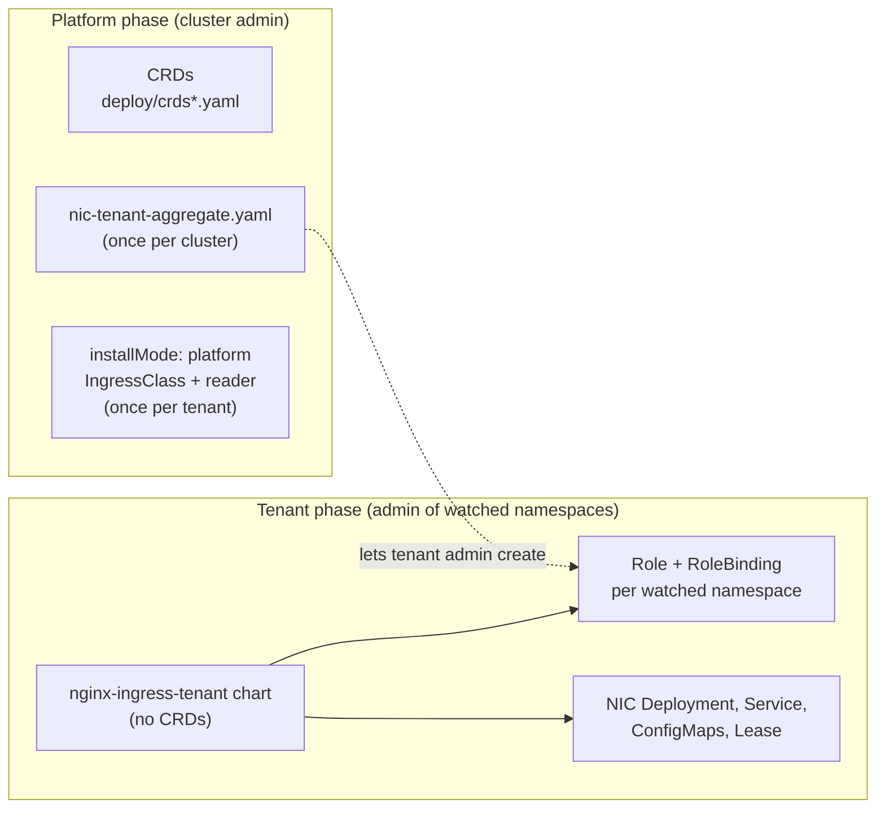

# High-Level Design: Namespace-Scoped Installation

> Status: Proposal
>
> Milestone: 5.8.0

## Overview

NGINX Ingress Controller (NIC) assumes it is installed by someone with
cluster-admin rights. The Helm chart renders a ClusterRole, a
ClusterRoleBinding and an IngressClass by default, and installs CRDs. At
startup the controller reads its IngressClass and exits if it can't. In a
multi-tenant cluster, an application team that administers only its own
namespaces therefore can't install or run NIC.

This design splits installation into two phases:

1. **Platform phase.** A cluster admin applies the CRDs and one
   aggregate-to-admin manifest once per cluster, then installs one `platform`
   release per tenant. That release renders the tenant's IngressClass and a
   small read-only ClusterRole.
2. **Tenant phase.** An admin of the tenant's namespaces installs a `tenant`
   release. It renders only namespaced resources, and NIC runs with a Role in
   each watched namespace.

A new chart value, `installMode`, selects the phase. Tenants install a second
published chart, `nginx-ingress-tenant`. It uses the same templates, contains
no CRDs, and is pinned to tenant mode. A new flag, `-ingress-class-validation`,
lets NIC start without reading its IngressClass (#10783).

The community ingress-nginx project covers part of this with
`--watch-namespace` and the chart's `scope.enabled`. This design also separates
platform-owned and tenant-owned resources in the chart, and reports missing
prerequisites clearly.

## Goals

- Let an admin of the tenant's namespaces install, upgrade and remove NIC
  without cluster-scoped write permissions. See [Tenant RBAC](#tenant-rbac).
- Tenant installs render no cluster-scoped resources, unless the installer
  opts in to CRD installation. See [Install Modes](#install-modes).
- Watch only the tenant's namespaces, using the existing `-watch-namespace`.
  See [Helm Values](#helm-values).
- Let NIC start without access to its IngressClass (#10783). See
  [CLI Flags](#cli-flags).
- Report missing CRDs and permissions clearly. See
  [Startup Behaviour](#startup-behaviour).
- Let several tenants run independent NIC installs, and leave the default
  install (`installMode: full`) unchanged. See
  [Compatibility and Upgrade](#compatibility-and-upgrade).

## Non-Goals

- Making IngressClass, CRDs, ClusterRoles or webhook configurations
  namespace-scoped, or letting namespace-only users create them.
- Provisioning platform-owned resources from the tenant release.
- Changing Kubernetes RBAC semantics.
- Label-based namespace watching (`-watch-namespace-label`) in tenant mode. It
  needs a cluster-wide Namespace watch.
- Changing how NIC selects resources by ingress class
  (`HasCorrectIngressClass()`).

## Background: How Kubernetes Scopes an Ingress Controller

The design relies on the following Kubernetes and Helm behaviour.

- **Cluster-scoped kinds.** IngressClass, ClusterRole, ClusterRoleBinding,
  CustomResourceDefinition, Namespace and Node have no namespace. Reading or
  writing them needs a ClusterRoleBinding. A RoleBinding grants access only
  inside its own namespace.
- **RBAC escalation prevention.** A user can create a Role only if they already
  hold every permission in it, or hold the `escalate` verb. The built-in
  `admin` ClusterRole, which namespace admins usually hold through a
  RoleBinding, grants no rights on NIC's CRDs. ClusterRoles labelled
  `rbac.authorization.k8s.io/aggregate-to-admin: "true"` are merged into
  `admin` automatically.
- **A namespace's own object.** The API server treats
  `GET /api/v1/namespaces/<name>` as a request in namespace `<name>`, so a Role
  can grant `get` on its own Namespace object. It can't grant `list` or
  `watch` on Namespaces.
- **Helm `crds/`.** Helm installs files in `crds/` before rendering templates,
  never upgrades or deletes them, and ignores only "already exists" errors.
  The API server checks permissions before existence, so a tenant without CRD
  rights gets "forbidden" even when the CRDs exist. Values can't stop this, so
  the tenant chart is published without CRDs.
- **Release storage.** Helm stores release state in Secrets in the release
  namespace. Tenants can usually delete Secrets in their own namespace, so a
  platform release should not live there.

### What NIC Reads Today

| Read | Code | Scope | When denied today |
| --- | --- | --- | --- |
| IngressClass `get` | `mustValidateIngressClass()` in `cmd/nginx-ingress/main.go` | Cluster | **Exit** |
| Namespace `kube-system` `get` | `GetClusterID()` in `internal/common_cluster_info` | Cluster | Agent v3: **exit** (`internal/nginx/manager.go`); license report: empty `cluster_id`; telemetry: empty field |
| Nodes `list` | `GetNodeCount()`, `getControllerZone()`, telemetry | Cluster | License: node count 0; zone routing off; telemetry: empty fields |
| IngressClasses `list`, Services `list` (all namespaces) | `IngressClassCount()`, `ServiceCounts()` in `internal/telemetry/cluster.go` | Cluster | Debug log, counts 0 |
| Startup Secrets `get` | `getAndValidateSecret()` in `cmd/nginx-ingress/main.go` | The namespace each flag points to | **Exit** |
| Ingress, Service, EndpointSlice, Pod, Secret, NIC CRDs and feature CRDs | `newNamespacedInformer()` in `internal/k8s/controller.go` | Each watched namespace | Informer errors, NIC never becomes ready |

## User Contract

### Install Modes

| `installMode` | Who installs it | Release namespace | Renders |
| --- | --- | --- | --- |
| `full` (default) | Cluster admin | Any | Today's output, unchanged |
| `platform` | Cluster admin, once per tenant | A platform namespace, not the tenant's | The tenant's IngressClass and the tenant reader ClusterRole and binding |
| `tenant` | Admin of every watched namespace | The tenant namespace | Namespaced resources only |

Each tenant needs its own `controller.ingressClass.name`. A second platform
release with the same name fails with a Helm ownership error.

Tenant mode is available from two charts:

- **`nginx-ingress-tenant`** is the supported tenant install. It contains no
  CRDs, so it never attempts CRD writes.
- **`nginx-ingress` with `installMode: tenant`** is the explicit opt-in for CRD
  installation. Helm installs the chart's CRDs unless `--skip-crds` is passed,
  so the installer needs CRD create rights.

### Helm Values

| Value | Type | Default | Mode | Effect |
| --- | --- | --- | --- | --- |
| `installMode` | `full`, `platform` or `tenant` | `full` | All | Selects which resources are rendered. Pinned to `tenant` in `nginx-ingress-tenant`. |
| `platform.tenantNamespace` | string | — | `platform`, required | Namespace of the tenant ServiceAccount that the reader ClusterRole is bound to |
| `platform.tenantReader.create` | boolean | `true` | `platform` | Renders the tenant reader ClusterRole and its binding |
| `controller.serviceAccount.name` | string | Chart full name | `tenant`, required; `platform`, required when `platform.tenantReader.create` | Must be the same in the tenant release and its platform release |
| `controller.watchNamespace` | string | `""` | All | In `tenant` mode, an empty value means the release namespace only, never all namespaces. The chart always adds the release namespace and renders one Role and RoleBinding per watched namespace. It trims each entry and drops empty entries and duplicates before rendering `-watch-namespace`. The installer must be admin in every listed namespace, because Helm creates these Roles as the installing user. |
| `controller.ingressClass.validation` | `strict` or `skip` | `strict` | `full` and `tenant` | Sets `-ingress-class-validation` |

`controller.ingressClass.create` keeps its meaning in `platform` mode. Set it
to `false` to grant the reader role for an IngressClass the platform already
manages.

Chart validation (`fail` in `_helpers.tpl`) rejects:

- `tenant` with `controller.watchNamespaceLabel` set;
- `tenant` with a `watchSecretNamespace` entry that isn't in `watchNamespace`
  or the release namespace;
- `platform` without `platform.tenantNamespace`;
- `tenant`, or `platform` with `platform.tenantReader.create`, without
  `controller.serviceAccount.name`;
- `installMode` other than `tenant` when the chart is `nginx-ingress-tenant`
  (checked through `.Chart.Name`).

### CLI Flags

| Flag | Values | Default | Behaviour |
| --- | --- | --- | --- |
| `-ingress-class-validation` | `strict`, `skip` | `strict` | `strict`: today's check. NIC exits if the IngressClass can't be read, doesn't exist, or has the wrong `spec.controller`. `skip`: no API call; NIC logs one warning and starts. |

Resource selection is the same in both modes. `HasCorrectIngressClass()` in
`internal/k8s/controller.go` compares the class name from the
`kubernetes.io/ingress.class` annotation or `spec.ingressClassName`, and never
reads the IngressClass object. `skip` only loses the startup check for a
mistyped class name or a class owned by another controller.

### Platform Prerequisites

Applied once per cluster by a cluster admin:

- **CRDs:** `deploy/crds.yaml`, plus `deploy/crds-nap-waf.yaml` and
  `deploy/crds-nap-dos.yaml` when App Protect is used. Feature CRDs from other
  projects (cert-manager, F5 CIS for IngressLink) come from those projects.
- **Aggregate-to-admin manifest:** `deployments/rbac/nic-tenant-aggregate.yaml`.
  See [Platform RBAC](#platform-rbac).

**Installs without Helm.** Static manifests in `deployments/rbac/` cover the
same two phases:

- The platform admin applies the CRDs, `nic-tenant-aggregate.yaml`,
  `common/ingress-class.yaml` with the tenant's class name, and
  `platform-tenant-reader.yaml` with the tenant namespace and ServiceAccount
  filled in.
- The tenant applies `tenant-role.yaml` in each watched namespace, then the
  ServiceAccount, ConfigMap, Deployment and Service manifests from
  `deployments/`, in their own namespace with `-watch-namespace` set. They
  don't apply the `Namespace` from `common/ns-and-sa.yaml` or
  `common/ingress-class.yaml`. `tenant-role.yaml` covers custom resources;
  uncomment the feature blocks you use.

#### Examples

```yaml
# Platform release for team-a, installed by a cluster admin.
# helm install nic-team-a-platform oci://ghcr.io/nginx/charts/nginx-ingress \
#   -n nic-platform --skip-crds -f platform-team-a.yaml
installMode: platform
platform:
  tenantNamespace: team-a
controller:
  serviceAccount:
    name: nic
  ingressClass:
    name: team-a
```

```yaml
# Tenant release, installed by an admin of team-a and team-a-apps.
# helm install nic oci://ghcr.io/nginx/charts/nginx-ingress-tenant \
#   -n team-a -f tenant-team-a.yaml
controller:
  serviceAccount:
    name: nic
  ingressClass:
    name: team-a
  watchNamespace: team-a,team-a-apps
```

A tenant that watches several namespaces must be admin in all of them. Check
before installing:

```shell
for ns in team-a team-a-apps; do kubectl auth can-i create roles -n "$ns"; done
```

## Architecture



The controller already supports namespace scoping: `newNamespacedInformer()`
creates every informer with `WithNamespace(ns)` for each namespace in
`-watch-namespace`. This design adds no informers. It changes:

1. **Startup** (`cmd/nginx-ingress/main.go`): the `-ingress-class-validation`
   flag, a CRD discovery check, and clearer messages for "forbidden" errors on
   startup reads.
2. **Informers** (`internal/k8s/`): a watch error handler on each namespaced
   informer, so missing namespace permissions are logged by NIC.
3. **Chart**: `installMode`, the tenant Roles, the platform templates, and
   validation. RBAC rules are built from fragments in `_helpers.tpl` that the
   `full` ClusterRole, the tenant Role and the aggregate manifest each compose.
4. **Static manifests**: `deployments/rbac/nic-tenant-aggregate.yaml`,
   `deployments/rbac/tenant-role.yaml` and
   `deployments/rbac/platform-tenant-reader.yaml`, generated from the chart by
   one `make` target.
5. **Packaging**: `publish-helm.yml` is a reusable workflow that publishes one
   chart per call, named by its `chart_name` input. A new `tenant` input
   removes the `crds` symlink and sets `installMode: tenant` in `values.yaml`
   before `helm package`, using the same `sed` approach the workflow already
   uses for values changes. Each regular release workflow that calls
   `publish-helm.yml` gets one more call with `chart_name: nginx-ingress-tenant`
   and `tenant: true`. This only repackages the existing chart; it adds no
   build step.

### Tenant RBAC

The tenant release renders a Role and RoleBinding in each watched namespace.
The release namespace is always watched. Rules follow the conditions in
today's `clusterrole.yaml`, limited to namespaced resources:

| API group | Resources | Verbs | Where |
| --- | --- | --- | --- |
| `""` | `namespaces` (its own object) | `get` | Every watched namespace |
| `""` | `services`, `pods`, `configmaps` | `get`, `list`, `watch` | Every watched namespace |
| `""` | `secrets` | `get`, `list`, `watch` | Every watched namespace where Secrets are watched (`watchSecretNamespace`, which can only narrow the watched set) |
| `""` | `events` | `create`, `patch`, `list` | Every watched namespace |
| `discovery.k8s.io` | `endpointslices` | `get`, `list`, `watch` | Every watched namespace |
| `networking.k8s.io` | `ingresses`; `ingresses/status` | `get`, `list`, `watch`; `update` | Every watched namespace |
| `k8s.nginx.org` | `virtualservers`, `virtualserverroutes`, `transportservers`, `policies`, `globalconfigurations`; their `/status` subresources (GlobalConfiguration has none) | `get`, `list`, `watch`; `update` on status | Every watched namespace, if custom resources are enabled |
| `appprotect.f5.com`, `appprotectdos.f5.com`, `cert-manager.io`, `externaldns.nginx.org` | As in `clusterrole.yaml` | As in `clusterrole.yaml` | Every watched namespace, if the feature is enabled |
| `cis.f5.com` | `ingresslinks` | `get`, `list`, `watch` | Release namespace, if IngressLink is set |
| `""` | `secrets` | `get` | Release namespace, always (license, management, default-server and wildcard Secrets) |
| `""` | `services` | `create`, `update`, `patch`, `delete` | Release namespace |
| `""` | `pods` | `update` | Release namespace |
| `apps` | `replicasets`, `daemonsets`, `statefulsets` | `get` | Release namespace |
| `coordination.k8s.io` | `leases` | `get`, `update` on the lock; `create` | Release namespace |

The controller only reads NIC's own resources and updates their status. For
cert-manager Certificates and ExternalDNS DNSEndpoints, which the controller
creates itself, the Role keeps the write verbs from `clusterrole.yaml`.

### Platform RBAC

**Tenant reader ClusterRole**, rendered by the `platform` release and bound to
`<tenantNamespace>/<serviceAccount.name>`:

| API group | Resources | Verbs | Used by |
| --- | --- | --- | --- |
| `networking.k8s.io` | `ingressclasses` | `get`, `list` | `strict` validation, telemetry |
| `""` | `namespaces`, `resourceNames: [kube-system]` | `get` | Cluster ID for license reporting, Agent v3, telemetry |
| `""` | `nodes` | `list` | Topology-aware routing, license node count, telemetry |

**Aggregate-to-admin manifest.** `deployments/rbac/nic-tenant-aggregate.yaml`
holds one ClusterRole, `nginx-ingress-tenant-aggregate`, labelled
`rbac.authorization.k8s.io/aggregate-to-admin: "true"`. It contains every rule
the tenant Role can contain, for every feature, plus `create`, `update`,
`patch`, `delete` and `deletecollection` on NIC's CRDs and the feature CRDs.
Namespace admins then hold the tenant Role's permissions, so they can create
it, and can manage VirtualServers, Policies and the other NIC resources.

The manifest is static and unconditional, like `deploy/crds.yaml`, so it
belongs to no Helm release and is shared by every tenant. A `make` target
generates it from the chart's rule fragments, and a Helm unit test checks that
it still covers every rule the tenant Role can render. Rules that the tenant
Role limits with `resourceNames`, such as the leader-election Lease, are
written without `resourceNames` in the aggregate, so they cover every
release's lock name. Namespace admins also already hold Lease read/write
through the built-in `edit` role. Rules for resources whose CRDs aren't
installed are harmless.

### Startup Behaviour

- **IngressClass:** controlled by `-ingress-class-validation`, as in
  [CLI Flags](#cli-flags).
- **CRD check:** after the IngressClass check, NIC uses API discovery to check
  the group, version and resource that each enabled informer uses. A missing
  CRD is logged as an error that names it and where it comes from, for example
  `CRD virtualservers.k8s.nginx.org is not installed; the platform admin must apply deploy/crds.yaml`.
  The check logs in every mode and doesn't change whether NIC starts.
- **Forbidden errors:** the direct startup reads in
  [What NIC Reads Today](#what-nic-reads-today) (IngressClass, `kube-system`,
  Nodes, startup Secrets) keep their current behaviour.
  When one fails with "forbidden", the message names the missing permission
  and namespace.
- **Watch errors:** each namespaced informer gets a watch error handler, set
  in its `add*Handler()` before the informer starts. On a "forbidden" list or
  watch, NIC logs one error per resource and namespace, for example
  `missing permission: list ingresses.networking.k8s.io in namespace team-a-apps; check the tenant Role`.
  Further failures for the same resource and namespace are suppressed until a
  list succeeds. Other errors go to client-go's default handler. This applies
  in every mode.

Failures during `helm install`, such as a forbidden Role create, happen before
NIC runs. `NOTES.txt` for the tenant release lists the prerequisites: CRDs, the
aggregate manifest, the platform release, and admin in every watched namespace.

### Rendered Examples

Objects rendered for the examples above:

```text
# installMode: platform, tenantNamespace: team-a
# (release: nic-team-a-platform, fullname: nic-team-a-platform-nginx-ingress)
IngressClass        team-a
ClusterRole         nic-team-a-platform-nginx-ingress-tenant-reader
ClusterRoleBinding  nic-team-a-platform-nginx-ingress-tenant-reader  -> team-a/nic

# nginx-ingress-tenant, watchNamespace: team-a,team-a-apps
# (release: nic, fullname: nic-nginx-ingress-tenant)
ServiceAccount      team-a/nic
Role                team-a/nic-nginx-ingress-tenant
RoleBinding         team-a/nic-nginx-ingress-tenant
Role                team-a-apps/nic-nginx-ingress-tenant
RoleBinding         team-a-apps/nic-nginx-ingress-tenant
ConfigMap           team-a/nic-nginx-ingress-tenant
ConfigMap           team-a/nic-nginx-ingress-tenant-leader-election
Lease               team-a/nic-nginx-ingress-tenant-leader-election
Deployment          team-a/nic-nginx-ingress-tenant-controller
Service             team-a/nic-nginx-ingress-tenant-controller
```

Controller arguments in tenant mode:

```text
-ingress-class=team-a
-watch-namespace=team-a,team-a-apps
-nginx-configmaps=$(POD_NAMESPACE)/nic-nginx-ingress-tenant
```

`-ingress-class-validation` is rendered only when it isn't `strict`.

## Comparison with the Full Install

| | `full` | `platform` + `tenant` |
| --- | --- | --- |
| Installer rights | Cluster admin | Platform: cluster admin. Tenant: admin of every watched namespace. |
| Watch scope | All namespaces by default | Listed namespaces, plus the release namespace |
| Label-based namespace watch | Supported | Not supported |
| Controller RBAC | One ClusterRole | One Role per watched namespace, plus a read-only ClusterRole |
| CRDs | Helm `crds/` | Applied by the platform admin; the tenant chart contains none |
| Several controllers in one cluster | Possible, with manual RBAC | One platform release per tenant |

## Interactions with Other Features

| Feature | Interaction | Guidance |
| --- | --- | --- |
| VirtualServer, VSR, TS and Policy without `ingressClassName` | Every NIC that watches the namespace accepts them | Give each tenant its own namespaces and its own IngressClass name, or set `ingressClassName` |
| Cross-namespace references (VSR, Policy, Secret) | Resolved only in watched namespaces | Add the namespace to `watchNamespace`. For Secrets, it must also be in `watchSecretNamespace` when that is set. |
| GlobalConfiguration | Read from its namespace | Keep it in a watched namespace |
| App Protect, cert-manager, ExternalDNS, IngressLink | Their CRDs are platform prerequisites | See [Platform Prerequisites](#platform-prerequisites) |
| Startup Secret flags (`-default-server-tls-secret`, `-wildcard-tls-secret`, PLM Secrets) | Read in the namespace the flag points to | Keep them in the release namespace or a Secret-watched namespace. PLM credentials need a Secret-watched namespace, because they're read through an informer. |
| `prometheus.serviceMonitor.create` | Creates a `monitoring.coreos.com/v1` ServiceMonitor | The installer needs those rights in `admin`. That's a platform prerequisite if the Prometheus Operator doesn't aggregate them. |
| Telemetry, license reporting, Agent v3, topology-aware routing | Need the reader ClusterRole. Without it, they behave as today: telemetry and the license report have empty fields, zone routing is off, and Agent v3 exits. Telemetry Service counts are 0 in tenant mode, because tenants can't list Services cluster-wide. | Keep `platform.tenantReader.create: true`, especially with NGINX Plus or Agent v3 |

## Security Model

- **No new privileges in `full` mode.** Its output is unchanged.
- **Tenants get less, not more.** In tenant mode, the controller has no
  cluster-wide Secret, Service or Ingress access. It gains only the reader
  ClusterRole.
- **Reader exposure.** `nodes list` reveals node names, labels, addresses and
  capacity. `ingressclasses list` reveals class names. `kube-system` `get`
  reveals the namespace's UID and labels. Platforms that don't accept this can
  set `platform.tenantReader.create: false`, with the existing behaviour above.
- **Aggregation scope.** The aggregate manifest is merged into `admin` in every
  namespace, so every namespace admin in the cluster gains read, status update
  and authoring rights on NIC's CRDs and the feature CRDs in their own
  namespaces. Users with only the `edit` role don't. Platforms that want a
  narrower grant can bind their own role instead of applying the manifest.
- **The platform release stays out of reach.** Install it outside the tenant
  namespace, so a tenant can't delete the Helm release Secret that owns its
  prerequisites.
- **IngressClass in `skip` mode.** A tenant can name any class, but still sees
  only its watched namespaces. Tenants that watch separate namespaces can't
  take over each other's traffic.

## Observability

- **CRD check:** one error log per missing CRD, naming the CRD and its source.
- **Startup errors:** "forbidden" errors name the missing permission and
  namespace.
- **Watch errors:** one error log per resource and namespace when an informer's
  list or watch is forbidden.
- **`skip` mode:** one warning log at startup.
- **`NOTES.txt`:** prerequisites and next steps for each install mode.

## Compatibility and Upgrade

`installMode: full` renders the same output as today, and
`-ingress-class-validation` defaults to `strict`, so existing installs don't
change.

**Migrating from `full`:** uninstall the `full` release first. Helm refuses to
create resources that another release owns (`invalid ownership metadata` on the
IngressClass), so an in-place switch isn't possible. Then apply the platform
prerequisites, install the platform release, and install the tenant release.
Expect brief downtime.

**Upgrading:** Helm doesn't upgrade CRDs in `crds/`. Upgrade in this order:
CRDs and the aggregate manifest, then platform releases, then tenant releases.
A newer tenant Role can contain rules that an older aggregate manifest
doesn't, and its `helm upgrade` then fails with a forbidden error.

## Delivery Plan

| Order | Pull request | Contents |
| --- | --- | --- |
| 1 | IngressClass validation (#10783) | `-ingress-class-validation` flag, error-returning refactor of `mustValidateIngressClass()`, chart value `controller.ingressClass.validation`, unit and Helm tests, CHANGELOG |
| 2 | Startup errors | CRD discovery check that logs missing CRDs, clearer "forbidden" messages on startup reads, watch error handler on namespaced informers, unit tests |
| 3 | Install modes | `installMode`, RBAC rule fragments, tenant Roles, platform templates, chart validation, `NOTES.txt`, schema, generated `deployments/rbac/nic-tenant-aggregate.yaml`, `deployments/rbac/tenant-role.yaml` and `deployments/rbac/platform-tenant-reader.yaml`, `tenant` input in `publish-helm.yml` and an `nginx-ingress-tenant` call in each regular release workflow that uses it, Helm tests, `examples/shared-examples/multi-tenant/`, integration tests |

Once pull request 1 merges, #10783 is resolved. Pull request 2 adds read-only
API discovery and log output, and doesn't change whether NIC starts. Pull
request 3 depends on pull requests 1 and 2. Until it merges, tenant installs
need manual RBAC. All three are planned for the 5.8.0 milestone.

### Requirements Traceability

| Requirement | Addressed by |
| --- | --- |
| #10640: tenant mode renders only namespace-scoped resources | `installMode: tenant`, the `nginx-ingress-tenant` chart |
| #10640: platform mode renders cluster-scoped prerequisites | `installMode: platform`, [Platform Prerequisites](#platform-prerequisites) |
| #10640: tenant mode creates no IngressClass, ClusterRole, ClusterRoleBinding, CRD or webhook unless explicitly enabled | [Install Modes](#install-modes): `nginx-ingress-tenant` contains no CRDs; `nginx-ingress` with `installMode: tenant` is the explicit opt-in; the chart has no webhooks |
| #10640: Role and RoleBinding for namespaced permissions | [Tenant RBAC](#tenant-rbac) |
| #10640: watch a specific namespace | Existing `-watch-namespace`, [Helm Values](#helm-values) |
| #10640: tenant references a platform-provisioned IngressClass | `controller.ingressClass.name`, [Platform RBAC](#platform-rbac) |
| #10640: clear errors when prerequisites are missing | [Startup Behaviour](#startup-behaviour) |
| #10640: several teams deploy independent installs | One platform release per tenant, [Verification](#verification) |
| #10640: Helm values and manifests for the platform-admin and tenant phases | [Helm Values](#helm-values), and static manifests in `deployments/rbac/` ([Platform Prerequisites](#platform-prerequisites)) |
| #10640: platform and tenant documentation and examples | Pull request 3 examples; user docs in `nginx/documentation` |
| #10640: ownership conflicts | [Compatibility and Upgrade](#compatibility-and-upgrade) |
| #10783: operate without IngressClass access | `-ingress-class-validation=skip` |

## Verification

- Unit tests in `cmd/nginx-ingress` with a fake clientset:
  - `strict`: forbidden, missing and wrong-controller IngressClass return an
    error; a valid one doesn't;
  - `skip`: no IngressClass API call;
  - CRD check: a missing CRD for each enabled feature is logged with its
    source, and startup continues;
  - a "forbidden" startup read names the permission and namespace.
- Unit tests in `internal/k8s`: a forbidden list on an informer logs one named
  error per resource and namespace, and other errors reach client-go's default
  handler.
- Helm unit tests:
  - `full` output is unchanged (existing snapshots don't change);
  - `tenant` with one and several watched namespaces; the release namespace is
    always watched and never duplicated;
  - `tenant` with an empty `watchNamespace` renders
    `-watch-namespace=<release namespace>`, never an empty value;
  - `tenant` with `watchNamespace: "team-a,,team-b, "` renders each namespace
    once, with no empty entry;
  - `tenant` with a `watchSecretNamespace` entry outside `watchNamespace` and
    the release namespace fails;
  - with `.Chart.Name` set to `nginx-ingress-tenant`, any `installMode` other
    than `tenant` fails;
  - `tenant` rendered templates contain no cluster-scoped kind;
  - `platform` renders only the IngressClass and the reader role and binding,
    and only the reader with `controller.ingressClass.create: false`;
  - each `fail` rule;
  - each tenant Role is a subset of the `full` ClusterRole and Role together,
    for the same settings (the named Lease rules come from today's
    `controller-role.yaml`);
  - all three static manifests in `deployments/rbac/` match the generator
    output, and `nic-tenant-aggregate.yaml` covers every tenant Role rule;
    an unscoped rule covers a `resourceNames`-scoped one.
- Packaging check in CI: package the chart with the `tenant` input, then
  `helm show crds` on the result prints nothing and `helm show values` shows
  `installMode: tenant`.
- Integration tests in kind, with a namespace-admin identity for tenant
  installs:
  - two tenants with their own IngressClasses each serve only their own
    namespaces;
  - a namespace admin installs `nginx-ingress-tenant` with no extra flags; the
    main chart with `installMode: tenant` and no `--skip-crds` attempts the CRD
    install and fails for that user;
  - a tenant install with a watched namespace where the installer isn't admin
    fails with a forbidden error;
  - with the reader role removed and `validation: skip`, NIC starts and serves
    traffic;
  - NIC started with a CRD missing logs the named error;
  - with a tenant Role removed from one namespace, NIC logs the named
    permission error.
- Gates: `make test`, `make lint`, and `make test-update-snaps` with snapshot
  changes only for the new cases.
